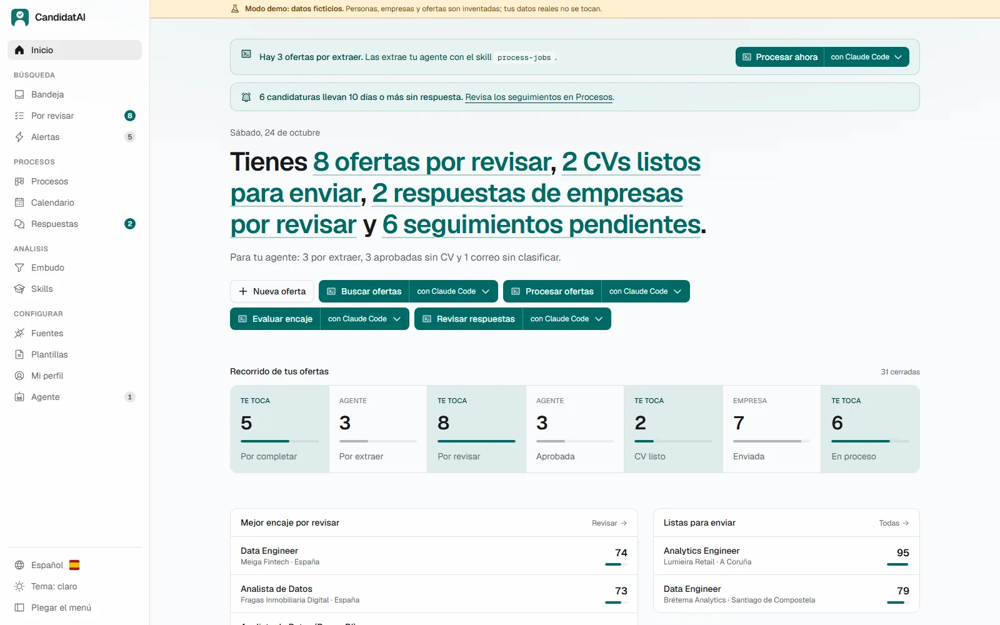
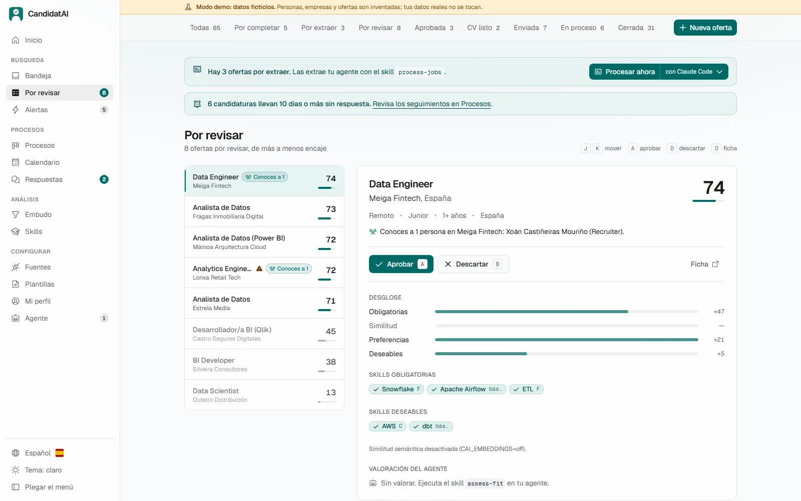
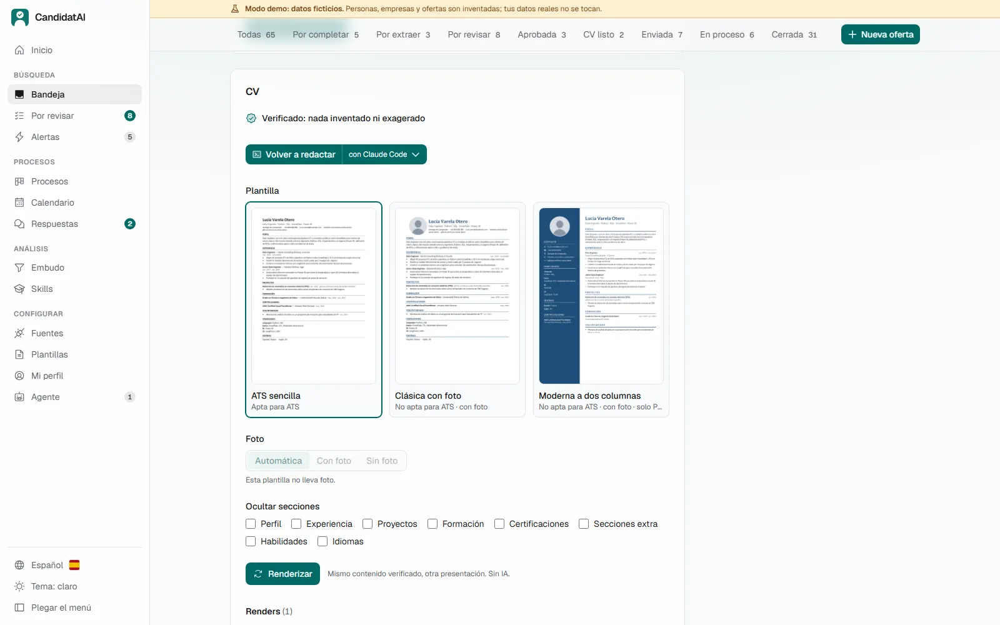
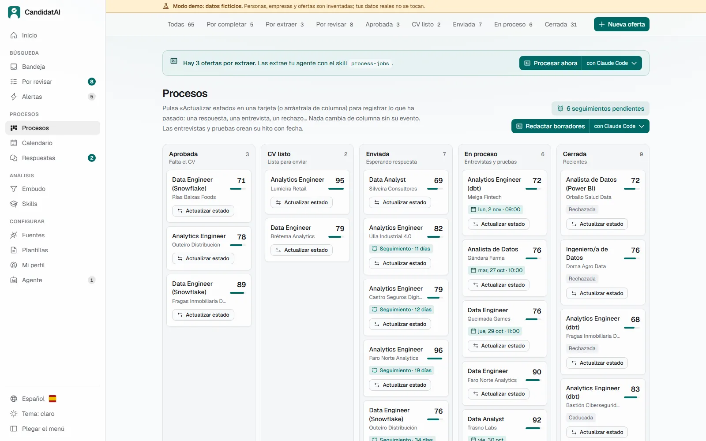
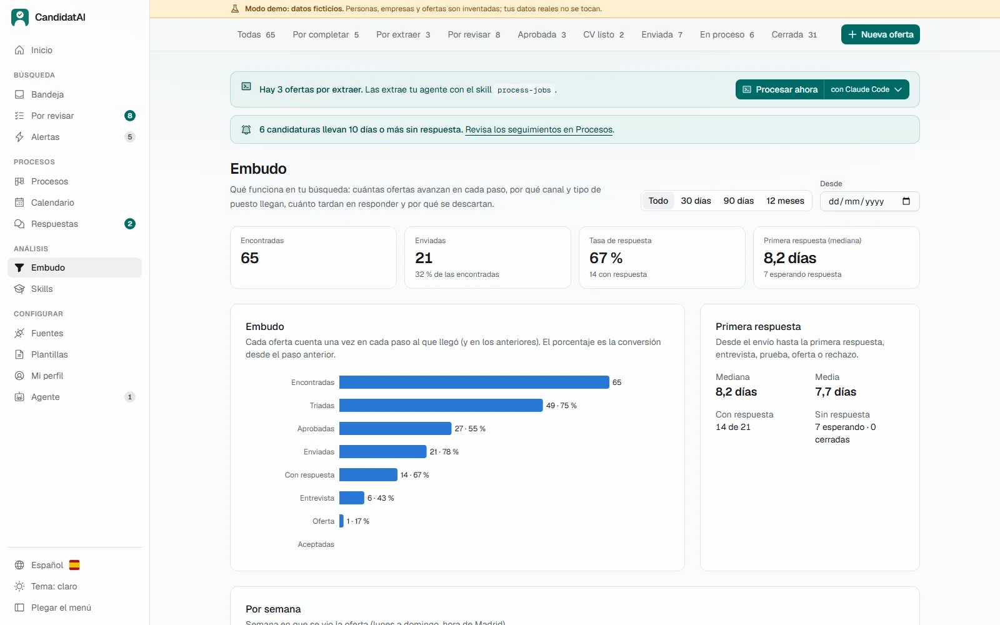
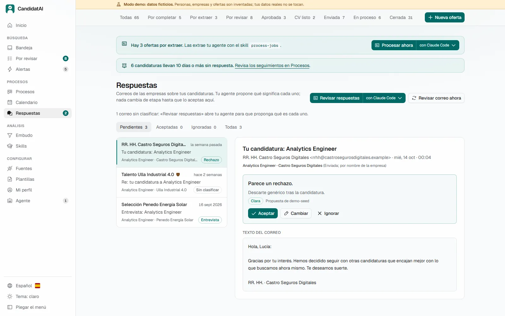
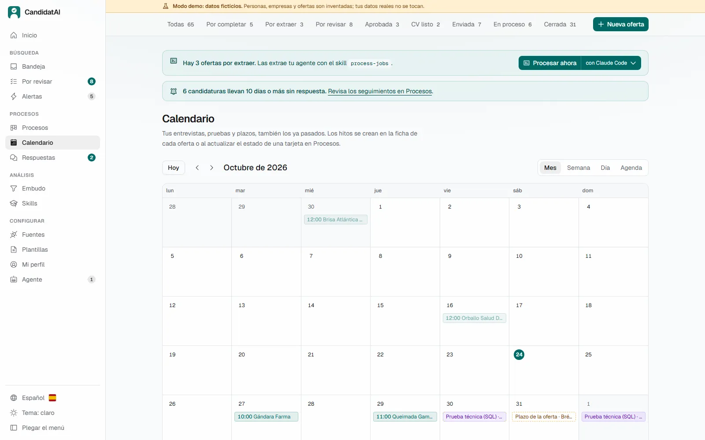
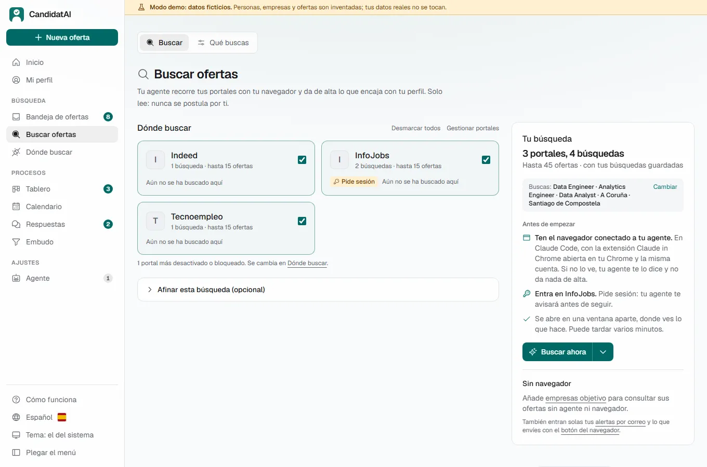
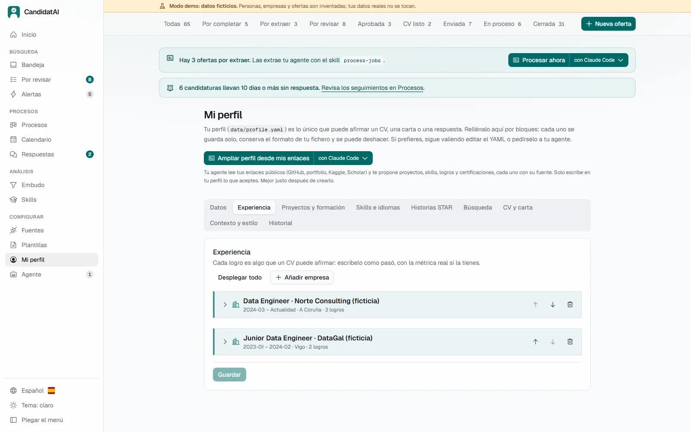
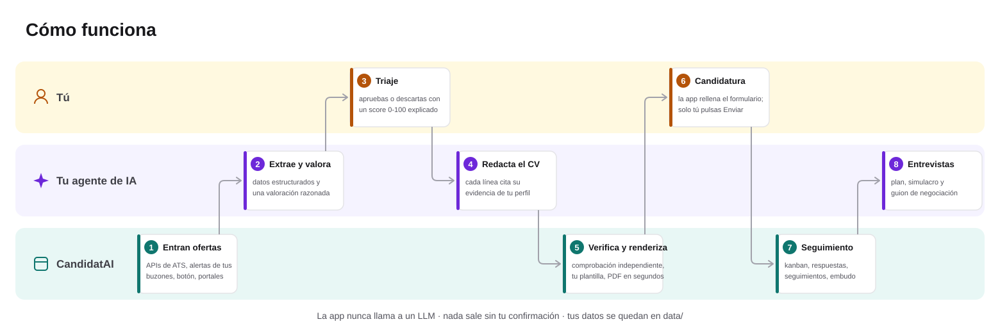

<p align="center">
  
</p>

<h1 align="center">CandidatAI</h1>

<p align="center">
  Tu búsqueda de empleo entera, en una app: tú decides, tu agente de IA lee y escribe, y no se envía nada sin ti.
</p>

<p align="center">
  <a href="README.md">English</a> · <b>Español</b>
</p>

<p align="center">
  <a href="https://github.com/DiegoPrieto23/candidatai/releases/latest"></a>
  <a href="https://github.com/DiegoPrieto23/candidatai/actions/workflows/ci.yml"></a>
  <a href="LICENSE"></a>
  
  
  
</p>

CandidatAI te lleva de una oferta nueva a una oferta de trabajo: reúne ofertas de muchas fuentes,
te dice cuánto encaja contigo cada una, escribe un CV y una carta a medida sin inventar nada,
rellena el formulario de la candidatura y espera a que tú pulses Enviar, y después sigue cada
proceso con sus entrevistas, respuestas y seguimientos.

Es para quien busca trabajo y quiere tener toda su búsqueda en un sitio, con sus datos en su propio
equipo. Lo que hay que leer y escribir lo hace un agente de IA que ya uses (Claude Code, Codex,
Antigravity CLI…), que la app no incluye. Es un proyecto joven, con una sola persona detrás, y lo más
probado es Windows 11 con Claude Code: mira las [limitaciones conocidas](#limitaciones-conocidas).

**Para empezar:** [instálala](#úsala-en-tu-equipo) · [Empieza aquí](docs/EMPEZAR.md), si no eres
de perfil técnico.

## Demo

<p align="center">
  <!-- media:provisional -->
  
  <br><sub>Todo lo que se ve es la demo: una candidata, empresas y ofertas inventadas. El trabajo del
  agente (leer las ofertas, escribir el CV) ya viene hecho en ella; con un agente de verdad, cada
  paso tarda de unos segundos a unos minutos.</sub>
</p>

## Funcionalidades

- **Ofertas de muchas fuentes:** pega un enlace o el texto, sigue a tus empresas objetivo por sus
  portales de empleo públicos (Greenhouse, Lever, Ashby y cinco más), lee tus alertas de empleo por
  correo, envía la página que estás viendo con un botón del navegador o deja que tu agente busque en
  los portales que elijas. Las repetidas se juntan.
- **Detecta el texto dirigido a una IA:** el texto de una oferta es solo un dato. Las instrucciones
  escondidas se detectan y se avisan, y esa oferta nunca sale como encaje fuerte.
- **Un encaje explicado para cada oferta:** filtros duros, un encaje de 0 a 100 que dice de dónde
  sale cada punto y la valoración razonada de tu agente. Aprueba o descarta con el teclado.
- **Un CV a medida para cada oferta:** tu agente lo escribe con tu perfil, la app lo genera con tu
  plantilla, tu foto y tu color, y un verificador aparte lo revisa. Pide cambios con tus palabras,
  edítalo tú o vuelve a cualquier versión.
- **El diseño de tu propio CV:** importa cualquier CV (Word, PDF, una imagen, Canva) como plantilla,
  y cambia plantilla, color o secciones en segundos sin usar a tu agente.
- **No inventa experiencia:** cada línea del CV tiene que apuntar a una evidencia de tu perfil, o el
  código la rechaza.
- **Cartas y respuestas de formulario** a juego con el CV y la oferta, con tus propias indicaciones.
- **Candidatura asistida:** la app rellena formularios de Greenhouse, Lever, Ashby o genéricos y se
  para ante captchas e inicios de sesión.
- **Nada sale sin tu confirmación:** enviar necesita tu clic, candidatura a candidatura. Mensajes y
  correos son borradores que envías tú.
- **Todos tus procesos en un tablero:** un tablero que solo se mueve con pasos registrados, un
  calendario, recordatorios de seguimiento y las respuestas de las empresas leídas de tu buzón y
  ordenadas para que las aceptes.
- **Entrevistas y ofertas:** una guía de preparación en PDF con un plan por días, simulacros,
  repasos, investigación de la empresa con fuentes y ofertas comparadas con tu sueldo mínimo sin
  que el agente lo vea nunca.
- **Un embudo que te dice qué funciona:** dónde se paró cada candidatura, por fuente, puesto,
  plantilla y referencia, y si el encaje acertó con lo que pasó de verdad.

**Todas las funcionalidades, página a página y skill a skill:** [`docs/FUNCIONALIDADES.md`](docs/FUNCIONALIDADES.md).

## Capturas

<!-- media:provisional -->
<picture>
  <source media="(prefers-color-scheme: dark)" srcset="docs/img/es/dark/home.webp">
  
</picture>
<p align="center"><sub>Inicio te dice qué te espera a ti y a tu agente, y cuál es el siguiente paso.</sub></p>

<table>
  <tr>
    <td width="50%"><!-- media:provisional --><br><sub>Revisa las ofertas por encaje y decide con una tecla.</sub></td>
    <td width="50%"><!-- media:provisional --><br><sub>Un CV verificado, con el diseño que elijas.</sub></td>
  </tr>
  <tr>
    <td><!-- media:provisional --><br><sub>Todas tus candidaturas en un tablero, movido por pasos registrados.</sub></td>
    <td><!-- media:provisional --><br><sub>Mira dónde se paran tus candidaturas.</sub></td>
  </tr>
  <tr>
    <td><!-- media:provisional --><br><sub>Los correos de las empresas, ordenados para que los aceptes.</sub></td>
    <td><!-- media:provisional --><br><sub>Entrevistas, plazos y seguimientos en un calendario.</sub></td>
  </tr>
  <tr>
    <td><!-- media:provisional --><br><sub>Elige dónde busca tu agente y qué preparar antes.</sub></td>
    <td><!-- media:provisional --><br><sub>Tu perfil, lo único de lo que sale lo que va en un CV.</sub></td>
  </tr>
</table>

<sub>Todas las capturas usan los datos inventados de la demo. Las animaciones cortas de cada
funcionalidad están en [`docs/FUNCIONALIDADES.md`](docs/FUNCIONALIDADES.md).</sub>

## Úsala en tu equipo

1. **Lo que necesitas.** Un ordenador con Windows, macOS o Linux; sin Python, Node ni permisos de
   administrador, porque el instalador trae lo que hace falta. Y un agente de IA: Claude Code, Codex
   o Antigravity CLI con la suscripción que quizá ya pagas (Claude, ChatGPT o Google AI Pro),
   Antigravity CLI también con una cuenta gratuita de Google, o un modelo local. **La app nunca
   llama a una IA por su cuenta.** Cuál elegir y cuánto cuesta cada uno: [Empieza aquí](docs/EMPEZAR.md).
2. **Instálala.**
   - **Windows** (Windows 11), en PowerShell:

     ```powershell
     iwr -useb https://raw.githubusercontent.com/DiegoPrieto23/candidatai/main/install.ps1 -OutFile $env:TEMP\cai-install.ps1
     powershell -ExecutionPolicy Bypass -File $env:TEMP\cai-install.ps1
     ```

   - **macOS y Linux**, en una terminal (sin `sudo`):

     ```bash
     curl -fsSL https://raw.githubusercontent.com/DiegoPrieto23/candidatai/main/install.sh | bash
     ```

   - **Docker** (opcional): desde una copia del repositorio, `docker compose up -d --build`. Tu
     agente se queda fuera del contenedor, con algunos límites: mira
     [Con Docker](docs/GUIA.md#con-docker-opcional).

   Los instaladores descargan la [última versión](https://github.com/DiegoPrieto23/candidatai/releases/latest),
   **comprueban su suma SHA-256** y crean un acceso directo «CandidatAI». Para actualizar, vuelve a
   ejecutarlos: tus datos no se tocan. Para ver antes qué harían, añade `-WhatIf` a la segunda
   línea de Windows o usa `| bash -s -- --dry-run`.
3. **Ábrela.** Con el acceso directo «CandidatAI»: en el escritorio y en el menú Inicio en Windows,
   en `~/Applications` en macOS (Spotlight también lo encuentra) y en el menú de aplicaciones en
   Linux. Una ventana de terminal arranca la app y tu navegador se abre en `http://127.0.0.1:8000`,
   que es tu propio equipo. Deja esa ventana abierta mientras la uses. Desde una terminal es
   `uv run cai start` en la carpeta `backend` de la app:

   ```bash
   cd $env:LOCALAPPDATA\CandidatAI\app\backend               # Windows (PowerShell)
   cd ~/"Library/Application Support/CandidatAI/app/backend"   # macOS
   cd ~/.local/share/candidatai/app/backend                    # Linux
   uv run cai start
   ```

   `uv run cai --help` lista los demás comandos: `cai doctor` comprueba que no falte nada. Con
   Docker, la app arranca con el contenedor y la abres en esa misma dirección.
4. **Prueba la demo y hazla tuya.** `uv run cai demo seed` carga una búsqueda inventada para
   curiosear. Después, crea tu perfil a partir de tu CV y conecta tu agente:
   [Empieza aquí](docs/EMPEZAR.md) paso a paso, o la [guía de uso](docs/GUIA.md).

## Documentación

- [Empieza aquí](docs/EMPEZAR.md): lo que necesitas y cómo instalarla, sin ser de perfil técnico.
- [Guía de uso](docs/GUIA.md): cada página y cómo usarla en el día a día.
- [Funcionalidades](docs/FUNCIONALIDADES.md): todo lo que hace la app, página a página y skill a
  skill.
- [Políticas](docs/POLICIES.md): las reglas de veracidad, privacidad y candidaturas.
- [Agentes](docs/AGENTS_COMPAT.md): qué agentes funcionan y cuánto se han probado.
- [Todos los documentos](docs/README.md), agrupados. Los documentos técnicos están en español; las
  guías existen en los dos idiomas.
- [Registro de cambios](CHANGELOG.md): qué cambió en cada versión.

## Cómo funciona

<p align="center">
  <!-- media:provisional -->
  
</p>

Cada color es quién hace el paso: **tú** decides, **tu agente** razona y **la app** guarda,
comprueba y automatiza. El agente trabaja con una interfaz propia (herramientas MCP y una CLI
`cai … --json` equivalente) y solo puede rellenar esquemas estrictos que el código valida. Los
skills, como `generate-cv 42` o `process-jobs`, se lanzan desde tu agente o con un botón de la app.
Más en [`docs/ARCHITECTURE.md`](docs/ARCHITECTURE.md).

## Por qué CandidatAI

Hay dos proyectos abiertos muy conocidos que también usan un agente de IA para buscar empleo, y los
dos han inspirado este: [AI Job Search](https://github.com/ai-job-search-dev/ai-job-search) y
[career-ops](https://github.com/career-ops-hq/career-ops). CandidatAI se diferencia en tres cosas: es
una **app** que se instala como cualquier programa y sirve sin abrir a tu agente; sus reglas (ninguna
línea del CV sin respaldo, nada se envía sin ti, el texto de una oferta es solo un dato) **las
comprueba el código**, uses el agente que uses; y cubre la búsqueda entera, **hasta la oferta**, en
un solo sitio.

**Lo que ellos hacen mejor, hoy:** career-ops funciona con más agentes y modelos, cubre más fuentes
de ofertas y más países y está mucho más rodado; AI Job Search es más sencillo (haces un fork y
lanzas `/setup`) y tiene detrás una historia real de contratación. Los dos tienen comunidades
grandes que este proyecto aún no tiene.

<details>
<summary><b>Uno al lado del otro</b> (comprobado el 6 de noviembre de 2026)</summary>
<br>

| | CandidatAI | AI Job Search | career-ops |
|---|---|---|---|
| Qué es | Una **app** con UI web, base de datos y un proceso en segundo plano | Instrucciones y comandos para Claude Code sobre ficheros | Un agente con muchos modos y scripts de Node sobre ficheros, un panel de terminal y una UI web |
| Instalar | Un comando, un acceso directo, nada instalado antes | Fork, y después Claude Code, Python, Bun y LaTeX | `npx … init` con Node instalado |
| Sin el agente abierto | Revisar ofertas, tablero, calendario, embudo, perfil, diseños de CV | Nada | Buscar ofertas, el panel y la UI web |
| Reglas | **Las comprueba el código**: una línea del CV sin evidencia en tu perfil se rechaza; enviar necesita tu clic | Instrucciones, permisos mínimos y un filtro de inyección en código | Instrucciones, y comprobaciones de hechos y de redacción del CV en código |
| Agentes | 5 configurados; Claude Code probado del todo | Claude Code | 12 CLIs, modelos gratuitos y locales |
| Comunidad | Una persona, recién publicado | ~70k estrellas, ~90 contribuidores, la búsqueda real del autor | ~81k estrellas, ~470 contribuidores, Discord, muchas historias de éxito |

La comparativa completa, función a función y con sus fuentes, está en
[`docs/COMPARATIVA.md`](docs/COMPARATIVA.md).
</details>

## Limitaciones conocidas

- **Solo para ordenador.** La app está hecha para la pantalla de un ordenador; no está pensada para
  el móvil.
- **Una persona, un equipo.** Funciona en tu propio equipo, en `127.0.0.1`, sin cuentas ni
  sincronización entre dispositivos.
- **Necesitas un agente de IA.** Sin él puedes revisar ofertas, seguir tus procesos y cambiar el
  diseño de tus CVs, pero leer las ofertas y escribir CVs, cartas o guías de entrevista necesita un
  agente, que la app no incluye.
- **Lo que se ha probado de verdad:** Windows 11 es lo más probado, también una instalación limpia
  desde la release; macOS y Linux tienen instalador y pasan los tests en la CI, pero no se han
  instalado a mano desde una release. Claude Code está probado de principio a fin, Codex con una
  oferta y Antigravity CLI en parte; OpenCode solo se ha probado con un modelo local pequeño, que no
  terminó la prueba, y Qwen Code está configurado, pero sin probar. El detalle, en
  [`docs/AGENTS_COMPAT.md`](docs/AGENTS_COMPAT.md).
- **Solo en español e inglés**, en la app y en las guías.
- **Sin leer portales que no tienen API** y sin candidaturas automáticas en LinkedIn, a propósito:
  esas ofertas entran por las alertas de correo, el botón del navegador o tu agente buscando con tu
  navegador.

## Rendimiento

Medido el 6 de noviembre de 2026 en un portátil con un AMD Ryzen 7 5700U, 16 GB de RAM y sin tarjeta
gráfica dedicada, con Windows 11 y con la app ya abierta una vez antes (mediana de tres vueltas, salvo la memoria):

| Qué | Tiempo o tamaño |
|---|---|
| Arrancar la app, hasta que responde / hasta que ves Inicio | 4,0 s / 4,6 s |
| Memoria de la app entera, en reposo / tras recorrer todas las páginas | ≈ 330 MB / ≈ 365 MB |
| Un CV con otro diseño, a PDF: plantillas de Word (LibreOffice) / plantillas HTML | 11,7 s / 4,7 s |
| Inicio, primera carga / recarga, con la demo (65 ofertas) | 0,28 s / 0,11 s |
| Inicio, primera carga / recarga, con 10 veces más ofertas (650) | 0,28 s / 0,11 s |
| Bandeja de ofertas, primera carga / recarga, con la demo | 0,49 s / 0,31 s |
| Bandeja de ofertas, primera carga / recarga, con 650 ofertas | 0,53 s / 0,31 s |

No incluye el trabajo de tu agente (leer una oferta, escribir un CV): depende del agente y de su
modelo. Como referencia, Claude Code tardó 8,5 minutos en leer, valorar y escribir un CV verificado
para cinco ofertas en la [matriz de agentes](evals/compat/REPORT.md).

El eval de matching (80 casos inventados, sin embeddings): precision **0,88**, recall **0,95**,
F1 **0,92** con el umbral de score por defecto ([`evals/REPORT.md`](evals/REPORT.md)).

## Seguridad

Nada sale de tu equipo sin tu confirmación, y el texto de las ofertas o de los correos nunca se sigue
como instrucciones. Para avisar de una vulnerabilidad, mira [`SECURITY.md`](SECURITY.md); las reglas
que aplica la app están en [`docs/POLICIES.md`](docs/POLICIES.md).

## Desarrollo

Para contribuir, lee [`CONTRIBUTING.md`](CONTRIBUTING.md) y el
[apartado de desarrollo de la guía](docs/GUIA.md#15-desarrollo).

## Licencia

[MIT](LICENSE) © 2026 Diego Prieto.

Inspirado en [ackyer/job-search-agent-template](https://github.com/ackyer/job-search-agent-template)
(MIT) y en ideas de [AI Job Search](https://github.com/ai-job-search-dev/ai-job-search) y
[career-ops](https://github.com/career-ops-hq/career-ops) (los dos MIT). Sin relación con
Anthropic, OpenAI, Google, LinkedIn ni ningún portal de empleo.
