<p align="center">
  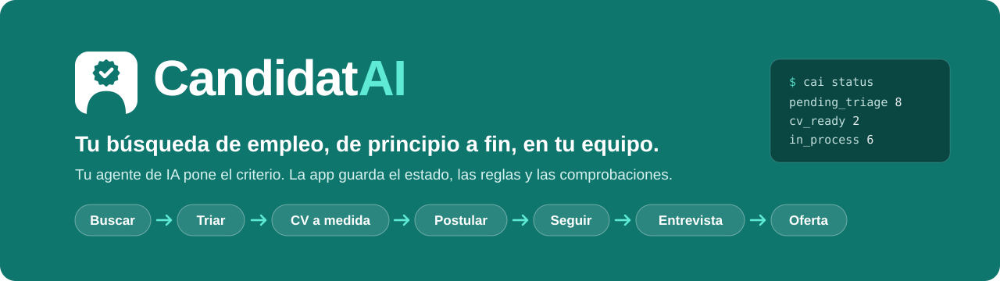
</p>

<p align="center">
  <a href="README.md">English</a> · <b>Español</b>
</p>

<p align="center">
  <a href="LICENSE"></a>
  
  
  
  
  
  
</p>

**CandidatAI** es una app local que lleva tu búsqueda de empleo entera: entran ofertas de
varias fuentes, las triagas con un score explicado, cada una recibe un **CV y una carta a medida y
verificados**, la app rellena el formulario de la candidatura y **espera a que tú pulses Enviar**, y
después sigue el proceso hasta la oferta.

**La app no llama a ningún LLM.** Lo que necesita criterio (leer ofertas, valorar el encaje,
redactar el CV) lo hace el agente de IA que ya uses (Claude Code, Codex, Gemini CLI, Cursor…) a
través de una interfaz para agentes: herramientas MCP y una CLI `cai … --json` equivalente. La app
guarda el estado, las reglas y las comprobaciones, así que el agente no puede inventarse tu
experiencia ni enviar nada por su cuenta.

<p align="center">
  
  <br><sub>Triaje con el teclado. Todo lo que se ve es la <b>demo</b>: una candidata, empresas y ofertas inventadas.</sub>
</p>

> [!NOTE]
> Mira el **[recorrido en vídeo](docs/video/recorrido.mp4)** (42 s).

## Índice

- [Por qué](#por-qué)
- [Cómo funciona](#cómo-funciona)
- [Qué hace](#qué-hace)
- [Más de cerca](#más-de-cerca)
- [Pruébalo en 5 minutos](#pruébalo-en-5-minutos)
- [Úsalo con tus datos](#úsalo-con-tus-datos)
- [Agentes compatibles](#agentes-compatibles)
- [Garantías](#garantías)
- [Frente a proyectos parecidos](#frente-a-proyectos-parecidos)
- [Arquitectura](#arquitectura)
- [Calidad y evals](#calidad-y-evals)
- [Documentación](#documentación)
- [Cómo se construyó](#cómo-se-construyó)
- [Licencia y créditos](#licencia-y-créditos)

## Por qué

Buscar trabajo bien es mucho trabajo repetitivo con criterio en medio: leer decenas de ofertas,
descartar las que no encajan, adaptar el CV a cada una sin inventar nada, rellenar formularios,
acordarse de hacer seguimiento y saber qué está funcionando.

Los asistentes de IA ayudan en cada paso suelto, pero sin memoria ni estado: cada conversación
empieza de cero, nada impide que «mejoren» tu CV con cosas que no has hecho, y una oferta puede
llevar instrucciones ocultas para la IA que la lee.

CandidatAI pone el estado, las reglas y la verificación en una app determinista, y deja al agente
solo lo que necesita razonar, siempre contra tu perfil y con comprobaciones que no dependen de él.

## Cómo funciona

<p align="center">
  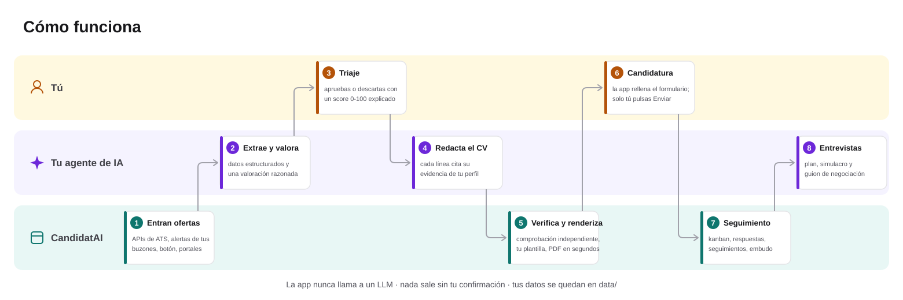
</p>

Cada color es quién hace el paso: **tú** decides, **tu agente** razona y **la app** guarda,
comprueba y automatiza. Un día normal:

1. Cada mañana el worker trae ofertas nuevas (APIs de ATS, alertas por correo y la búsqueda pública
   de LinkedIn si la activaste).
2. Pides a tu agente `process-jobs` y `assess-fit` (o los lanzas desde la UI, en segundo
   plano).
3. Triagas con `J`/`K`, `A` y `D`.
4. `generate-cv 42` redacta y verifica el CV de la oferta 42; eliges plantilla, foto y color en la
   UI, sin gastar agente.
5. Revisas el formulario relleno y pulsas Enviar. La app lo registra, archiva lo enviado y te
   recuerda el seguimiento.

## Qué hace

| | |
|---|---|
| 📥 **Ofertas de muchas fuentes** | Alta por URL o texto; APIs públicas de Greenhouse, Lever y Ashby; InfoJobs y Adzuna con claves; **alertas de empleo por correo** (IMAP de solo lectura); un **botón de extensión** para la página que estás viendo; tu agente recorriendo portales con tu navegador y, si lo activas, la búsqueda pública de LinkedIn. Con deduplicación, aviso de republicadas y de ofertas cerradas, y **detección de texto dirigido a una IA** |
| 🎯 **Triaje con score explicado** | Filtros duros (nivel, años, modalidad, zona, idiomas) y un score 0-100 por cobertura de skills, preferencias y similitud semántica local opcional. Tu agente añade una valoración razonada. «¿Acierta el score?» lo compara con los resultados reales |
| 📄 **CV y carta a medida** | El agente redacta el contenido citando **la evidencia de tu perfil de cada línea**; el código lo valida, lo renderiza (Word o HTML → PDF) con tu plantilla, foto y color, y otro rol lo verifica. **Importa tu propio diseño de CV** (Word, PDF, imagen, Canva) como plantilla |
| 📝 **Candidatura asistida** | Rellena formularios de Greenhouse, Lever, Ashby o genéricos, se para ante captchas o logins y **solo envía tras tu confirmación**, escribiendo el nombre de la empresa |
| 📊 **Seguimiento y analítica** | Kanban que solo se mueve con eventos, hitos con calendario `.ics`, avisos de seguimiento, correos de las empresas convertidos en propuestas que aceptas, y embudo por fuente, puesto, semana, plantilla, carta y referencia |
| 🎤 **Entrevistas y ofertas** | Plan de preparación por días, simulacros con feedback, repasos que alimentan tu banco de historias STAR, dosier de empresa con fuentes y comparación de ofertas recibidas con tu mínimo **sin que el agente lo vea nunca** |
| 🤝 **Red y mensajes** | Tus contactos de LinkedIn (exportación CSV) cruzados con tus ofertas («conoces a 2 personas aquí»), mensajes de LinkedIn (≤ 300 caracteres) y correos de candidatura como borradores que envías tú |
| 🧭 **Estrategia de búsqueda** | Huecos de skills agregados con plan de formación, títulos cercanos para ampliar la búsqueda, retrospectiva semanal y revisión de tu perfil de LinkedIn |

| Inicio | Por revisar |
|---|---|
| <picture><source media="(prefers-color-scheme: dark)" srcset="docs/img/dark/inicio.png">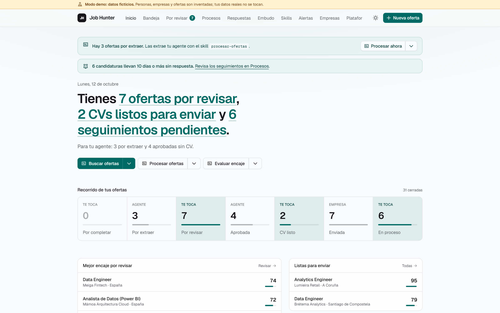</picture> | <picture><source media="(prefers-color-scheme: dark)" srcset="docs/img/dark/por-revisar.png">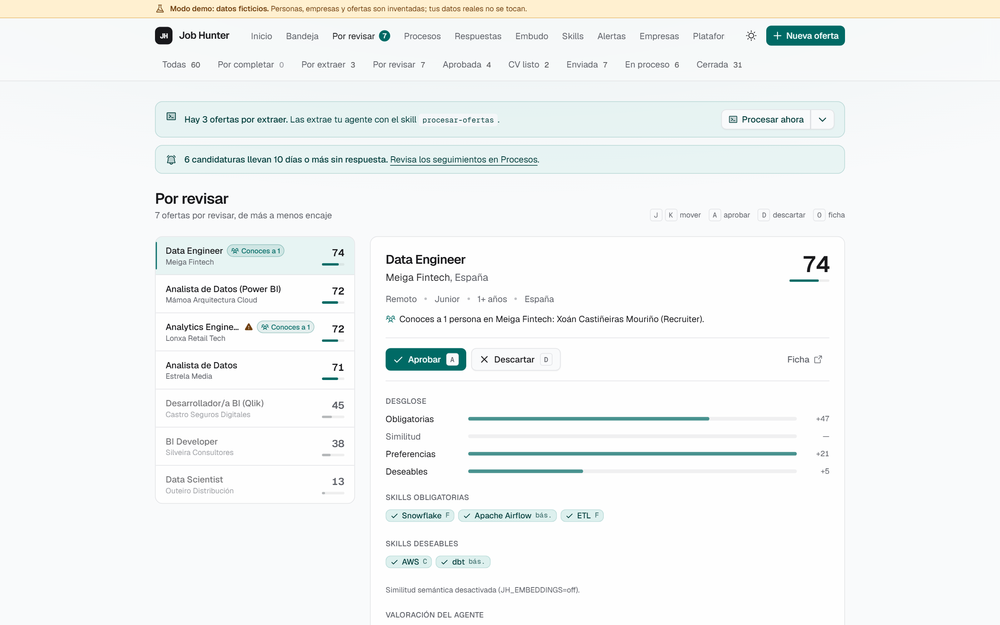</picture> |
| **Procesos (kanban)** | **Embudo** |
|  |  |

## Más de cerca

<details open>
<summary><b>CV a medida: el mismo contenido verificado, cualquier diseño, en segundos</b></summary>
<br>
<p align="center"></p>

El agente redacta el contenido del CV una sola vez. En la ficha de la oferta eliges plantilla, foto
(automática según el país, con o sin), color de acento y secciones ocultas, y pulsas «Renderizar»:
tarda segundos y **no gasta cuota del agente**. Puedes comparar renders lado a lado y marcar el que
envías. Si no eliges nada, se aplican tus reglas (por ejemplo, `ats-simple` sin foto para ofertas
en Workday o en el Reino Unido).
</details>

<details>
<summary><b>La ficha</b>: extracción, desglose del encaje, CV, carta, paquete de candidatura y proceso</summary>
<br>
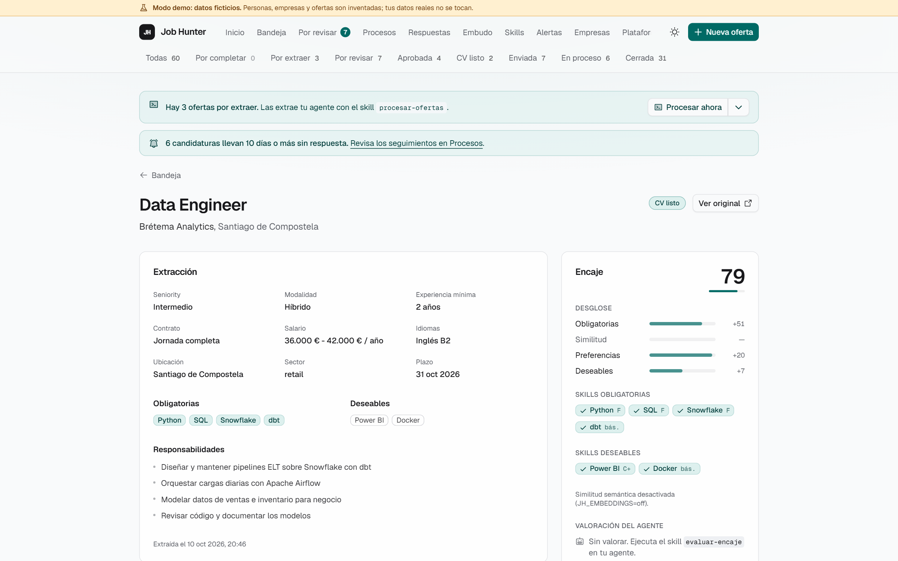

</details>

<details>
<summary><b>Plantillas de CV</b>: las integradas y las tuyas, importadas de cualquier diseño</summary>
<br>

</details>

<details>
<summary><b>Skills</b>: lo que piden las ofertas y no tienes, y alias «es lo mismo que…»</summary>
<br>
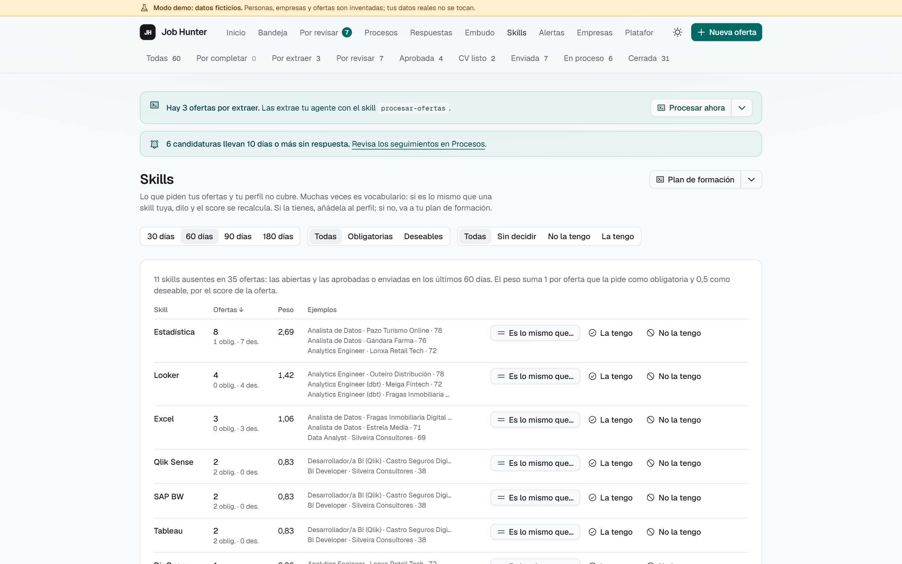
</details>

<details>
<summary><b>Fuentes</b>: empresas objetivo y portales que recorre tu agente</summary>
<br>
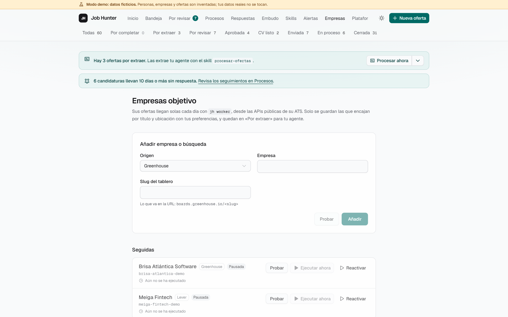
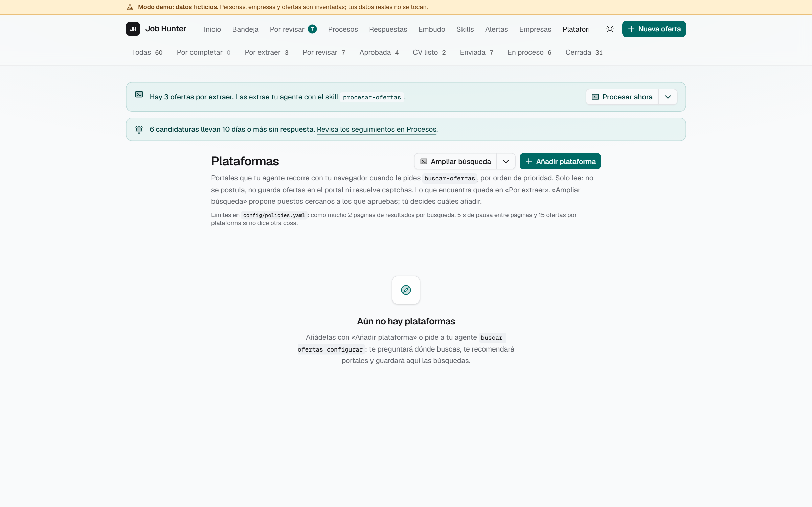
</details>

<details>
<summary><b>Agente</b>: lanza skills desde la UI, en una terminal o en segundo plano</summary>
<br>
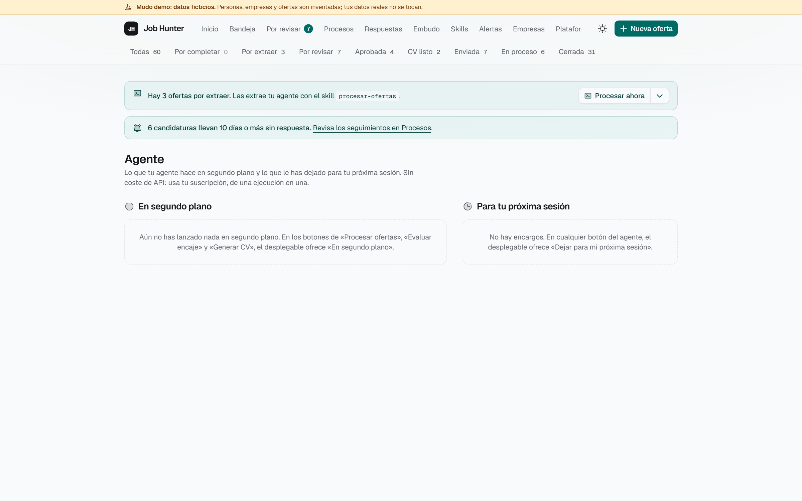
</details>

## Pruébalo en 5 minutos

Necesitas **Windows 11** (otros sistemas deberían funcionar, pero aún no están probados),
[uv](https://docs.astral.sh/uv/), **Node LTS** con **pnpm** y, para los PDF de los CVs,
**LibreOffice** o el Chromium de Playwright.

```powershell
git clone https://github.com/DiegoPrieto23/candidatai.git candidatai; cd candidatai
cd backend
uv sync
uv run playwright install chromium     # PDF sin LibreOffice
uv run cai demo seed                    # data-demo/: 60 ofertas, 8 semanas de historial, 2 CVs
$env:CAI_DATA_DIR = "data-demo"; uv run cai serve
# en otra terminal
cd frontend; pnpm install; pnpm dev    # http://127.0.0.1:5173
```

La UI muestra un banner «Modo demo». La demo es determinista y nunca toca `data/`, donde irían tus
datos reales. Para probar los skills sobre la demo, arranca tu agente con `CAI_DATA_DIR=data-demo`.

Paso a paso, con tu propio perfil, las alertas por correo y la extensión del navegador:
**[Guía de uso](docs/GUIA.md)**.

## Úsalo con tus datos

Tus datos viven en `data/`, fuera de git. Arranca `cai serve`, `cai worker` y `pnpm dev`, crea tu
perfil con el skill `update-profile` y, después, pide a tu agente:

| Skill | Qué hace |
|---|---|
| `update-profile` | Crea o actualiza `data/profile.yaml` (tu única fuente de verdad) desde tu CV y lo versiona |
| `process-jobs` | Extrae las ofertas nuevas (rol `extractor`, aislado cuando el agente lo permite) |
| `assess-fit` | Valora y explica el encaje de las ofertas por revisar |
| `generate-cv 42` | Redacta, renderiza y verifica el CV para la oferta 42 |
| `generate-cover-letter 42` | Carta según tus indicaciones, verificada; TXT y PDF a juego con el CV |
| `prepare-application 42` | Respuestas de screening y, si hace falta, la carta |
| `prepare-interview 42` | Dosier de entrevista y plan por días hasta la fecha |
| `mock-interview 42` | Simulacro: una pregunta cada vez, feedback y una respuesta mejor con tu perfil |
| `debrief-interview 42` | Repaso: notas, próximos pasos, siguiente ronda probable e historias STAR nuevas |
| `prepare-negotiation 42` | Argumentos, preguntas y guion para una oferta recibida; revisa el contrato. Nunca propone una cifra |
| `research-company 42` | Dosier de la empresa con fuentes (producto, noticias, cultura de ingeniería, stack) |
| `draft-message 42` | Mensaje de LinkedIn (≤ 300 caracteres) o correo de candidatura, como borrador |
| `draft-follow-up` | Borradores de seguimiento (máx. 2 por candidatura) y de agradecimiento |
| `review-replies` | Clasifica los correos de las empresas (entrevista con fecha, prueba, oferta, rechazo) en propuestas |
| `daily-summary` | Qué tienes hoy: pendientes, seguimientos vencidos, próximos hitos |
| `handle-requests` | Hace lo que dejaste en la UI con «Dejar para mi próxima sesión» |
| `search-jobs` | Recorre con tu navegador los portales que apruebas y da de alta lo que encaje |
| `broaden-search` | Propone títulos cercanos («Analytics Engineer») a partir de lo que apruebas |
| `review-search` | Retrospectiva semanal: qué funciona (tramos de score, fuentes, plantilla, referencias) y qué cambiar |
| `training-plan` | Plan de formación con tus huecos reales de skills, con recursos verificados |
| `review-linkedin` | Informe de mejoras de tu perfil de LinkedIn, listo para copiar |
| `import-cv-template` | Convierte tu CV (o cualquier diseño) en plantilla para los CVs a medida |

Se invocan como `/generate-cv 42` en Claude Code, `$generate-cv 42` en Codex, o pidiéndolo en
lenguaje natural, en español o en inglés («genérame el CV de la 42»). Hasta la fase 23 tenían nombres
en español (`generar-cv`…).

### De dónde salen las ofertas

| Vía | Automática | Cubre |
|---|---|---|
| Alta por URL o texto | No | Cualquier oferta |
| APIs públicas de ATS (Greenhouse, Lever, Ashby) | Diaria | Tus empresas objetivo (`cai sources discover` encuentra sus tableros) |
| APIs de portales (InfoJobs, Adzuna), con claves | Diaria | Búsquedas por palabras clave |
| Alertas de empleo por correo (IMAP de solo lectura o `.eml` exportados) | Sí | LinkedIn, InfoJobs, Indeed, Tecnoempleo… |
| Botón «Enviar a CandidatAI» del navegador | Un clic | Cualquier página que estés viendo, LinkedIn incluido |
| Tu agente con tu navegador | A demanda | Portales que apruebas; LinkedIn solo si lo activas |
| Búsqueda pública de LinkedIn, sin sesión | Diaria, **apagada por defecto** | Tus búsquedas de LinkedIn, una vez al día como mucho y con límites estrictos |

## Agentes compatibles

| Agente | Estado |
|---|---|
| **Claude Code** | Referencia: se desarrolla y prueba con él, con MCP y sin él (solo CLI: 5/5 ofertas extraídas, valoradas y con un CV que pasa el eval). Los skills también se lanzan **en segundo plano** desde la UI |
| **Codex** | Configuración generada (`.codex/`); aún fuera de la matriz probada |
| **Gemini CLI, Cursor, Copilot, OpenCode…** | Sin probar: valen si leen `AGENTS.md` y hablan MCP o ejecutan comandos |

Skills, roles (subagentes) y el manifiesto de agentes se escriben una vez en `.agents/` y se generan
para cada agente con `scripts/sync_agents.py`. Detalle y cómo añadir un agente:
[`docs/AGENTS_COMPAT.md`](docs/AGENTS_COMPAT.md).

## Garantías

Son reglas del código, no promesas del agente:

- **Nada sale sin tu confirmación.** La app rellena y se para; el envío lo desencadena tu clic,
  candidatura a candidatura, con un token de un solo uso. Mensajes y correos son borradores.
- **Nada inventado.** Cada afirmación del CV apunta a una evidencia de tu perfil que tiene que
  existir, o el código la rechaza; un rol `verifier` independiente revisa el resto.
- **El contenido ajeno es dato.** El texto de ofertas, correos y webs nunca es una instrucción. Se
  detecta texto oculto y frases dirigidas a una IA, y se avisa en la UI.
- **Tus datos se quedan contigo.** Todo vive en `data/` (fuera de git). El agente nunca recibe tu
  correo, tu teléfono ni tu mínimo salarial.
- **LinkedIn y captchas.** Nada de candidaturas automáticas en LinkedIn, y los captchas nunca se
  resuelven ni se esquivan. Buscar en LinkedIn (con tu navegador o por su búsqueda pública) solo
  ocurre si lo activas tú en la UI.

## Frente a proyectos parecidos

CandidatAI toma las mejores ideas de dos grandes proyectos abiertos,
[AI Job Search](https://github.com/MadsLorentzen/ai-job-search) y
[career-ops](https://github.com/career-ops-hq/career-ops), y las convierte en una app con estado.

| | CandidatAI | AI Job Search | career-ops |
|---|:---:|:---:|:---:|
| UI web completa (triaje, kanban, embudo…) | ✅ | ❌ | 🟡 terminal |
| MCP + CLI con paridad comprobada | ✅ | ❌ | ❌ |
| El código comprueba el CV contra tu perfil | ✅ | 🟡 | 🟡 |
| Tu propio diseño de CV (Word, PDF, imagen) | ✅ | 🟡 LaTeX | 🟡 LaTeX |
| Rellena formularios de candidatura (envías tú) | ✅ | ❌ | 🟡 solo respuestas |
| Alertas por correo y botón del navegador como fuentes | ✅ | ❌ | ❌ |
| Calibración del score con los resultados | ✅ | ❌ | ✅ |
| Ofertas recibidas sin exponer tu mínimo | ✅ | ❌ | 🟡 |
| Muchos ATS y portales de serie | 🟡 5 | 🟡 | ✅ 55+ |
| Evaluación en lote en paralelo | 🟡 | ✅ | ✅ |
| Instalación de un comando, macOS/Linux, Docker | ❌ | 🟡 | ✅ |
| README en varios idiomas | 🟡 2 | ❌ | ✅ 17 |

Comparativa completa función a función, lo que nos falta y lo que no haremos (y qué regla lo
impide): [`docs/COMPARATIVA.md`](docs/COMPARATIVA.md).

## Arquitectura

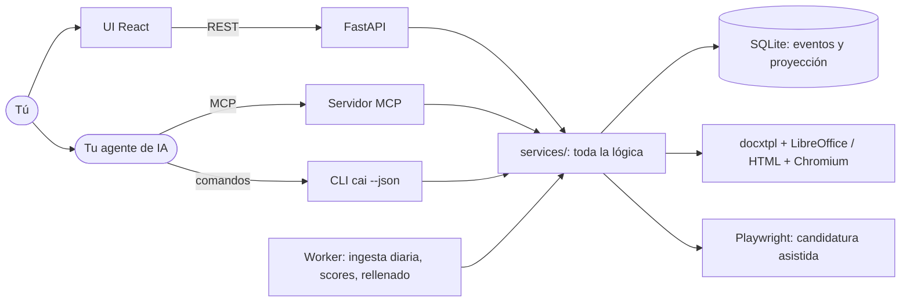

- **Capas finas.** API, MCP y CLI solo traducen; la lógica vive en `app/services/` y se prueba ahí.
  Cada herramienta MCP tiene su comando `cai … --json` con la misma entrada y salida (un test lo
  comprueba), así que un agente sin MCP puede hacer lo mismo.
- **Eventos como fuente de verdad.** Cada cambio de una oferta es un evento validado contra una
  tabla de transiciones; la etapa actual es una proyección que se puede recalcular.
- **El agente nunca escribe directamente.** Rellena esquemas Pydantic estrictos (`JobExtraction`,
  `CvContent`…) que el código valida, con cada afirmación del CV ligada a su evidencia.

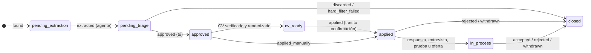

<details>
<summary><b>Decisiones clave</b> (34 ADR en <code>docs/DECISIONS.md</code>)</summary>

| Decisión | Por qué |
|---|---|
| Sin API de LLM: el razonamiento lo pone tu agente | Sin costes ni claves extra; funciona con la suscripción que ya tengas |
| Interfaz neutral: MCP + CLI con paridad | Cualquier agente que hable MCP o ejecute comandos sirve |
| `.agents/` como fuente única y configuración nativa generada | Un skill se escribe una vez y se genera para Claude Code, Codex… |
| Seguridad que no depende del agente | Detección de inyección, validación y una interfaz que no puede enviar nada, con cualquier agente |
| Eventos como fuente de verdad | Historial completo, analítica fiable y estados que no se corrompen |
| Contenido y presentación del CV separados | Cambiar plantilla, foto o color no vuelve a gastar agente |
| LinkedIn solo por alertas, tus clics o funciones que activas tú | Respeta tu cuenta; la app prepara y tú terminas |
| SQLite, nativo en Windows | Una app personal: sin servidores ni Docker |
| Embeddings locales y opcionales | Mejor matching sin mandar tus datos fuera |
</details>

## Calidad y evals

- **Tests:** 2.351 de backend (pytest, cobertura mínima del 85 % en `services/`) y 230 de frontend
  (Vitest). CI en Windows (backend) y Linux (frontend), más la comprobación de que la configuración
  generada de agentes está al día y una siembra de la demo como prueba de humo.
- **Eval de matching** (80 casos inventados, sin embeddings): precision **0,88**, recall **0,95**,
  F1 **0,92** con el umbral de triaje por defecto. Errores típicos y por qué:
  [`evals/REPORT.md`](evals/REPORT.md).
- **Eval de CV** (`cai eval cv`): 7 comprobaciones automáticas sobre los CVs que deja un agente
  (evidencias que existen, sin skills inventadas ni no pedidas, una página, cobertura de keywords,
  idioma y verificación independiente).

## Documentación

| Quiero… | Lee |
|---|---|
| Instalarlo y usarlo en el día a día | [Guía de uso](docs/GUIA.md) · [User guide](docs/GUIDE.md) |
| Ver cómo se compara con proyectos parecidos | [`docs/COMPARATIVA.md`](docs/COMPARATIVA.md) |
| Entender la arquitectura y el modelo de datos | [`docs/ARCHITECTURE.md`](docs/ARCHITECTURE.md), [`docs/DATA_MODEL.md`](docs/DATA_MODEL.md) |
| Conocer las reglas (veracidad, privacidad, candidaturas) | [`docs/POLICIES.md`](docs/POLICIES.md) |
| Configurar las fuentes y las alertas por correo | [`docs/FUENTES_OFERTAS.md`](docs/FUENTES_OFERTAS.md), [`docs/CONFIGURAR_CORREO.md`](docs/CONFIGURAR_CORREO.md) |
| Trabajar con plantillas de CV | [`docs/CV_TEMPLATES.md`](docs/CV_TEMPLATES.md) |
| Conectar otro agente | [`docs/AGENTS_COMPAT.md`](docs/AGENTS_COMPAT.md), [`docs/AGENT_INTERFACE.md`](docs/AGENT_INTERFACE.md) |
| Contribuir | [`CONTRIBUTING.md`](CONTRIBUTING.md) |

Todos los documentos, agrupados: [`docs/README.md`](docs/README.md).

## Cómo se construyó

En 22 fases (con subfases), cada una con su encargo en `prompts/`, implementadas con un agente de
IA (Claude Code) sobre una especificación escrita antes del código: plan, rama por fase, tests,
revisión por un rol `reviewer` y registro de decisiones y deuda. El registro de cada fase está en
[`docs/ROADMAP.md`](docs/ROADMAP.md), su resumen en [`docs/RESUMEN_FASES.md`](docs/RESUMEN_FASES.md)
y el método en [`docs/DESARROLLO_POR_FASES.md`](docs/DESARROLLO_POR_FASES.md).

## Licencia y créditos

[MIT](LICENSE) © 2026 Diego Prieto.

Inspirado en [ackyer/job-search-agent-template](https://github.com/ackyer/job-search-agent-template)
(MIT) y en ideas de [AI Job Search](https://github.com/MadsLorentzen/ai-job-search) y
[career-ops](https://github.com/career-ops-hq/career-ops) (ambos MIT). Sin relación con Anthropic,
OpenAI, LinkedIn ni ningún portal de empleo.
