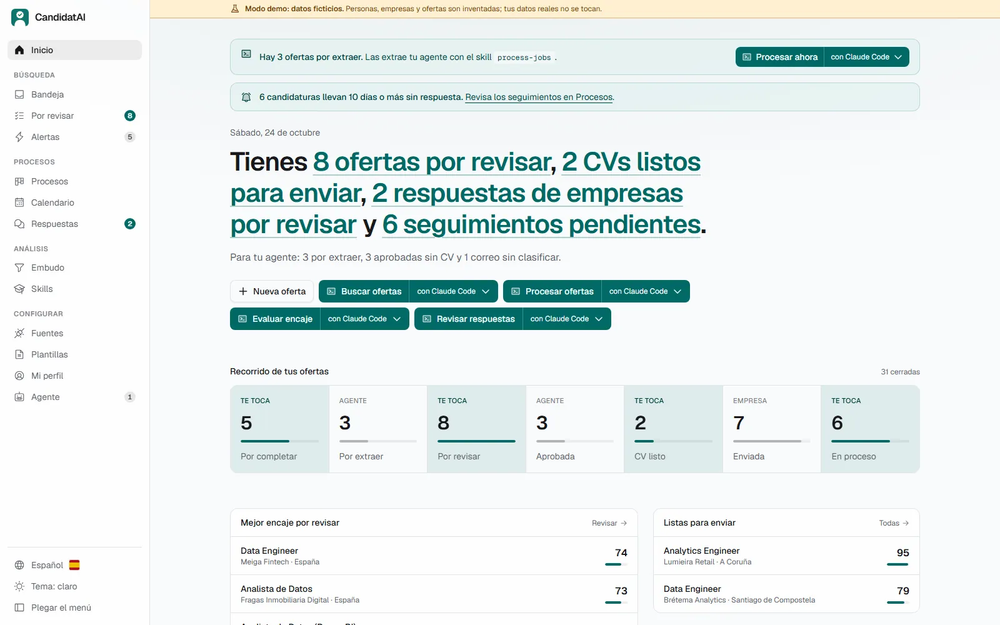
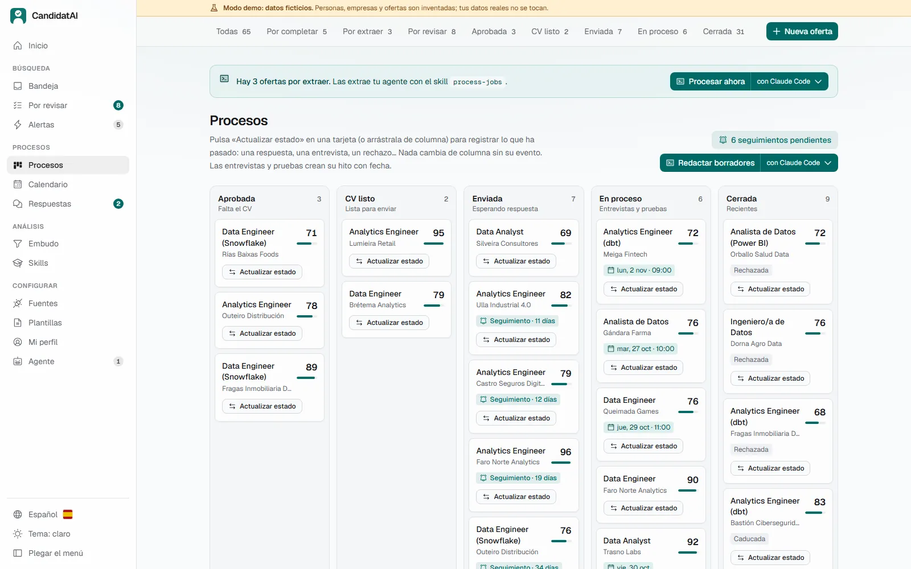
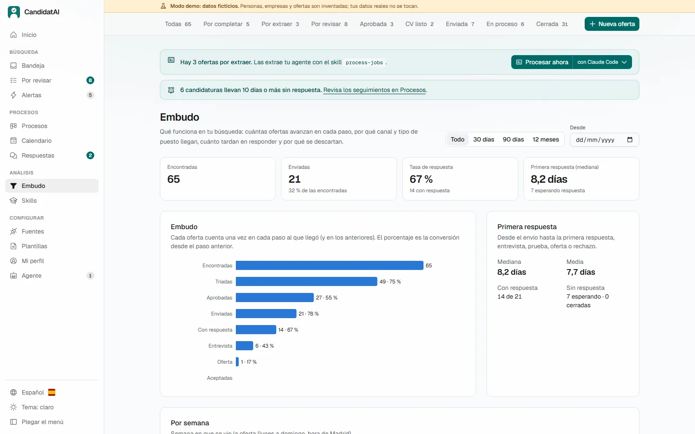
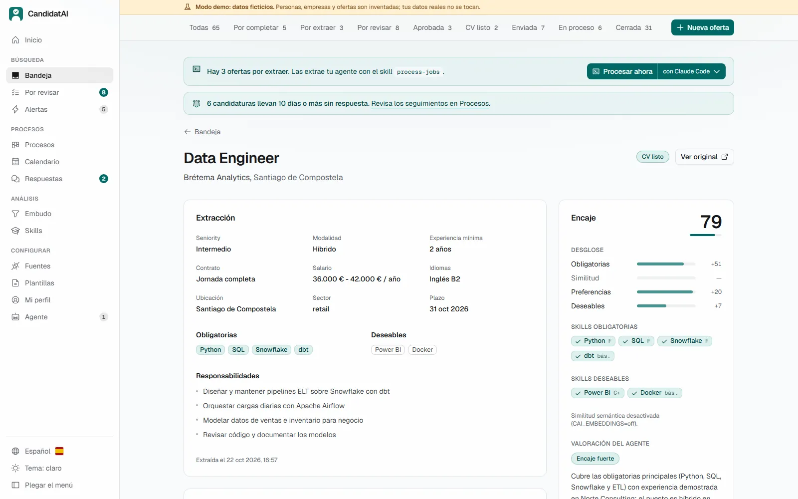
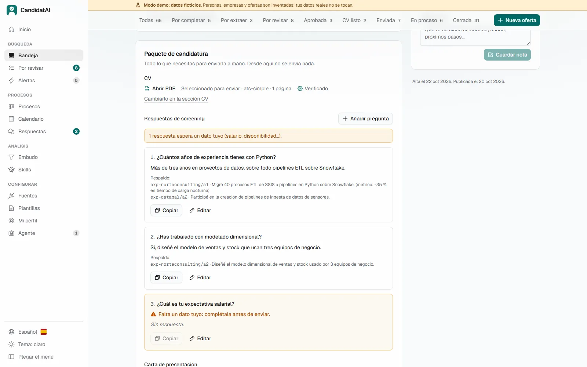
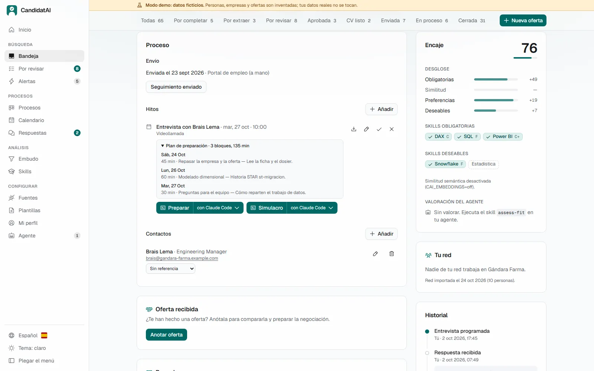

<p align="center">
  
</p>

<p align="center">
  <a href="README.md">English</a> · <b>Español</b>
</p>

<h3 align="center">Tu búsqueda de empleo entera, en una app: tú decides, tu IA lee y escribe, y no se envía nada sin ti.</h3>

<p align="center">
  
  <br><sub>De la oferta nueva a la candidatura, en 50 segundos. Todo lo que se ve es la <b>demo</b>: una candidata, empresas y ofertas inventadas.</sub>
</p>

<p align="center">
  <a href="#windows"></a>
  <a href="#macos-y-linux"></a>
  <a href="#docker"></a>
</p>

<p align="center">
  <a href="https://github.com/DiegoPrieto23/candidatai/releases/latest"></a>
  <a href="https://github.com/DiegoPrieto23/candidatai/actions/workflows/ci.yml"></a>
  <a href="LICENSE"></a>
</p>

> [!NOTE]
> **En qué punto está (v0.1, octubre de 2026):** Windows 11 es lo más probado, también una
> instalación limpia desde la release; macOS y Linux tienen instalador, pero son nuevos. Claude Code
> está probado de principio a fin, Codex con una oferta y Antigravity CLI en parte; OpenCode solo se ha
> probado con un modelo local pequeño, que no terminó la prueba, y Qwen Code está configurado, pero sin probar. La interfaz está en español e inglés.

<!--
  Tu búsqueda en números (fase 25.6). `cai stats story` o la tarjeta «Tu búsqueda en números» del
  Embudo te dan esta línea con tus cifras reales: solo recuentos agregados, sin empresas.
  Para publicarla, pégala aquí abajo, cuenta en una línea qué funcionó y quita este comentario.

> **Mi búsqueda con CandidatAI** (D mmm AAAA → D mmm AAAA, N semanas): N ofertas evaluadas,
> N aprobadas, N candidaturas, N respuestas, N entrevistas y N ofertas.
> Lo que funcionó: …
-->

## Lo que necesitas

1. **Un ordenador** con Windows, macOS o Linux. Sin Python, Node ni permisos de administrador: el
   instalador trae lo que hace falta.
2. **La app**, que guarda tus ofertas, tu perfil, tus CVs y tus procesos en tu equipo.
3. **Un agente de IA** que lea y escriba: Claude Code o Codex con la suscripción que quizá ya
   pagas, Antigravity CLI con una cuenta gratuita de Google, o un modelo local. **La app nunca llama
   a una IA por su cuenta.** Cuál elegir y cuánto cuesta cada uno: **[Empieza aquí](docs/EMPEZAR.md)**.

## Qué hace

Entran ofertas de varias fuentes, las revisas con un score explicado, cada una recibe un **CV y una
carta a medida y verificados**, la app rellena el formulario de la candidatura y **espera a que tú
pulses Enviar**, y después sigue el proceso hasta la oferta.

| | |
|---|---|
| 📥 **Ofertas de muchas fuentes** | Pega una URL o el texto; APIs públicas de ATS (Greenhouse, Lever, Ashby, Personio, Teamtailor, Workable, SmartRecruiters, Recruitee); InfoJobs, Adzuna, Manfred y freehire.me; **alertas de empleo por correo**; un botón en el navegador; tu agente recorriendo portales; y, si lo activas, la búsqueda pública de LinkedIn. Sin duplicados y con **detección de texto dirigido a una IA** |
| 🎯 **Revisión con score explicado** | Filtros duros y un score de 0 a 100 por cobertura de skills y tus preferencias; tu agente añade un veredicto razonado, y «¿Acierta el score?» lo contrasta con lo que pasó de verdad |
| 📄 **CV y carta a medida** | El agente cita **una evidencia de tu perfil para cada línea**; el código la comprueba, lo renderiza con tu plantilla, foto y color, y un rol aparte lo verifica. **Importa el diseño de tu propio CV** como plantilla |
| 📝 **Candidatura asistida** | Rellena formularios de Greenhouse, Lever, Ashby o genéricos, se para ante captchas e inicios de sesión y **solo envía cuando tú confirmas** |
| 📊 **Seguimiento y analítica** | Un kanban que solo se mueve con eventos registrados, un calendario, recordatorios de seguimiento, las respuestas de las empresas clasificadas y un embudo por fuente, puesto, plantilla y referencia |
| 🎤 **Entrevistas y ofertas** | Guías y planes de preparación, simulacros, repasos, investigación de la empresa con fuentes y ofertas comparadas con tu mínimo **sin que el agente lo vea nunca** |

**Todas las funcionalidades, página a página y skill a skill:** [`docs/FUNCIONALIDADES.md`](docs/FUNCIONALIDADES.md).

| Inicio | Procesos (kanban) |
|---|---|
| <picture><source media="(prefers-color-scheme: dark)" srcset="docs/img/es/dark/home.webp"></picture> | <picture><source media="(prefers-color-scheme: dark)" srcset="docs/img/es/dark/processes.webp"></picture> |
| **Bandeja: descartar con Deshacer** | **Embudo** |
|  |  |

<details>
<summary><b>CV a medida: el mismo contenido verificado, cualquier diseño, en segundos</b></summary>
<br>
<p align="center"></p>

El agente redacta el contenido una vez. Tú eliges plantilla, foto, color y secciones ocultas y
pulsas «Renderizar»: tarda segundos y **no gasta cupo del agente**.
</details>

<details>
<summary><b>Candidatura asistida</b>: la app rellena el formulario, tú revisas cada campo y lo envías</summary>
<br>
<p align="center"></p>
</details>

<details>
<summary><b>La ficha de una oferta</b>: extracción, encaje, CV, carta, paquete y entrevistas</summary>
<br>



</details>

## Por qué CandidatAI

Hay dos proyectos abiertos conocidos que también usan un agente de IA para buscar empleo, y los dos
han inspirado este. Comprobado el **25 de octubre de 2026** en sus repositorios
([AI Job Search](https://github.com/MadsLorentzen/ai-job-search),
[career-ops](https://github.com/career-ops-hq/career-ops)):

| | CandidatAI | AI Job Search | career-ops |
|---|---|---|---|
| Qué es | Una **app** con interfaz web, base de datos y tareas en segundo plano | Instrucciones y comandos para Claude Code sobre ficheros | Un agente con muchos modos y scripts de Node sobre ficheros, un panel de terminal y una web en alfa |
| Instalar | Un comando, un acceso directo y nada instalado antes | Fork, y luego Claude Code, Python, Bun y LaTeX | `npx … init` con Node instalado |
| Sin el agente abierto | Revisar ofertas, kanban, calendario, embudo, perfil, volver a renderizar CVs | Nada | Escanear, el panel y la web |
| Reglas | **Aplicadas por el código**: una línea del CV sin evidencia en tu perfil se rechaza; enviar necesita tu clic | Instrucciones, más un filtro de inyección en código | Instrucciones, más una comprobación de hechos del PDF en código |
| Agentes | 5 configurados; Claude Code probado del todo | Claude Code | 12 CLIs, modelos gratuitos y locales |
| Comunidad | Recién publicado, un mantenedor | ~65 000 estrellas, ~90 contribuidores, la búsqueda real del autor | ~77 000 estrellas, ~460 contribuidores, Discord, muchas historias de contratación |

**Lo que ellos hacen mejor, hoy:** career-ops funciona con más agentes y modelos, cubre más fuentes
de ofertas y países y está mucho más probado; AI Job Search es más sencillo (haz fork y ejecuta
`/setup`) y tiene detrás una historia real de contratación. Los dos tienen una comunidad que este
proyecto aún no tiene. La comparativa entera, función a función, está en
[`docs/COMPARATIVA.md`](docs/COMPARATIVA.md).

## Instalar

### Windows

En PowerShell (Windows 11; sin permisos de administrador):

```powershell
iwr -useb https://raw.githubusercontent.com/DiegoPrieto23/candidatai/main/install.ps1 -OutFile $env:TEMP\cai-install.ps1
powershell -ExecutionPolicy Bypass -File $env:TEMP\cai-install.ps1
```

### macOS y Linux

En una terminal (sin `sudo`):

```bash
curl -fsSL https://raw.githubusercontent.com/DiegoPrieto23/candidatai/main/install.sh | bash
```

### Docker

Desde una copia del repositorio, `docker compose up -d --build`. Tu agente se queda fuera del
contenedor, con algunos límites: ver [Con Docker](docs/GUIA.md#con-docker-opcional).

Los instaladores descargan la [última release](https://github.com/DiegoPrieto23/candidatai/releases/latest),
**comprueban su suma SHA-256** y dejan un acceso directo **«CandidatAI»** que abre la app en tu
navegador. Para actualizar, vuelve a ejecutarlos: tus datos no se tocan. Para ver antes qué harían,
añade `-WhatIf` a la segunda línea de Windows o usa `| bash -s -- --dry-run`.

Después, prueba la demo (`cai demo seed`), crea tu perfil a partir de tu CV y conecta tu agente:
**[Empieza aquí](docs/EMPEZAR.md)** paso a paso, o la **[guía de uso](docs/GUIA.md)** completa. Para
desarrollarla, ver [Desarrollo](docs/GUIA.md#15-desarrollo).

## Garantías

Son reglas que aplica el código, uses el agente que uses:

- **No sale nada sin tu confirmación.** La app rellena formularios y se para; enviar requiere tu
  clic, candidatura a candidatura. Los mensajes y correos son borradores que envías tú.
- **Nada de experiencia inventada.** Cada afirmación del CV tiene que apuntar a una evidencia de tu
  perfil o el código la rechaza; un rol verificador independiente revisa el resto.
- **El contenido no confiable sigue siendo datos.** El texto de ofertas, correos y webs nunca se
  trata como instrucciones; el texto dirigido a una IA se detecta y se marca.
- **Tus datos se quedan contigo.** Todo vive en tu equipo. El agente nunca recibe tu correo, tu
  teléfono ni tu mínimo salarial.
- **LinkedIn y captchas.** Nada de candidaturas automáticas en LinkedIn, y los captchas nunca se
  resuelven ni se esquivan. Solo se busca en LinkedIn si lo activas en la UI.

## Cómo funciona

<p align="center">
  
</p>

Cada color es quién hace el paso: **tú** decides, **tu agente** razona y **la app** guarda,
comprueba y automatiza. El agente trabaja a través de una interfaz propia (herramientas MCP y una
CLI `cai … --json` equivalente) y solo puede rellenar esquemas estrictos que el código valida. Los
skills, como `generate-cv 42` o `assess-fit`, se lanzan desde tu agente o desde un botón de la UI.
Todos los skills y las fuentes: [`docs/FUNCIONALIDADES.md`](docs/FUNCIONALIDADES.md); los agentes:
[`docs/AGENTS_COMPAT.md`](docs/AGENTS_COMPAT.md) y la matriz medida en
[`evals/compat/REPORT.md`](evals/compat/REPORT.md); la arquitectura:
[`docs/ARCHITECTURE.md`](docs/ARCHITECTURE.md).

**Calidad:** tests de backend en Windows, Linux y macOS y de frontend en la CI. El eval de matching
(80 casos inventados, sin embeddings): precision **0,88**, recall **0,95**,
F1 **0,92** con el umbral de score por defecto ([`evals/REPORT.md`](evals/REPORT.md)).

## Documentación

| Quiero… | Lee |
|---|---|
| Instalarla sin ser técnico | [Empieza aquí](docs/EMPEZAR.md) · [Start here](docs/START_HERE.md) |
| Usarla en el día a día | [Guía de uso](docs/GUIA.md) · [User guide](docs/GUIDE.md) |
| Ver todo lo que hace | [`docs/FUNCIONALIDADES.md`](docs/FUNCIONALIDADES.md) |
| Conocer las reglas (veracidad, privacidad, enviar) | [`docs/POLICIES.md`](docs/POLICIES.md), [`SECURITY.md`](SECURITY.md) |
| Contribuir | [`CONTRIBUTING.md`](CONTRIBUTING.md) (en inglés; se aceptan incidencias y PR en español) |
| Ver qué ha cambiado | [`CHANGELOG.md`](CHANGELOG.md) |

Todos los documentos, agrupados: [`docs/README.md`](docs/README.md).

## Licencia y créditos

[MIT](LICENSE) © 2026 Diego Prieto.

Inspirado en [ackyer/job-search-agent-template](https://github.com/ackyer/job-search-agent-template)
(MIT), y en ideas de [AI Job Search](https://github.com/MadsLorentzen/ai-job-search) y
[career-ops](https://github.com/career-ops-hq/career-ops) (los dos MIT). Sin relación con
Anthropic, OpenAI, LinkedIn ni ningún portal de empleo.
