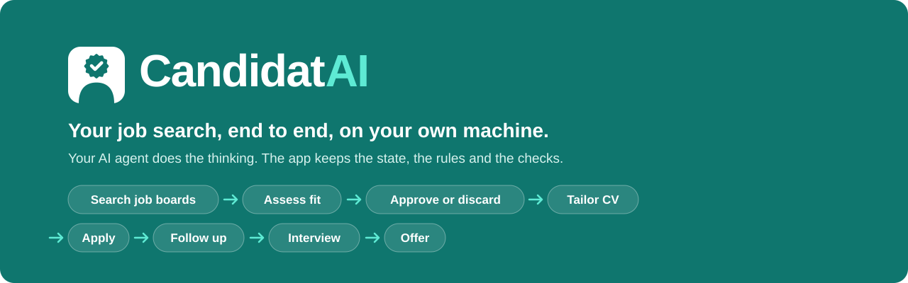
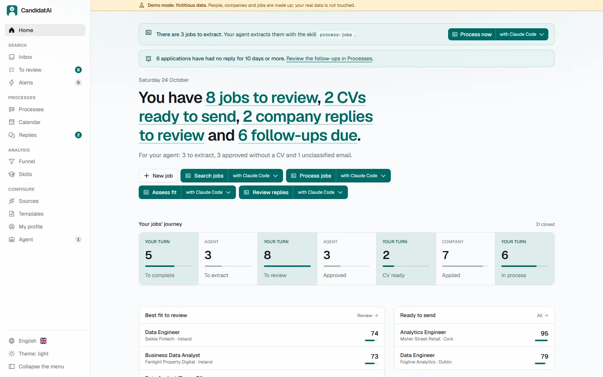
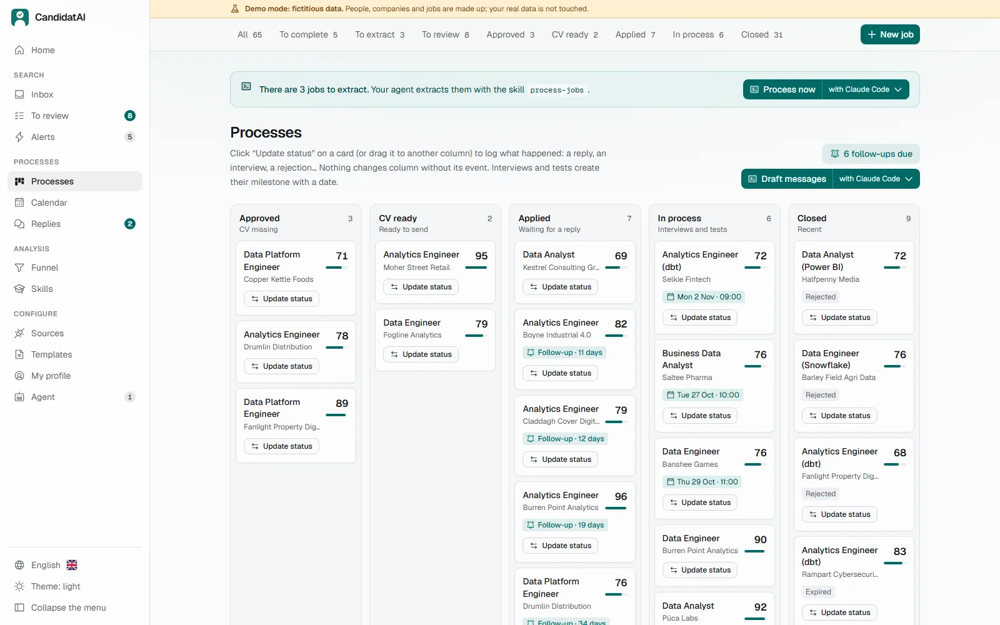
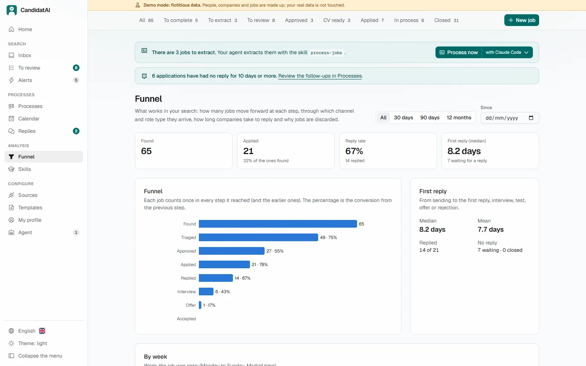
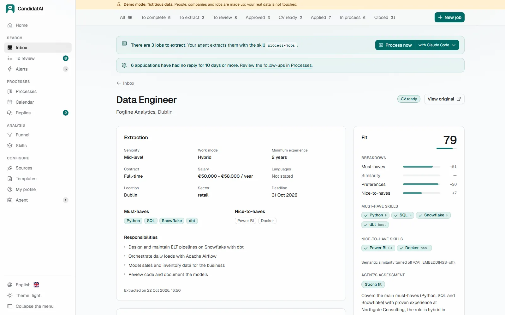
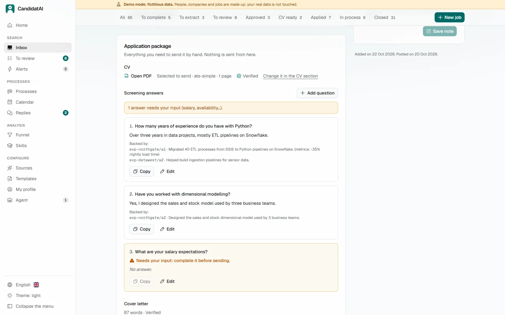
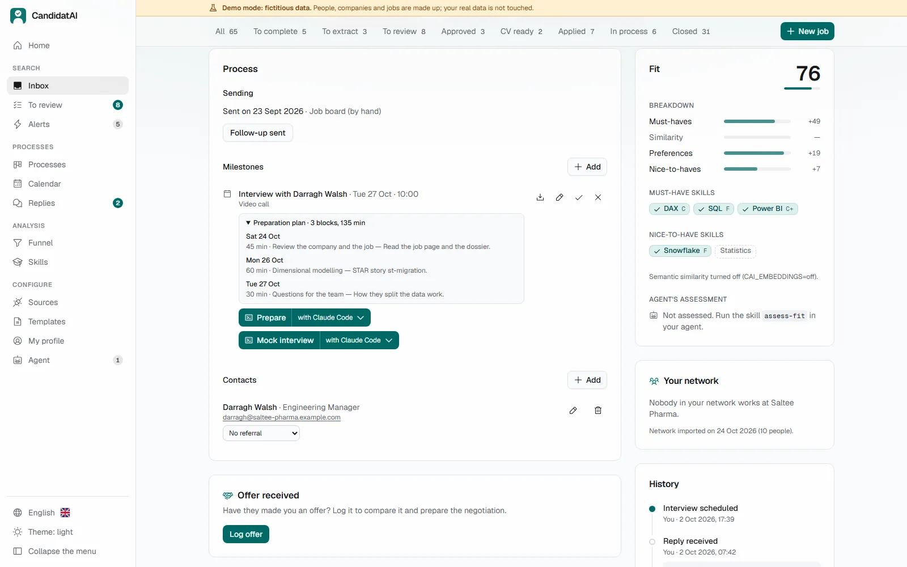
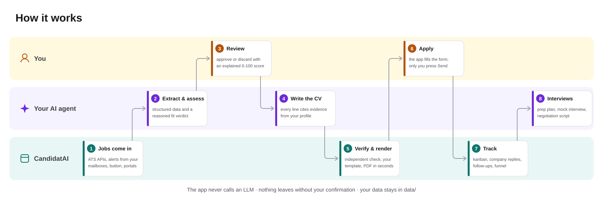

<p align="center">
  
</p>

<p align="center">
  <b>English</b> · <a href="README.es.md">Español</a>
</p>

<h3 align="center">Your whole job search in one app: you decide, your AI reads and writes, and nothing is sent without you.</h3>

<p align="center">
  
  <br><sub>From a new job to the application, in 50 seconds. Everything you see is the <b>demo</b>: a fictional candidate, companies and jobs.</sub>
</p>

<p align="center">
  <a href="#windows"></a>
  <a href="#macos-and-linux"></a>
  <a href="#docker"></a>
</p>

<p align="center">
  <a href="https://github.com/DiegoPrieto23/candidatai/releases/latest"></a>
  <a href="https://github.com/DiegoPrieto23/candidatai/actions/workflows/ci.yml"></a>
  <a href="LICENSE"></a>
</p>

> [!NOTE]
> **Where it stands (v0.1, October 2026):** Windows 11 is the most tested, including a clean
> install from the release; macOS and Linux have an installer but are new. Claude Code is tested
> end to end, Codex with one job and Antigravity CLI in part; OpenCode was only tried
> with a small local model, which didn't finish the test, and Qwen Code is configured but untested. The UI is in English and Spanish.

<!--
  Your search in numbers (phase 25.6). `cai stats story` or the "Your search in numbers" card in
  the Funnel gives you this line with your real figures: aggregated counts only, no companies.
  To publish it, paste it below, write what worked in one line and remove this comment.

> **My search with CandidatAI** (D Mon YYYY → D Mon YYYY, N weeks): N postings evaluated,
> N approved, N applications, N replies, N interviews, N offers.
> What worked: …
-->

## What you need

1. **A computer** with Windows, macOS or Linux. No Python, Node or admin rights: the installer
   brings what it needs.
2. **The app**, which keeps your jobs, profile, CVs and processes on your machine.
3. **An AI agent** to do the reading and writing: Claude Code or Codex with the subscription you may
   already pay, Antigravity CLI with a free Google account, or a local model. **The app never calls an
   AI itself.** Which one to pick and what each costs: **[Start here](docs/START_HERE.md)**.

## What it does

Jobs come in from several sources, you review them with an explained score, each one gets a
**tailored, verified CV and cover letter**, the app fills the application form and **waits for you
to press Send**, and then it tracks the process all the way to the offer.

| | |
|---|---|
| 📥 **Jobs from many sources** | Paste a URL or text; public ATS APIs (Greenhouse, Lever, Ashby, Personio, Teamtailor, Workable, SmartRecruiters, Recruitee); InfoJobs, Adzuna, Manfred and freehire.me; **job alerts by email**; a browser button; your agent browsing portals; and, opt-in, LinkedIn's public search. Deduplicated, with **detection of text aimed at an AI** |
| 🎯 **Review with an explained score** | Hard filters and a 0-100 score from skill coverage and your preferences; your agent adds a reasoned verdict, and "Is the score right?" checks it against real outcomes |
| 📄 **Tailored CV and cover letter** | The agent cites **evidence from your profile for every line**; the code checks it, renders it with your template, photo and colour, and a separate role verifies it. **Import your own CV design** as a template |
| 📝 **Assisted applications** | Fills Greenhouse, Lever, Ashby or generic forms, stops at captchas and logins, and **only submits after you confirm** |
| 📊 **Tracking and analytics** | A kanban that only moves through recorded events, a calendar, follow-up reminders, company replies classified for you, and a funnel by source, role, template and referral |
| 🎤 **Interviews and offers** | Prep guides and plans, mock interviews, debriefs, company research with sources, and offers compared against your minimum **without the agent ever seeing it** |

**Every feature, page by page and skill by skill:** [`docs/FEATURES.md`](docs/FEATURES.md).

| Home | Processes (kanban) |
|---|---|
| <picture><source media="(prefers-color-scheme: dark)" srcset="docs/img/en/dark/home.webp"></picture> | <picture><source media="(prefers-color-scheme: dark)" srcset="docs/img/en/dark/processes.webp"></picture> |
| **Inbox: discard with Undo** | **Funnel** |
|  |  |

<details>
<summary><b>Tailored CV: same verified content, any design, in seconds</b></summary>
<br>
<p align="center"></p>

The agent writes the content once. You choose the template, photo, colour and hidden sections and
press "Render": it takes seconds and **uses no agent quota**.
</details>

<details>
<summary><b>Assisted application</b>: the app fills the form, you check every field and send it</summary>
<br>
<p align="center"></p>
</details>

<details>
<summary><b>The job page</b>: extraction, fit, CV, cover letter, package and interviews</summary>
<br>



</details>

## Why CandidatAI

There are two well-known open projects that also use an AI agent for the job search, and both
inspired this one. Checked on **25 October 2026** in their repositories
([AI Job Search](https://github.com/MadsLorentzen/ai-job-search),
[career-ops](https://github.com/career-ops-hq/career-ops)):

| | CandidatAI | AI Job Search | career-ops |
|---|---|---|---|
| What it is | An **app** with a web UI, a database and a background worker | Instructions and commands for Claude Code over files | An agent with many modes and Node scripts over files, a terminal dashboard and a web UI in alpha |
| Installing | One command, a desktop shortcut, nothing installed beforehand | Fork, then Claude Code, Python, Bun and LaTeX | `npx … init` with Node installed |
| Without the agent open | Reviewing jobs, kanban, calendar, funnel, profile, re-render CVs | Nothing | Scanning, the dashboard and the web UI |
| Rules | **Enforced by code**: a CV line without evidence in your profile is rejected; sending needs your click | Instructions, plus an injection filter in code | Instructions, plus a fact check of the PDF in code |
| Agents | 5 configured; Claude Code fully tested | Claude Code | 12 CLIs, free and local models |
| Community | Just released, one maintainer | ~65k stars, ~90 contributors, the author's real search | ~77k stars, ~460 contributors, Discord, many success stories |

**What they do better, today:** career-ops works with more agents and models, covers more job
sources and countries and is far more battle-tested; AI Job Search is simpler (fork it and run
`/setup`) and has a real hiring story behind it. Both have communities this project doesn't have
yet. The full feature-by-feature comparison is in [`docs/COMPARATIVA.md`](docs/COMPARATIVA.md)
(Spanish).

## Install

### Windows

In PowerShell (Windows 11; no admin rights needed):

```powershell
iwr -useb https://raw.githubusercontent.com/DiegoPrieto23/candidatai/main/install.ps1 -OutFile $env:TEMP\cai-install.ps1
powershell -ExecutionPolicy Bypass -File $env:TEMP\cai-install.ps1
```

### macOS and Linux

In a terminal (no `sudo`):

```bash
curl -fsSL https://raw.githubusercontent.com/DiegoPrieto23/candidatai/main/install.sh | bash
```

### Docker

From a copy of the repository, `docker compose up -d --build`. Your agent stays outside the
container, with some limits: see [With Docker](docs/GUIDE.md#with-docker-optional).

The installers download the [latest release](https://github.com/DiegoPrieto23/candidatai/releases/latest),
**check its SHA-256 checksum** and create the shortcut described in the next section. To update,
run them again: your data isn't touched. To see first what they'd do, add `-WhatIf` to the second
Windows line or use `| bash -s -- --dry-run`.

## How to start it

The installers create a **"CandidatAI"** shortcut, like any other app:

| System | Where it is |
|---|---|
| Windows | On the desktop and in the Start menu |
| macOS | In your user's Applications folder (`~/Applications`); Spotlight finds it too |
| Linux | In your desktop's applications menu |

When you open it, a terminal window starts the app and your browser opens at
`http://127.0.0.1:8000`, which is your own computer. Keep that window open while you use it:
closing it stops the app.

**From a terminal** it's the same: `uv run cai start` in the app's `backend` folder.

```bash
cd $env:LOCALAPPDATA\CandidatAI\app\backend               # Windows (PowerShell)
cd ~/"Library/Application Support/CandidatAI/app/backend"   # macOS
cd ~/.local/share/candidatai/app/backend                    # Linux
uv run cai start
```

`uv run cai --help` lists the other commands: `cai doctor` checks that nothing is missing and
`cai status` sums up your search. With **Docker**, the app starts with the container
(`docker compose up -d`) and you open it at that same address.

Then try the demo (`cai demo seed`), create your profile from your CV and connect your agent:
**[Start here](docs/START_HERE.md)** step by step, or the full **[user guide](docs/GUIDE.md)**.
To develop it, see [Development](docs/GUIDE.md#15-development).

## Guarantees

These are rules enforced by code, whichever agent you use:

- **Nothing leaves without your confirmation.** The app fills forms and stops; submitting takes
  your click, application by application. Messages and emails are drafts you send yourself.
- **No made-up experience.** Every CV claim must point to evidence in your profile, or the code
  rejects it; an independent verifier role reviews the rest.
- **Untrusted content stays data.** Text from postings, emails and websites is never treated as
  instructions; text aimed at an AI is detected and flagged.
- **Your data stays with you.** Everything lives on your machine. The agent never receives your
  email, phone or salary minimum.
- **LinkedIn and captchas.** No automated applications on LinkedIn, and captchas are never solved or
  bypassed. Searching LinkedIn only happens if you turn it on in the UI.

## How it works

<p align="center">
  
</p>

Each colour is who does the step: **you** decide, **your agent** reasons, **the app** stores,
checks and automates. The agent works through a dedicated interface (MCP tools plus an equivalent
`cai … --json` CLI) and can only fill strict schemas that the code validates. Skills such as
`generate-cv 42` or `assess-fit` run from your agent or from a button in the UI. Every skill and
source: [`docs/FEATURES.md`](docs/FEATURES.md); agents: [`docs/AGENTS_COMPAT.md`](docs/AGENTS_COMPAT.md)
and the measured matrix in [`evals/compat/REPORT.md`](evals/compat/REPORT.md); architecture:
[`docs/ARCHITECTURE.md`](docs/ARCHITECTURE.md) (Spanish).

**Quality:** backend tests on Windows, Linux and macOS and frontend tests in CI. The matching eval
(80 fictional cases, no embeddings): precision **0.88**, recall **0.95**,
F1 **0.92** at the default score threshold ([`evals/REPORT.md`](evals/REPORT.md)).

## Documentation

| I want to… | Read |
|---|---|
| Install it without being technical | [Start here](docs/START_HERE.md) · [Empieza aquí](docs/EMPEZAR.md) |
| Use it day to day | [User guide](docs/GUIDE.md) · [Guía de uso](docs/GUIA.md) |
| See everything it does | [`docs/FEATURES.md`](docs/FEATURES.md) |
| Know the rules (truthfulness, privacy, applying) | [`docs/POLICIES.md`](docs/POLICIES.md), [`SECURITY.md`](SECURITY.md) |
| Contribute | [`CONTRIBUTING.md`](CONTRIBUTING.md) |
| See what changed | [`CHANGELOG.md`](CHANGELOG.md) |

All documents, grouped: [`docs/README.md`](docs/README.md). Technical docs are in Spanish; this
README, the guides and the code are in English.

## License and credits

[MIT](LICENSE) © 2026 Diego Prieto.

Inspired by [ackyer/job-search-agent-template](https://github.com/ackyer/job-search-agent-template)
(MIT), and by ideas from [AI Job Search](https://github.com/MadsLorentzen/ai-job-search) and
[career-ops](https://github.com/career-ops-hq/career-ops) (both MIT). Not affiliated with
Anthropic, OpenAI, LinkedIn or any job portal.
