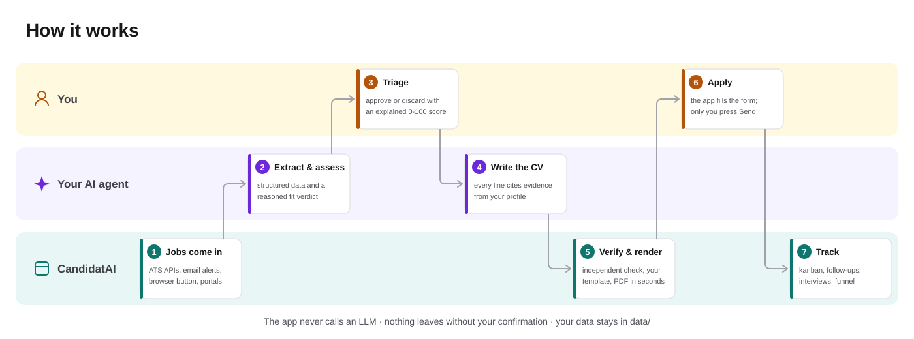
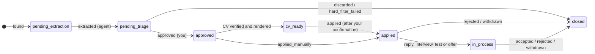

<p align="center">
  
</p>

<p align="center">
  <b>English</b> · <a href="README.es.md">Español</a>
</p>

<p align="center">
  <a href="LICENSE"></a>
  
  
  
  
  
  
</p>

**Job Hunter** is a local app that runs your whole job search: jobs come in from several sources,
you triage them with an explained score, each one gets a **tailored, verified CV and cover
letter**, the app fills the application form and **waits for you to press Send**, and then
tracks the process all the way to the offer.

**The app never calls an LLM.** The thinking (reading postings, judging fit, writing the CV) is
done by the AI agent you already use (Claude Code, Codex, Gemini CLI, Cursor…) through a
dedicated agent interface: MCP tools plus an equivalent `jh … --json` CLI. The app keeps the
state, the rules and the checks, so the agent can't invent your experience or send anything on its
own.

<p align="center">
  
  <br><sub>Triage with the keyboard. Everything you see is the <b>demo</b>: a fictional candidate, companies and jobs.</sub>
</p>

> [!NOTE]
> The user interface and most technical docs are in **Spanish** (it started as a personal project
> in Spain). This README, the [user guide](docs/GUIDE.md) and the code are in English.
> Watch the **[short video tour](docs/video/recorrido.mp4)**.

## Contents

- [Why](#why)
- [How it works](#how-it-works)
- [What it does](#what-it-does)
- [A closer look](#a-closer-look)
- [Try it in 5 minutes](#try-it-in-5-minutes)
- [Use it with your own data](#use-it-with-your-own-data)
- [Compatible agents](#compatible-agents)
- [Guarantees](#guarantees)
- [Compared with similar projects](#compared-with-similar-projects)
- [Architecture](#architecture)
- [Quality and evals](#quality-and-evals)
- [Documentation](#documentation)
- [How it was built](#how-it-was-built)
- [License and credits](#license-and-credits)

## Why

A good job search is a lot of repetitive work with judgment in the middle: reading dozens of
postings, dropping the ones that don't fit, adapting your CV to each one without inventing
anything, filling in forms, remembering to follow up and knowing what is actually working.

AI assistants help with each step on its own, but they have no memory and no state: every
conversation starts from scratch, nothing stops them from "improving" your CV with things you never
did, and a posting can carry hidden instructions aimed at the AI that reads it.

Job Hunter puts the state, the rules and the verification in a deterministic app, and leaves the
agent only what needs reasoning, always against your profile and with checks that don't depend on
the agent.

## How it works

<p align="center">
  
</p>

Each colour is who does the step: **you** decide, **your agent** reasons, **the app** stores,
checks and automates. A typical day:

1. Every morning the worker brings in new jobs (ATS APIs, email alerts, LinkedIn's public search if
   you enabled it).
2. You ask your agent to `procesar-ofertas` and `evaluar-encaje` (or launch them from the UI, in the
   background).
3. You triage with `J`/`K`, `A` and `D`.
4. `generar-cv 42` writes and verifies the CV for job 42; you pick the template, photo and colour
   in the UI, which costs no agent time.
5. You review the filled form and press Send. The app records it, archives what was sent and reminds
   you to follow up.

## What it does

| | |
|---|---|
| 📥 **Jobs from many sources** | Paste a URL or text; public APIs of Greenhouse, Lever and Ashby; InfoJobs and Adzuna with keys; **job alerts by email** (read-only IMAP); a **browser-extension button** for the page you're viewing; your agent browsing portals with your browser; and, opt-in, LinkedIn's public search. Deduplicated, with repost and "still open?" detection, and with **detection of text aimed at an AI** |
| 🎯 **Triage with an explained score** | Hard filters (level, years, remote mode, location, languages) and a 0-100 score from skill coverage, preferences and optional local semantic similarity. Your agent adds a reasoned verdict. "Does the score work?" compares it with real outcomes |
| 📄 **Tailored CV and cover letter** | The agent writes the content citing **evidence from your profile for every line**; the code validates it, renders it (Word or HTML → PDF) with your template, photo and colour, and a separate role verifies it. **Import your own CV design** (Word, PDF, image, Canva) as a template |
| 📝 **Assisted applications** | Fills Greenhouse, Lever, Ashby or generic forms, stops at captchas or logins, and **only submits after you confirm** by typing the company name |
| 📊 **Tracking and analytics** | A kanban that only moves through recorded events, milestones with `.ics` calendar, follow-up reminders, email replies classified into proposals you accept, and a funnel by source, role, week, template, cover letter and referral |
| 🎤 **Interviews and offers** | A day-by-day prep plan, mock interviews with feedback, debriefs that grow your STAR story bank, company research with sources, and a comparison of received offers against your minimum **without the agent ever seeing your minimum** |
| 🤝 **Network and messages** | Your LinkedIn connections (CSV export) matched to your jobs ("you know 2 people here"), LinkedIn messages (≤ 300 characters) and application emails as drafts you send yourself |
| 🧭 **Search strategy** | Aggregated skill gaps with a training plan, adjacent job titles to widen the search, a weekly retrospective and a review of your LinkedIn profile |

| Home | Triage |
|---|---|
| <picture><source media="(prefers-color-scheme: dark)" srcset="docs/img/dark/inicio.png"></picture> | <picture><source media="(prefers-color-scheme: dark)" srcset="docs/img/dark/por-revisar.png"></picture> |
| **Processes (kanban)** | **Funnel** |
|  |  |

## A closer look

<details open>
<summary><b>Tailored CV: same verified content, any design, in seconds</b></summary>
<br>
<p align="center"></p>

The agent writes the CV content once. In the job page you choose the template, photo (automatic
by country, with or without), accent colour and hidden sections, and press "Render": it takes
seconds and **uses no agent quota**. You can compare renders side by side and mark the one you'll
send. Your rules apply when you don't choose (for example, `ats-simple` without a photo for
Workday jobs or UK companies).
</details>

<details>
<summary><b>The job page</b>: extraction, fit breakdown, CV, cover letter, application package and process</summary>
<br>


</details>

<details>
<summary><b>CV templates</b>: built-in ones and yours, imported from any design</summary>
<br>

</details>

<details>
<summary><b>Skills</b>: what jobs ask for that you lack, and "it's the same as…" aliases</summary>
<br>

</details>

<details>
<summary><b>Sources</b>: target companies and portals your agent browses</summary>
<br>


</details>

<details>
<summary><b>Agent</b>: launch skills from the UI, in a terminal or in the background</summary>
<br>

</details>

## Try it in 5 minutes

You need **Windows 11** (other systems should work but aren't tested yet), [uv](https://docs.astral.sh/uv/),
**Node LTS** with **pnpm** and, for CV PDFs, **LibreOffice** or Playwright's Chromium.

```powershell
git clone https://github.com/DiegoPrieto23/job-search.git job-hunter; cd job-hunter
cd backend
uv sync
uv run playwright install chromium     # PDFs without LibreOffice
uv run jh demo seed                    # data-demo/: 60 jobs, 8 weeks of history, 2 CVs
$env:JH_DATA_DIR = "data-demo"; uv run jh serve
# in a second terminal
cd frontend; pnpm install; pnpm dev    # http://127.0.0.1:5173
```

The UI shows a "Modo demo" banner. The demo is deterministic and never touches `data/`, where your
real data would go. To try the skills on the demo, start your agent with `JH_DATA_DIR=data-demo`.

Step by step, including your own profile, email alerts and the browser extension:
**[User guide](docs/GUIDE.md)**.

## Use it with your own data

Your data lives in `data/`, outside git. Start `jh serve`, `jh worker` and `pnpm dev`, create your
profile with the `actualizar-perfil` skill, and then ask your agent:

| Skill | What it does |
|---|---|
| `actualizar-perfil` | Creates or updates `data/profile.yaml` (your single source of truth) from your CV, and versions it |
| `procesar-ofertas` | Extracts new jobs (the `extractor` role, isolated when the agent allows it) |
| `evaluar-encaje` | Assesses and explains the fit of jobs waiting for triage |
| `generar-cv 42` | Writes, renders and verifies the CV for job 42 |
| `generar-carta 42` | Cover letter following your instructions, verified; TXT and PDF matching the CV |
| `preparar-candidatura 42` | Screening answers and, if needed, the cover letter |
| `preparar-entrevista 42` | Interview dossier and a day-by-day plan up to the date |
| `simular-entrevista 42` | Mock interview: one question at a time, feedback and a better answer from your profile |
| `repasar-entrevista 42` | Debrief: notes, next steps, likely next round and new STAR stories |
| `preparar-negociacion 42` | Arguments, questions and a script for a received offer; reviews the contract. Never proposes a figure |
| `investigar-empresa 42` | Company dossier with sources (product, news, engineering culture, stack) |
| `redactar-mensaje 42` | LinkedIn message (≤ 300 characters) or application email, as a draft |
| `redactar-seguimiento` | Follow-up (max. 2 per application) and thank-you drafts |
| `revisar-respuestas` | Classifies company emails (interview with its date, test, offer, rejection) into proposals |
| `resumen-diario` | What's on today: pending work, overdue follow-ups, upcoming milestones |
| `atender-encargos` | Does what you left in the UI with "Leave for my next session" |
| `buscar-ofertas` | Browses the portals you approved with your browser and adds what fits |
| `ampliar-busqueda` | Suggests adjacent job titles ("Analytics Engineer") from what you approve |
| `revisar-busqueda` | Weekly retrospective: what works (score bands, sources, template, referrals) and what to change |
| `plan-formacion` | Training plan from your real skill gaps, with verified resources |
| `revisar-linkedin` | Improvement report for your LinkedIn profile, ready to copy |
| `importar-plantilla-cv` | Turns your CV (or any design) into a template for tailored CVs |

Skill names are in Spanish; invoke them as `/generar-cv 42` in Claude Code, `$generar-cv 42` in
Codex, or just ask in plain language.

### Where jobs come from

| Source | Automatic | Covers |
|---|---|---|
| Paste a URL or text | No | Any job |
| Public ATS APIs (Greenhouse, Lever, Ashby) | Daily | Your target companies (`jh sources discover` finds their boards) |
| Portal APIs (InfoJobs, Adzuna), with keys | Daily | Keyword searches |
| Job alerts by email (read-only IMAP or exported `.eml`) | Yes | LinkedIn, InfoJobs, Indeed, Tecnoempleo… |
| "Send to Job Hunter" browser button | One click | Any page you're viewing, LinkedIn included |
| Your agent browsing with your browser | On demand | Portals you approve; LinkedIn only if you enable it |
| LinkedIn's public search, without login | Daily, **off by default** | Your LinkedIn searches, at most once a day, with strict limits |

## Compatible agents

| Agent | Status |
|---|---|
| **Claude Code** | Reference: built and tested with it, with MCP and without (CLI only: 5/5 jobs extracted, assessed and with a CV passing the eval). Skills can also run **in the background** from the UI |
| **Codex** | Generated configuration (`.codex/`); not yet in the tested matrix |
| **Gemini CLI, Cursor, Copilot, OpenCode…** | Untested: they work if they read `AGENTS.md` and speak MCP or run commands |

Skills, roles (sub-agents) and the agent manifest are written once in `.agents/` and generated
for each agent with `scripts/sync_agents.py`. Details and how to add an agent:
[`docs/AGENTS_COMPAT.md`](docs/AGENTS_COMPAT.md) (Spanish).

## Guarantees

These are rules enforced by code, not promises made by the agent:

- **Nothing leaves without your confirmation.** The app fills forms and stops; submitting takes
  your click, application by application, with a single-use token. Messages and emails are drafts.
- **No made-up experience.** Every CV claim must point to evidence in your profile that exists, or
  the code rejects it; an independent verifier role reviews the rest.
- **Untrusted content stays data.** Text from postings, emails and websites is never treated as
  instructions. Hidden text and phrases aimed at an AI are detected and flagged in the UI.
- **Your data stays with you.** Everything lives in `data/` (outside git). The agent never receives
  your email, phone or salary minimum.
- **LinkedIn and captchas.** No automated applications on LinkedIn, and captchas are never solved or
  bypassed. Searching LinkedIn (with your browser, or its public search) only happens if you turn it
  on in the UI.

## Compared with similar projects

Job Hunter borrows the best ideas of two great open projects,
[AI Job Search](https://github.com/MadsLorentzen/ai-job-search) and
[career-ops](https://github.com/career-ops-hq/career-ops), and turns them into an app with state.

| | Job Hunter | AI Job Search | career-ops |
|---|:---:|:---:|:---:|
| Full web UI (triage, kanban, funnel…) | ✅ | ❌ | 🟡 terminal |
| MCP + CLI with tested parity | ✅ | ❌ | ❌ |
| CV claims checked by code against your profile | ✅ | 🟡 | 🟡 |
| Use your own CV design (Word, PDF, image) | ✅ | 🟡 LaTeX | 🟡 LaTeX |
| Fills application forms (you submit) | ✅ | ❌ | 🟡 answers only |
| Email alerts and browser button as sources | ✅ | ❌ | ❌ |
| Score calibration against outcomes | ✅ | ❌ | ✅ |
| Received offers without exposing your minimum | ✅ | ❌ | 🟡 |
| Many ATS and job boards out of the box | 🟡 5 | 🟡 | ✅ 55+ |
| Parallel batch evaluation | 🟡 | ✅ | ✅ |
| One-command install, macOS/Linux, Docker | ❌ | 🟡 | ✅ |
| README in several languages | 🟡 2 | ❌ | ✅ 17 |

Full feature-by-feature comparison, what's missing and what we'll never do (and which rule forbids
it): [`docs/COMPARATIVA.md`](docs/COMPARATIVA.md) (Spanish).

## Architecture


- **Thin layers.** API, MCP and CLI only translate; the logic lives in `app/services/` and is tested
  there. Every MCP tool has a `jh … --json` command with the same input and output (a test checks
  it), so an agent without MCP can do exactly the same.
- **Events are the source of truth.** Every change to a job is an event validated against a
  transition table; the current stage is a projection that can be rebuilt.
- **The agent never writes directly.** It fills strict Pydantic schemas (`JobExtraction`,
  `CvContent`…) that the code validates, with each CV claim tied to its evidence.



<details>
<summary><b>Key decisions</b> (33 ADRs in <code>docs/DECISIONS.md</code>)</summary>

| Decision | Why |
|---|---|
| No LLM API: your agent does the reasoning | No extra cost or keys; it works with the subscription you already have |
| Neutral agent interface: MCP + CLI with parity | Any agent that speaks MCP or runs commands works |
| `.agents/` as the single source, native config generated | A skill is written once and generated for Claude Code, Codex… |
| Security that doesn't depend on the agent | Injection detection, validation and an interface that can't send anything, with any agent |
| Events as the source of truth | Full history, reliable analytics and states that don't get corrupted |
| CV content and presentation kept apart | Changing template, photo or colour doesn't spend agent quota again |
| LinkedIn only through alerts, your clicks or opt-in features | Respects your account; the app prepares and you finish |
| SQLite, native on Windows | A personal app: no servers, no Docker |
| Optional local embeddings | Better matching without sending your data anywhere |
</details>

## Quality and evals

- **Tests:** 2,351 backend tests (pytest, ≥ 85 % coverage enforced on `services/`) and 230
  frontend tests (Vitest). CI on Windows (backend) and Linux (frontend), plus a check that the
  generated agent configuration is up to date and a demo seed as smoke test.
- **Matching eval** (80 fictional cases, no embeddings): precision **0.88**, recall **0.95**,
  F1 **0.92** at the default triage threshold. Typical errors and why:
  [`evals/REPORT.md`](evals/REPORT.md).
- **CV eval** (`jh eval cv`): 7 automatic checks on the CVs an agent leaves (evidence exists, no
  invented or unrequested skills, one page, keyword coverage, language and independent
  verification).

## Documentation

| I want to… | Read |
|---|---|
| Install it and use it day to day | [User guide](docs/GUIDE.md) · [Guía de uso](docs/GUIA.md) |
| See how it compares with similar projects | [`docs/COMPARATIVA.md`](docs/COMPARATIVA.md) |
| Understand the architecture and the data model | [`docs/ARCHITECTURE.md`](docs/ARCHITECTURE.md), [`docs/DATA_MODEL.md`](docs/DATA_MODEL.md) |
| Know the rules (truthfulness, privacy, applying) | [`docs/POLICIES.md`](docs/POLICIES.md) |
| Set up job sources and email alerts | [`docs/FUENTES_OFERTAS.md`](docs/FUENTES_OFERTAS.md), [`docs/CONFIGURAR_CORREO.md`](docs/CONFIGURAR_CORREO.md) |
| Work with CV templates | [`docs/CV_TEMPLATES.md`](docs/CV_TEMPLATES.md) |
| Connect another agent | [`docs/AGENTS_COMPAT.md`](docs/AGENTS_COMPAT.md), [`docs/AGENT_INTERFACE.md`](docs/AGENT_INTERFACE.md) |
| Contribute | [`CONTRIBUTING.md`](CONTRIBUTING.md) |

All documents, grouped: [`docs/README.md`](docs/README.md). Technical docs are in Spanish.

## How it was built

In 22 phases (with sub-phases), each with its brief in `prompts/`, implemented with an AI agent
(Claude Code) against a specification written before the code: a plan, a branch per phase, tests,
a review by a `revisor` role, and a log of decisions and debt. The phase log is in
[`docs/ROADMAP.md`](docs/ROADMAP.md) and the method in
[`docs/DESARROLLO_POR_FASES.md`](docs/DESARROLLO_POR_FASES.md).

## License and credits

[MIT](LICENSE) © 2026 Diego Prieto.

Inspired by [ackyer/job-search-agent-template](https://github.com/ackyer/job-search-agent-template)
(MIT), and by ideas from [AI Job Search](https://github.com/MadsLorentzen/ai-job-search) and
[career-ops](https://github.com/career-ops-hq/career-ops) (both MIT). Not affiliated with
Anthropic, OpenAI, LinkedIn or any job portal.
