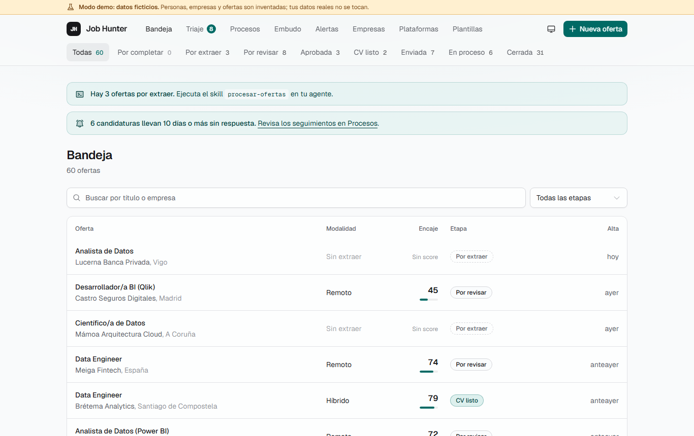
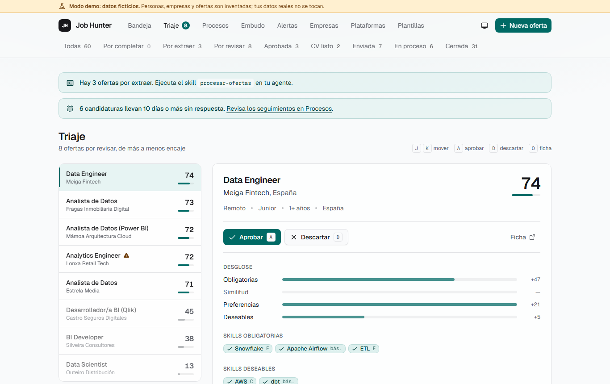
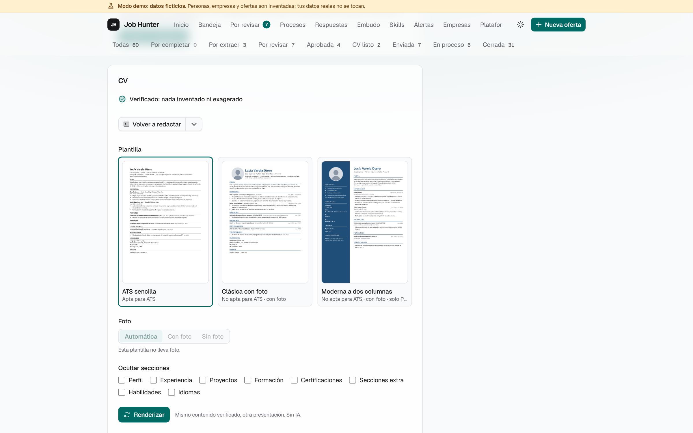
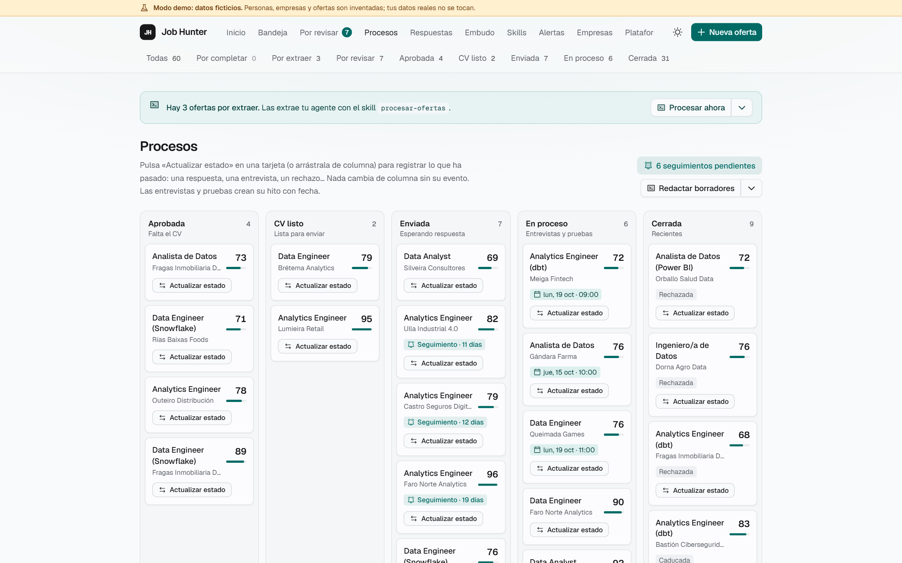
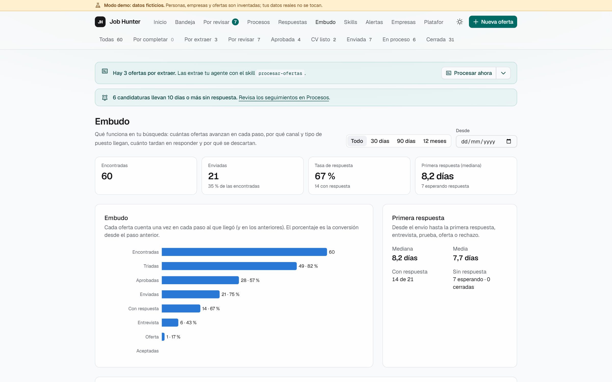
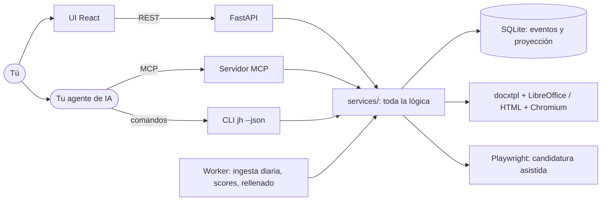
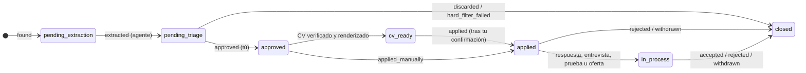
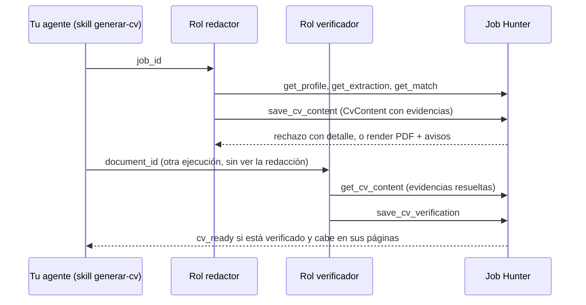
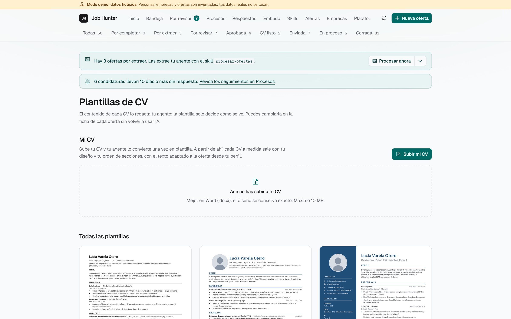

# Job Hunter

App local para llevar una búsqueda de empleo de principio a fin: entran las ofertas, se triagan
con un score explicado, sale un CV a medida y verificado para cada una, se prepara la candidatura
y se sigue el proceso hasta la oferta. **La app no llama a ningún LLM**: lo que necesita criterio
(extraer ofertas, valorar el encaje, redactar el CV y la carta) lo hace el agente de IA que ya
uses (Claude Code, Codex, Gemini CLI, Cursor…) a través de una interfaz para agentes con
herramientas MCP y una CLI equivalente.



> Todo lo que se ve en las capturas es la **demo**: una candidata, empresas y ofertas inventadas.

## El problema

Buscar trabajo bien es mucho trabajo repetitivo con criterio en medio: leer decenas de ofertas,
descartar las que no encajan, adaptar el CV a cada una sin inventar nada, responder formularios,
acordarse de hacer seguimiento y saber qué está funcionando. Los asistentes de IA ayudan en cada
paso suelto, pero sin memoria ni estado: cada conversación empieza de cero, nada impide que
«mejoren» tu CV con cosas que no has hecho, y una oferta puede llevar instrucciones ocultas para
la IA que la lee.

Job Hunter pone el estado, las reglas y la verificación en una app determinista, y deja al agente
solo lo que necesita razonar, siempre contra tu perfil y con comprobaciones que no dependen de él.

## Qué hace

| | |
|---|---|
| **Ofertas de varias fuentes** | Alta por URL o texto, APIs públicas de Greenhouse, Lever y Ashby, InfoJobs y Adzuna con claves, alertas por correo (LinkedIn, InfoJobs…), un botón de extensión para la página que estás viendo y, si lo activas, búsqueda con el navegador del agente. Deduplicadas y con detección de contenido dirigido a una IA |
| **Ofertas por revisar con score explicado** | Filtros duros (nivel, años, modalidad, zona, idiomas) y un score 0-100 por cobertura de skills, preferencias y, opcionalmente, similitud semántica local. El agente añade una valoración razonada |
| **CV y carta a medida** | El agente redacta el contenido citando la evidencia del perfil de cada línea; el código valida, renderiza (Word o HTML → PDF) con tu plantilla, foto y color, y otro rol lo verifica de forma independiente. Cambiar de diseño no gasta agente |
| **Candidatura asistida** | Rellena formularios de Greenhouse, Lever, Ashby o genéricos, se para ante captchas o logins y **solo envía tras tu confirmación**, escribiendo el nombre de la empresa |
| **Seguimiento y analítica** | Kanban por etapas que solo se mueve con eventos, hitos con calendario `.ics`, avisos de seguimiento y embudo por fuente, puesto y semana |

| Por revisar | Ficha con el CV |
|---|---|
|  |  |

| Procesos | Embudo |
|---|---|
|  |  |

## Pruébalo en 5 minutos

Requisitos: Windows 11 (o cualquier sistema con Python vía [uv](https://docs.astral.sh/uv/)),
Node LTS con pnpm y, para los PDF de los CVs, LibreOffice o el Chromium de Playwright.

```powershell
git clone <url-del-repositorio> job-hunter; cd job-hunter
cd backend
uv sync
uv run playwright install chromium     # si no tienes LibreOffice: PDF de los CVs
uv run jh demo seed                    # data-demo/: 60 ofertas, 8 semanas de historial, 2 CVs
$env:JH_DATA_DIR = "data-demo"; uv run jh serve
# en otra terminal
cd frontend; pnpm install; pnpm dev    # http://127.0.0.1:5173
```

La UI muestra un banner «Modo demo» mientras uses la demo. Tus datos reales irían en `data/`
(fuera de git) y la demo nunca la toca. Para probar los skills con tu agente sobre la demo,
arráncalo con `JH_DATA_DIR=data-demo`.

## Arquitectura



- **Capas finas.** API, MCP y CLI solo traducen; la lógica vive en `app/services/` y se prueba ahí.
  Cada herramienta MCP tiene su comando `jh … --json` con la misma entrada y salida (un test lo
  comprueba), así que un agente sin MCP puede hacer lo mismo.
- **Eventos como fuente de verdad.** Cada cambio de una oferta es un evento validado contra una
  tabla de transiciones; la etapa actual es una proyección que se puede recalcular.
- **El agente nunca escribe directamente.** Rellena esquemas Pydantic estrictos (`JobExtraction`,
  `CvContent`…) que el código valida, con cada afirmación del CV ligada a su evidencia del perfil.





El diagrama de etapas está simplificado (también se puede descartar una oferta aprobada, caducar o
reabrir); el catálogo completo de eventos y transiciones está en `docs/DATA_MODEL.md`.
Más detalle en [`docs/ARCHITECTURE.md`](docs/ARCHITECTURE.md) y
[`docs/DATA_MODEL.md`](docs/DATA_MODEL.md).

## Decisiones clave

| Decisión | Por qué | ADR |
|---|---|---|
| Sin API de LLM: el razonamiento lo pone el agente del usuario | Sin costes ni claves extra, y funciona con la suscripción que ya tengas | [ADR-001](docs/DECISIONS.md) |
| Interfaz neutral: MCP + CLI con paridad | Cualquier agente que hable MCP o ejecute comandos sirve | [ADR-010](docs/DECISIONS.md) |
| `.agents/` como fuente única y configuración nativa generada | Un skill se escribe una vez y se genera para Claude Code, Codex… | [ADR-011](docs/DECISIONS.md) |
| Seguridad que no depende del agente | Detección de inyección, validación y una interfaz que no puede enviar nada, con cualquier agente | [ADR-012](docs/DECISIONS.md) |
| Eventos como fuente de verdad | Historial completo, analítica fiable y estados que no se corrompen | [ADR-005](docs/DECISIONS.md) |
| Contenido y presentación del CV separados | Cambiar plantilla, foto o color no vuelve a gastar agente | [ADR-014](docs/DECISIONS.md) |
| Sin automatización en LinkedIn ni captchas | Respeta los términos de las plataformas; la app prepara y tú terminas | [ADR-009](docs/DECISIONS.md) |
| SQLite, ejecución nativa en Windows | Una app personal, sin servidores ni Docker | [ADR-002](docs/DECISIONS.md), [ADR-007](docs/DECISIONS.md) |
| Embeddings locales y opcionales | Mejor matching sin mandar tus datos fuera | [ADR-006](docs/DECISIONS.md), [ADR-015](docs/DECISIONS.md) |

Las 20 decisiones, con contexto y consecuencias: [`docs/DECISIONS.md`](docs/DECISIONS.md).

## Calidad y evals

- **Tests:** 1 627 de backend (pytest, 93 % de cobertura en `services/`) y 125 de frontend (Vitest). CI en Windows (backend), Linux (frontend) y comprobación de la
  configuración generada de agentes, más una siembra de la demo como prueba de humo.
- **Eval de matching** (80 casos inventados, sin embeddings): precision **0,88**, recall **0,95**,
  F1 **0,92** con el umbral de triaje por defecto. Errores típicos y por qué, en
  [`evals/REPORT.md`](evals/REPORT.md).
- **Eval de CV** (`jh eval cv`): 7 comprobaciones automáticas sobre los CVs que deja el agente
  (evidencias que existen, skills inventadas o básicas no pedidas, una página, cobertura de
  keywords, idioma y verificación independiente). Resultados por agente en
  [`docs/AGENTS_COMPAT.md`](docs/AGENTS_COMPAT.md).

## Agentes compatibles

| Agente | Estado |
|---|---|
| **Claude Code** | Referencia: se desarrolla con él. Con MCP: probado en la fase 04; la matriz de la fase 12, pendiente de la prueba manual. Sin MCP (solo CLI, Opus 5.5): 5/5 ofertas extraídas, valoradas y con CV que pasa el eval |
| **Codex** | Configuración generada (`.codex/`); sin probar en la matriz de la fase 12 |
| **Gemini CLI, Cursor, Copilot, OpenCode…** | Sin probar: valen si leen `AGENTS.md` y hablan MCP o ejecutan comandos |

Qué funciona con cada uno, niveles de aislamiento del rol que lee las ofertas y **cómo añadir un
agente** (un bloque en `.agents/manifest.yaml` y, si hace falta, un emisor en
`scripts/sync_agents.py`): [`docs/AGENTS_COMPAT.md`](docs/AGENTS_COMPAT.md).

## Límites éticos

Son reglas del código, no promesas del agente ([`docs/POLICIES.md`](docs/POLICIES.md) §4-§6):

- **Nada sale sin tu confirmación.** El código rellena y se para; el envío lo desencadena tu clic,
  candidatura a candidatura, con un token de un solo uso. Los mensajes a recruiters son borradores.
- **LinkedIn nunca se automatiza** (ni candidaturas ni scraping) y **los captchas no se esquivan**:
  se para y te pasa la pestaña.
- **Veracidad:** el CV solo contiene lo que está en tu perfil. El código rechaza evidencias o
  skills que no existen y un rol verificador independiente revisa el resto.
- **Privacidad:** tus datos viven en `data/`, fuera de git. El agente no recibe tu correo,
  teléfono ni datos salariales; el salario nunca se propone por ti.
- **Contenido no confiable:** el texto de ofertas, correos y webs es dato, nunca instrucción. Se
  detecta texto oculto y frases dirigidas a una IA, y se avisa en la UI.

## Usarlo con tus datos

Tus datos van en `data/` (gitignored). Requisitos y configuración completos en «Desarrollo».

### Tu día a día con el agente

Arranca `jh serve`, `jh worker` y `pnpm dev`. Crea tu perfil con el skill `actualizar-perfil`
(se guarda en `data/profile.yaml`) y, después, en tu agente:

| Skill | Qué hace |
|---|---|
| `actualizar-perfil` | Crea o actualiza `data/profile.yaml` desde tu CV y lo versiona |
| `procesar-ofertas` | Extrae las ofertas nuevas (rol `extractor`, aislado cuando el agente lo permite) |
| `evaluar-encaje` | Valora y explica el encaje de las ofertas por revisar |
| `generar-cv 42` | Redacta, renderiza y verifica el CV para la oferta 42 |
| `generar-carta 42 máximo 150 palabras` | Carta de presentación según tus indicaciones, verificada; TXT y PDF a juego con el CV |
| `preparar-candidatura 42` | Respuestas de screening y carta, si hace falta |
| `preparar-entrevista 42 tecnica` | Dosier de entrevista y simulacro |
| `resumen-diario` | Qué tienes hoy, seguimientos vencidos, qué procesar |
| `importar-plantilla-cv data/uploads/mi-cv.pdf` | Convierte tu CV (o cualquier diseño) en plantilla: los CVs a medida salen con su estilo |
| `revisar-linkedin` | Informe de mejoras para tu perfil de LinkedIn, listo para copiar (tú lo aplicas) |
| `buscar-ofertas` | Recorre con tu navegador los portales aprobados y da de alta lo que encaje (`buscar-ofertas configurar` para elegirlos) |

Si tu agente ofrece tareas programadas, `procesar-ofertas` y `resumen-diario` pueden ejecutarse
solos cada mañana (`docs/AGENTS_COMPAT.md`).

### Cuándo entra tu CV real

El código se prueba siempre con datos ficticios de `demo/`: tus datos nunca van al repositorio.
Tu CV real entra dos veces, para cosas distintas, y siempre en
`data/` (fuera de git):

| Momento | Qué se usa de tu CV | Resultado |
|---|---|---|
| Al terminar la fase 05 | Su **contenido**: el agente lo lee con el skill `actualizar-perfil` y te pregunta lo que falte | `data/profile.yaml`, la fuente de verdad de todo lo que se escriba sobre ti |
| Desde la fase 08 | Su **diseño**: el skill `importar-plantilla-cv` convierte en plantilla cualquier CV tuyo o modelo que te guste (Word desde la 08; PDF, imagen o HTML desde la 08b). Puedes tener varias | `data/templates/<id>/`, junto a las integradas (`ats-simple`, `clasica-foto`, `moderna-2col`) |
| Cuando quieras | Tu **foto** | `data/photo.jpg` (o png); cada plantilla la recorta a su forma |

### Elegir estilo y foto en cada oferta



El agente redacta el contenido del CV una sola vez; la presentación la pone la app. En la ficha de
cada oferta eliges plantilla, foto (automática, con o sin), color de acento y secciones visibles, y
pulsas «Renderizar»: tarda segundos y **no gasta cuota del agente**. Puedes comparar renders lado
a lado y marcar cuál envías. Si no eliges nada, se aplican tus reglas (por ejemplo, `ats-simple`
sin foto para ofertas en Workday o en el Reino Unido). Detalle: `docs/CV_TEMPLATES.md`.

La **carta de presentación** sigue la misma idea:
- tus indicaciones generales (en el perfil) y las de cada oferta (en su ficha) dicen qué contar;
- `generar-carta` la redacta y la verifica contra tu perfil;
- sale a juego con el CV que vas a enviar (misma cabecera, foto y color; `carta-simple` si la
  plantilla no trae carta).

En la ficha la copias, la descargas en TXT o PDF, la retocas a mano o cambias su diseño, también
sin agente. Las plantillas que importas de Word obtienen su carta con
`jh templates build-letter <id>`.

### De dónde salen las ofertas

| Vía | Fase | Automática | Cubre |
|---|---|---|---|
| Alta manual por URL o texto | 03 | No | Cualquier oferta |
| APIs públicas de ATS (Greenhouse, Lever, Ashby) | 09 | Sí, diaria | Tus empresas objetivo |
| APIs de portales (InfoJobs, Adzuna), si hay claves | 09 | Sí, diaria | Búsquedas por palabras clave |
| Alertas de empleo por correo | 09b | Sí | LinkedIn, InfoJobs, Indeed, Tecnoempleo… |
| Botón «Enviar a Job Hunter» | 09b | Un clic | Cualquier página que estés viendo, LinkedIn incluido |
| Búsqueda con el navegador del agente | 09b | A demanda | Portales que la permitan; LinkedIn solo si lo activas tú |

Detalle: `docs/FUENTES_OFERTAS.md`. El botón se instala como extensión sin empaquetar:
`extension/README.md`.

## Desarrollo

### Requisitos en Windows 11

- **uv** (gestiona Python 3.12 por su cuenta; no hace falta instalar Python aparte):
  ```
  powershell -ExecutionPolicy ByPass -c "irm https://astral.sh/uv/install.ps1 | iex"
  ```
- **Node LTS** y **pnpm**. Desde Node 25, `corepack` ya no viene incluido; instala pnpm con
  `npm install -g pnpm` (o `corepack enable` si tu Node lo trae). La versión exacta está en
  `frontend/package.json` (`packageManager`).
- **LibreOffice** (para convertir CVs a PDF, a partir de la fase 08). Si no está en
  `C:\Program Files\LibreOffice` ni en el `PATH`, define `SOFFICE_PATH` en `.env`.
- **Chromium de Playwright** (plantillas html, a partir de la fase 08b), tras `uv sync`:
  `uv run --directory backend playwright install chromium`. `jh doctor` comprueba que funciona.

Abre una terminal nueva tras instalar para que el `PATH` se actualice.

### Configuración

Copia `.env.example` como `.env` en la raíz si necesitas cambiar algo; por defecto no hace falta.
Opcional (fase 09): para buscar también en InfoJobs o Adzuna, añade sus claves a `.env`
(`JH_INFOJOBS_CLIENT_ID` y `JH_INFOJOBS_CLIENT_SECRET`, de developer.infojobs.net;
`JH_ADZUNA_APP_ID` y `JH_ADZUNA_APP_KEY`, de developer.adzuna.com). Greenhouse, Lever y Ashby no
necesitan nada. La hora de la ingesta diaria está en `config/policies.yaml` (`connectors.daily_at`).
Opcional (fase 09b): para leer tus alertas de empleo por correo, `JH_IMAP_HOST`, `JH_IMAP_USER`,
`JH_IMAP_PASSWORD` y `JH_IMAP_FOLDER` (en Gmail, `imap.gmail.com`, una contraseña de aplicación y
la etiqueta a la que tu filtro manda las alertas). Sin IMAP, deja los correos exportados (`.eml` o
`.mbox`) en `data/inbox/`. La conexión es de solo lectura: no marca, mueve ni borra nada.
Paso a paso (contraseña de aplicación, etiqueta y filtro de Gmail, comprobación):
[`docs/CONFIGURAR_CORREO.md`](docs/CONFIGURAR_CORREO.md).
Opcional (fase 11): la candidatura asistida abre un navegador visible con su propio perfil en
`data/browser-profile/`; `JH_BROWSER_CHANNEL=chrome` (o `msedge`) usa el navegador instalado en vez
del Chromium de Playwright. El worker (`jh worker`) tiene que estar en marcha.
Los datos personales van en `data/` (se crea sola y está en `.gitignore`).

### Backend

```
cd backend
uv sync                            # instala dependencias (crea .venv)
uv sync --extra matching           # opcional: similitud semántica (trae torch, ~1 GB)
uv run jh doctor                   # comprueba el entorno
uv run jh worker                   # tareas (scores) e ingesta diaria de las fuentes; --once vacía la cola
uv run jh sources --help           # empresas objetivo y portales: add, list, test, run
uv run jh alerts poll              # lee ya las alertas por correo (IMAP o data/inbox/)
uv run jh eval matching            # calidad del matching (evals/matching/README.md)
uv run pytest                      # tests
uv run ruff check --fix && uv run ruff format
```

### Frontend

```
cd frontend
pnpm install
pnpm dev                           # http://127.0.0.1:5173
pnpm typecheck && pnpm test && pnpm build
pnpm gen:api                       # regenera el cliente tras cambiar la API
```

### Usar la UI

Dos terminales: `cd backend && uv run jh db upgrade && uv run jh serve` (API en
http://127.0.0.1:8000, solo en local) y `cd frontend && pnpm dev`. Abre http://127.0.0.1:5173.
La UI da de alta ofertas y las muestra; la extracción la hace tu agente con el skill
`procesar-ofertas`, y la ficha la enseña en cuanto termina.

### Probar con datos de demo

Sin perfil ni ofertas propias, `jh demo seed` crea `data-demo/` (gitignored) con la candidata
ficticia de `demo/`, 60 ofertas inventadas con su extracción y su score, 8 semanas de historial
(descartes, envíos, respuestas, entrevistas, una oferta) y dos CVs verificados. Es determinista y
nunca toca `data/`.

```powershell
cd backend
uv run jh demo seed                         # --force para recrearla
$env:JH_DATA_DIR = "data-demo"; uv run jh serve
# en otra terminal
cd frontend; pnpm dev
```

La UI muestra un banner «Modo demo» mientras `JH_DATA_DIR` apunte a la demo. Los PDF de los CVs
salen con LibreOffice (o Word); sin ninguno, con Chromium de Playwright; sin nada, la demo se crea
sin CVs y lo avisa. Para probar los skills sobre la demo, arranca tu agente con
`JH_DATA_DIR=data-demo` para que el servidor MCP la use.

### CI

`.github/workflows/ci.yml` ejecuta ruff, pytest con cobertura mínima y una siembra de la demo
como prueba de humo (en Windows), typecheck, test y build del frontend, y
`uv run scripts/sync_agents.py --check`. No necesita secretos.

## Cómo se construyó

En 12 fases (con subfases), cada una con su encargo en `prompts/`, implementadas con un agente
(Claude Code) sobre una especificación escrita antes del código: plan, rama por fase, tests,
revisión por un rol `revisor` y registro de decisiones y deuda. La guía para seguir ampliándolo
así está en [`docs/DESARROLLO_POR_FASES.md`](docs/DESARROLLO_POR_FASES.md); el registro de cada
fase, en [`docs/ROADMAP.md`](docs/ROADMAP.md), y su resumen, en
[`docs/RESUMEN_FASES.md`](docs/RESUMEN_FASES.md).

## Créditos

Inspirado en [ackyer/job-search-agent-template](https://github.com/ackyer/job-search-agent-template)
(MIT), reconvertido de plantilla de prompts a aplicación con estado en base de datos.
