<p align="center">
  
</p>

<p align="center">
  <b>English</b> · <a href="README.es.md">Español</a>
</p>

<p align="center">
  <a href="https://github.com/DiegoPrieto23/candidatai/actions/workflows/ci.yml"></a>
  <a href="https://github.com/DiegoPrieto23/candidatai/releases/latest"></a>
  <a href="LICENSE"></a>
  
  
  
  
  
</p>

**CandidatAI** is a local app that runs your whole job search: jobs come in from several sources,
you triage them with an explained score, each one gets a **tailored, verified CV and cover
letter**, the app fills the application form and **waits for you to press Send**, and then
tracks the process all the way to the offer.

**The app never calls an LLM.** The thinking (reading postings, judging fit, writing the CV) is
done by the AI agent you already use (Claude Code, Codex, OpenCode, Qwen Code…) through a
dedicated agent interface: MCP tools plus an equivalent `cai … --json` CLI. The app keeps the
state, the rules and the checks, so the agent can't invent your experience or send anything on its
own.

<!--
  Your search in numbers (phase 25.6). `cai stats story` or the "Your search in numbers" card in
  the Funnel gives you this line with your real figures: aggregated counts only, no companies.
  To publish it, paste it below, write what worked in one line and remove this comment.

> **My search with CandidatAI** (D Mon YYYY → D Mon YYYY, N weeks): N postings evaluated,
> N approved, N applications, N replies, N interviews, N offers.
> What worked: …
-->

<p align="center">
  
  <br><sub>Triage with the keyboard. Everything you see is the <b>demo</b>: a fictional candidate, companies and jobs.</sub>
</p>

> [!NOTE]
> The user interface is in **English and Spanish** (switch from the sidebar). Most technical docs
> are in Spanish (it started as a personal project in Spain); this README, the
> [user guide](docs/GUIDE.md) and the code are in English.
> Watch the **[short video tour](docs/video/tour-en.mp4)**.

## Contents

- [Why](#why)
- [How it works](#how-it-works)
- [What it does](#what-it-does)
- [A closer look](#a-closer-look)
- [Try it in 5 minutes](#try-it-in-5-minutes)
- [Use it with your own data](#use-it-with-your-own-data)
- [Compatible agents](#compatible-agents)
- [Guarantees](#guarantees)
- [Architecture](#architecture)
- [Quality and evals](#quality-and-evals)
- [Documentation](#documentation)
- [How it was built](#how-it-was-built)
- [License and credits](#license-and-credits)

## Why

A good job search is a lot of repetitive work with judgment in the middle: reading dozens of
postings, dropping the ones that don't fit, adapting your CV to each one without inventing
anything, filling in forms, remembering to follow up and knowing what is actually working.

AI assistants help with each step on its own, but they have no memory and no state: every
conversation starts from scratch, nothing stops them from "improving" your CV with things you never
did, and a posting can carry hidden instructions aimed at the AI that reads it.

CandidatAI puts the state, the rules and the verification in a deterministic app, and leaves the
agent only what needs reasoning, always against your profile and with checks that don't depend on
the agent.

## How it works

<p align="center">
  
</p>

Each colour is who does the step: **you** decide, **your agent** reasons, **the app** stores,
checks and automates. A typical day:

1. Every morning the worker brings in new jobs (ATS APIs, email alerts, LinkedIn's public search if
   you enabled it).
2. You ask your agent to `process-jobs` and `assess-fit` (or launch them from the UI, in the
   background).
3. You triage with `J`/`K`, `A` and `D`.
4. `generate-cv 42` writes and verifies the CV for job 42; you pick the template, photo and colour
   in the UI, which costs no agent time.
5. You review the filled form and press Send. The app records it, archives what was sent and reminds
   you to follow up.

## What it does

| | |
|---|---|
| 📥 **Jobs from many sources** | Paste a URL or text; public APIs and feeds of Greenhouse, Lever, Ashby, Personio, Teamtailor, Workable, SmartRecruiters and Recruitee; InfoJobs and Adzuna with keys, Manfred and freehire.me without; **job alerts by email** (read-only IMAP); a **browser-extension button** for the page you're viewing; your agent browsing portals with your browser; and, opt-in, LinkedIn's public search. Deduplicated, with repost and "still open?" detection, and with **detection of text aimed at an AI** |
| 🎯 **Triage with an explained score** | Hard filters (level, years, remote mode, location, languages) and a 0-100 score from skill coverage, preferences and optional local semantic similarity. Your agent adds a reasoned verdict. "Is the score right?" compares it with real outcomes |
| 📄 **Tailored CV and cover letter** | The agent writes the content citing **evidence from your profile for every line**; the code validates it, renders it (Word or HTML → PDF) with your template, photo and colour, and a separate role verifies it. **Import your own CV design** (Word, PDF, image, Canva) as a template |
| 📝 **Assisted applications** | Fills Greenhouse, Lever, Ashby or generic forms, stops at captchas or logins, and **only submits after you confirm** by typing the company name |
| 📊 **Tracking and analytics** | A kanban that only moves through recorded events, milestones with `.ics` calendar, follow-up reminders, email replies classified into proposals you accept, and a funnel by source, role, week, template, cover letter and referral, plus your whole search in numbers to share (`cai stats story`) |
| 🎤 **Interviews and offers** | A day-by-day prep plan, mock interviews with feedback, debriefs that grow your STAR story bank, company research with sources, and a comparison of received offers against your minimum **without the agent ever seeing your minimum** |
| 🤝 **Network and messages** | Your LinkedIn connections (CSV export) matched to your jobs ("you know 2 people here"), LinkedIn messages (≤ 300 characters) and application emails as drafts you send yourself |
| 🧭 **Search strategy** | Aggregated skill gaps with a training plan, adjacent job titles to widen the search, a weekly retrospective and a review of your LinkedIn profile |

**Every feature, page by page and skill by skill:** [`docs/FEATURES.md`](docs/FEATURES.md). It
includes what this summary leaves out: the calendar, company replies, alerts from several mailboxes,
"My profile" editable from the UI with your search preferences, platform priorities, discarding
from the Inbox with Undo and the help on every agent button.

| Home | To review (triage) |
|---|---|
| <picture><source media="(prefers-color-scheme: dark)" srcset="docs/img/en/dark/home.png">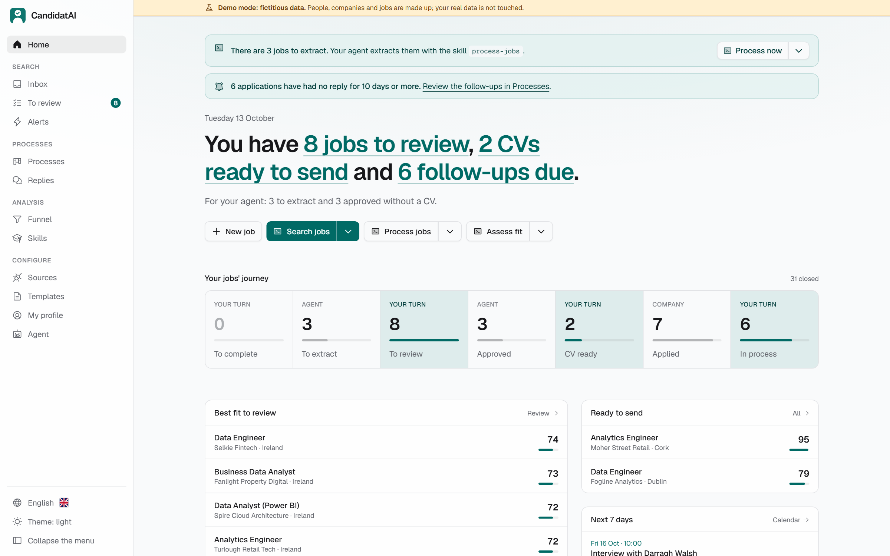</picture> | <picture><source media="(prefers-color-scheme: dark)" srcset="docs/img/en/dark/triage.png">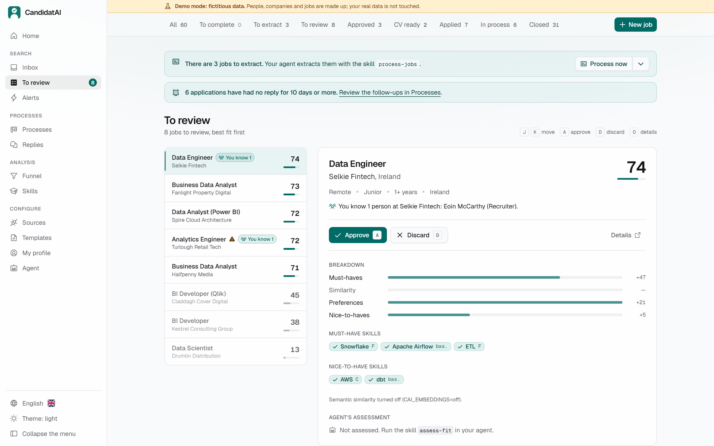</picture> |
| **Processes (kanban)** | **Funnel** |
| 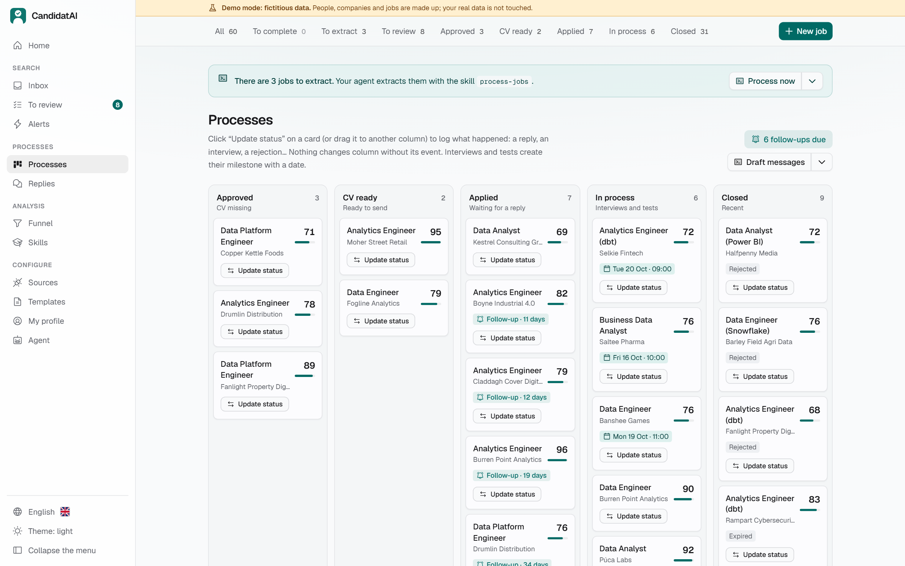 | 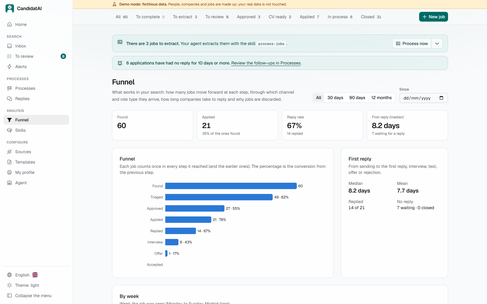 |

## A closer look

<details open>
<summary><b>Tailored CV: same verified content, any design, in seconds</b></summary>
<br>
<p align="center"></p>

The agent writes the CV content once. In the job page you choose the template, photo (automatic
by country, with or without), accent colour and hidden sections, and press "Render": it takes
seconds and **uses no agent quota**. You can compare renders side by side and mark the one you'll
send. Your rules apply when you don't choose (for example, `ats-simple` without a photo for
Workday jobs or UK companies).
</details>

<details>
<summary><b>The job page</b>: extraction, fit breakdown, CV, cover letter, application package and process</summary>
<br>
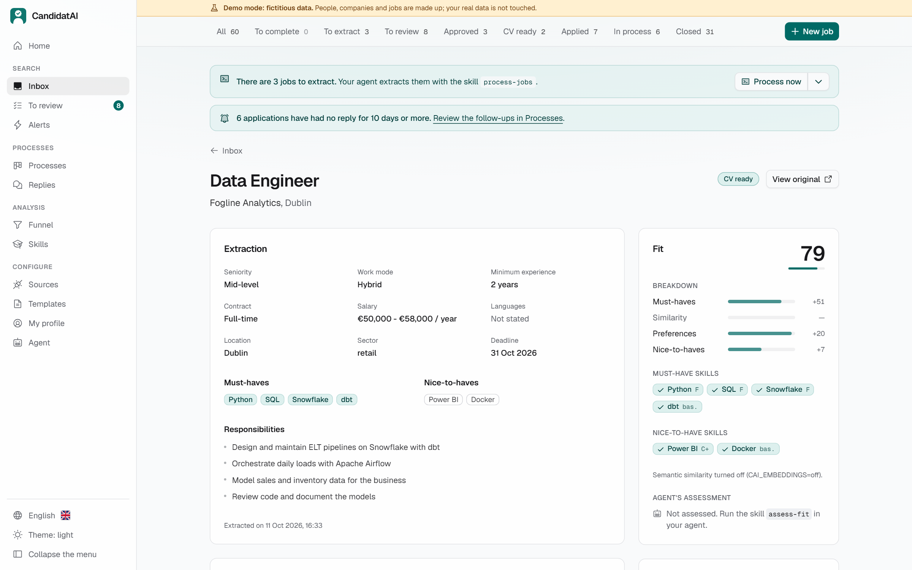
<picture><source media="(prefers-color-scheme: dark)" srcset="docs/img/en/dark/job-cv.png">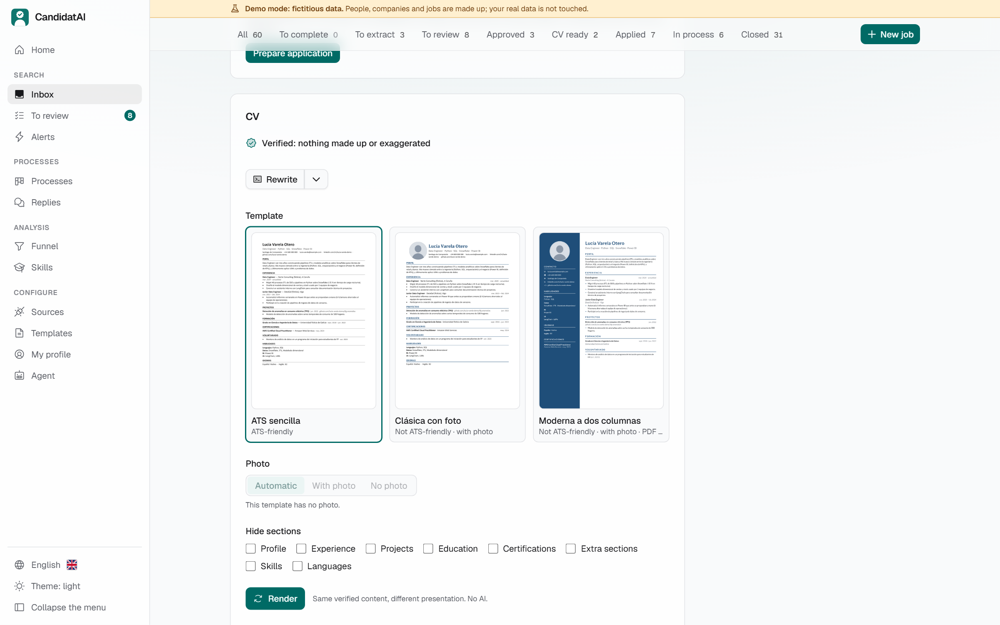</picture>
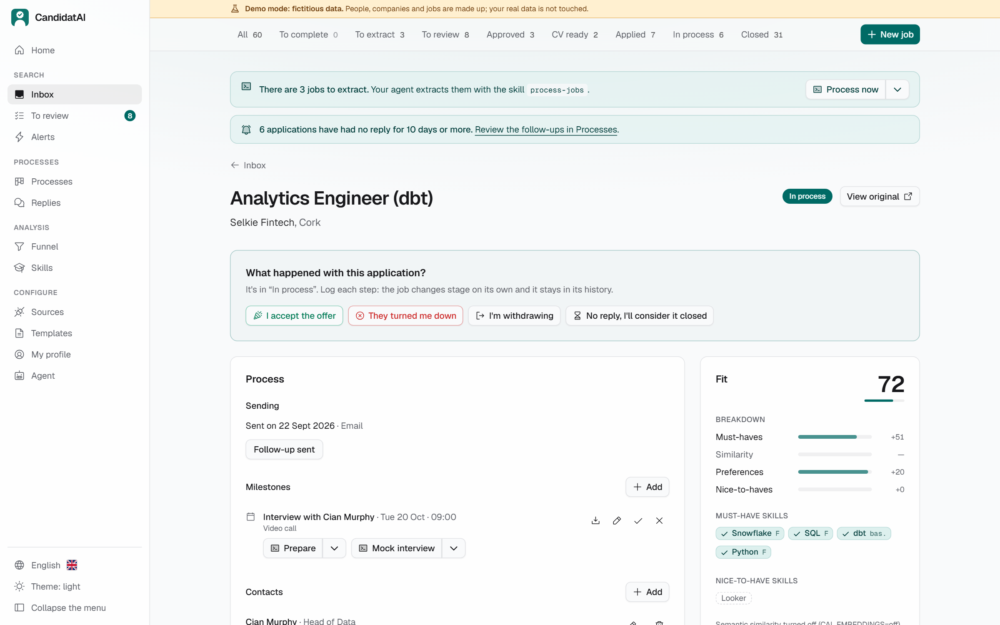
</details>

<details>
<summary><b>CV templates</b>: built-in ones and yours, imported from any design</summary>
<br>
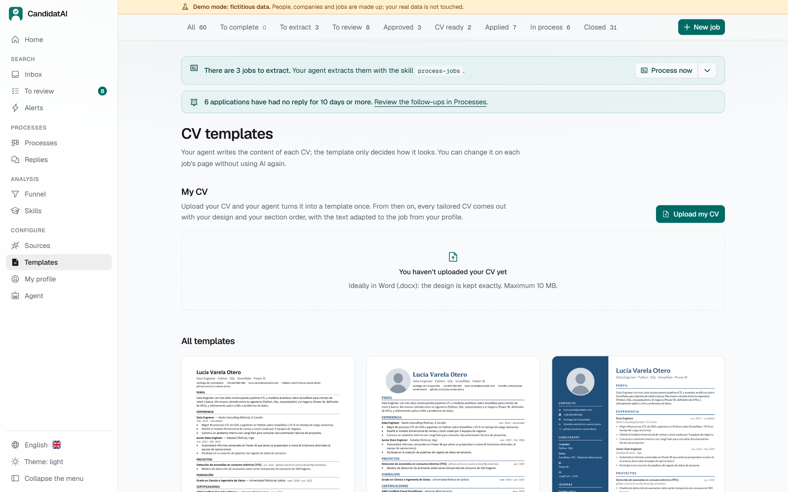
</details>

<details>
<summary><b>Skills</b>: what jobs ask for that you lack, and "it's the same as…" aliases</summary>
<br>
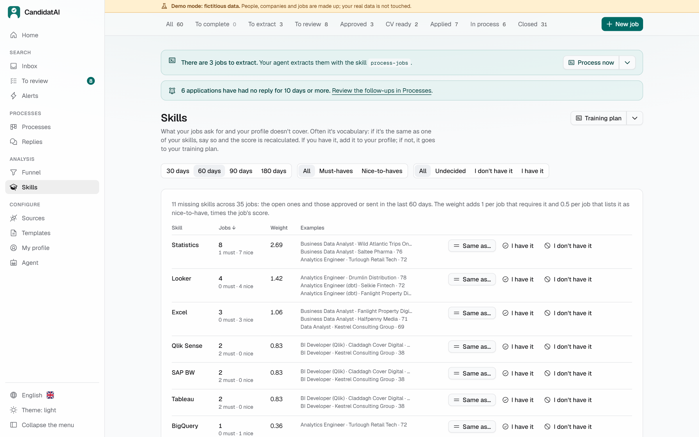
</details>

<details>
<summary><b>Sources</b>: target companies and portals your agent browses, in two tabs</summary>
<br>
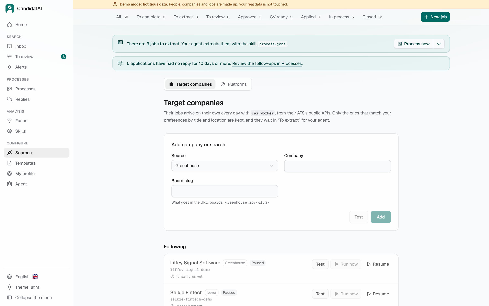
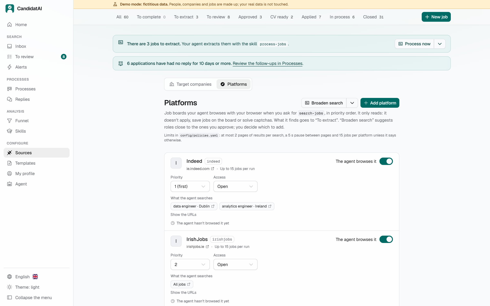
</details>

<details>
<summary><b>Agent</b>: launch skills from the UI, in a terminal or in the background</summary>
<br>
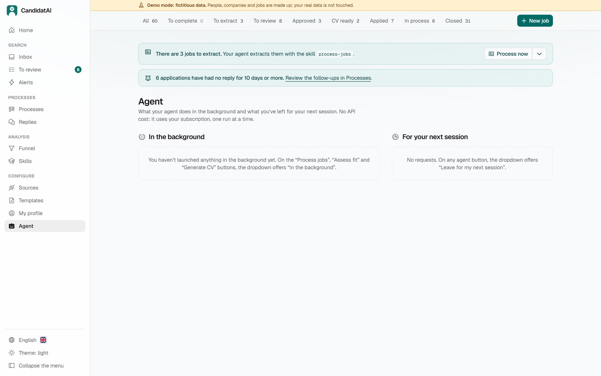
</details>

<details>
<summary><b>Sidebar</b>: grouped pages with what's waiting, collapsible, and language and theme at the bottom</summary>
<br>
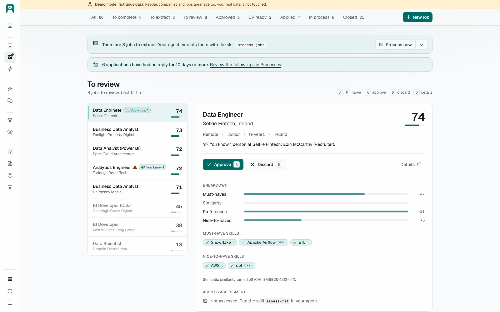
</details>

## Try it in 5 minutes

**To use it**, in PowerShell (Windows 11; no admin rights, Python or Node needed):

```powershell
iwr -useb https://raw.githubusercontent.com/DiegoPrieto23/candidatai/main/install.ps1 -OutFile $env:TEMP\cai-install.ps1
powershell -ExecutionPolicy Bypass -File $env:TEMP\cai-install.ps1
```

On **macOS or Linux**, in a terminal (no `sudo`):

```bash
curl -fsSL https://raw.githubusercontent.com/DiegoPrieto23/candidatai/main/install.sh | bash
```

It installs what's needed and leaves a **"CandidatAI"** shortcut (on the desktop and Start menu on
Windows, in Applications on macOS and in the applications menu on Linux): opening it starts
everything and opens your browser. To update, run it again; your data isn't touched. To see first
what it would do, add `-WhatIf` to the second Windows line or use `| bash -s -- --dry-run`. macOS
and Linux are new (phase 26) and still being tested.

Prefer not to install anything but Docker? `docker compose up -d --build` from the repository
folder also works, with limits (your agent stays outside the container): see
[With Docker](docs/GUIDE.md#with-docker-optional).

<p align="center">
  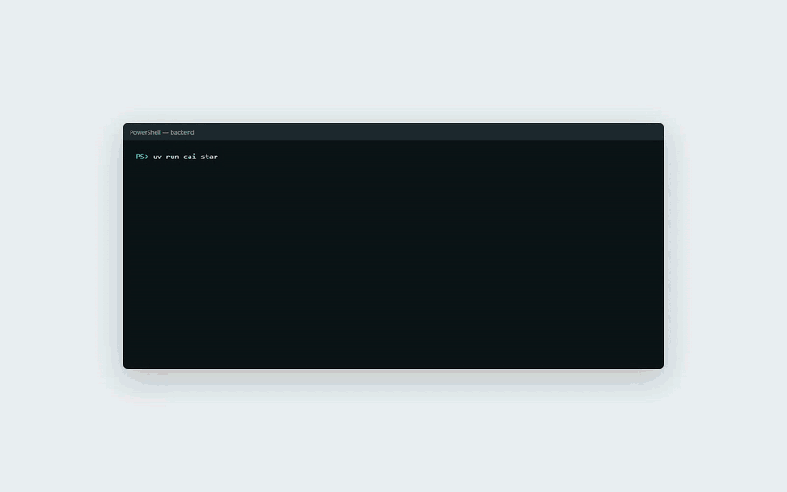
</p>

**To develop it**, with [uv](https://docs.astral.sh/uv/), Node LTS and pnpm, and the demo:

```powershell
git clone https://github.com/DiegoPrieto23/candidatai.git candidatai; cd candidatai
cd frontend; pnpm install; pnpm build; cd ..\backend
uv sync
uv run playwright install chromium     # PDFs without LibreOffice
uv run cai demo seed --lang en --dir data-demo-en   # 60 jobs, 8 weeks of history, 2 CVs
$env:CAI_DATA_DIR = "data-demo-en"; uv run cai start  # http://127.0.0.1:8000
```

`cai start` runs the API (which serves the UI) and the worker in one command and opens your
browser; `--dev` adds Vite with hot reload. The UI shows a "Demo mode" banner: the demo (a
fictional candidate in Dublin; without `--lang en`, one in Spain) is deterministic and never
touches `data/` or your mailbox. To try the skills on it, start your agent with
`CAI_DATA_DIR=data-demo-en`. A walk-through of every feature with the demo:
[demo test guide](dev/pruebas/guia-prueba-demo.md) (Spanish).

Step by step, including your own profile, your agent, email alerts and the browser extension:
**[User guide](docs/GUIDE.md)**.

## Use it with your own data

Your data lives in `data/`, outside git. Open CandidatAI (the shortcut, or `cai start`), create your
profile with the `update-profile` skill (it reads your CV), then fill it in and refine it in **My
profile**: experience, achievements, STAR stories, what you're looking for, your CV and letter
preferences, your context and writing samples, with no YAML (each block saves on its own and can be
undone). Then ask your agent:

| Skill | What it does |
|---|---|
| `update-profile` | Creates or updates `data/profile.yaml` (your single source of truth) from your CV, and versions it |
| `expand` | Proposes projects, skills, achievements and certifications from your public GitHub, portfolio, Kaggle or Scholar, each with its source; writes only what you accept |
| `process-jobs` | Extracts new jobs (the `extractor` role, isolated when the agent allows it) |
| `assess-fit` | Assesses and explains the fit of jobs waiting for triage |
| `generate-cv 42` | Writes, renders and verifies the CV for job 42 |
| `generate-cover-letter 42` | Cover letter following your instructions, verified; TXT and PDF matching the CV |
| `prepare-application 42` | Screening answers and, if needed, the cover letter |
| `prepare-interview 42` | A PDF interview guide (role, fit, concepts, likely questions, your pitch) and a day-by-day plan |
| `mock-interview 42` | Mock interview: one question at a time, feedback and a better answer from your profile |
| `debrief-interview 42` | Debrief: notes, next steps, likely next round and new STAR stories |
| `prepare-negotiation 42` | Arguments, questions and a script for a received offer; reviews the contract. Never proposes a figure |
| `research-company 42` | Company dossier with sources (product, news, engineering culture, stack) |
| `draft-message 42` | LinkedIn message (≤ 300 characters) or application email, as a draft |
| `draft-follow-up` | Follow-up (max. 2 per application) and thank-you drafts |
| `review-replies` | Classifies company emails (interview with its date, test, offer, rejection) into proposals |
| `daily-summary` | What's on today: pending work, overdue follow-ups, upcoming milestones |
| `handle-requests` | Does what you left in the UI with "Leave for my next session" |
| `search-jobs` | Browses the portals you approved with your browser and adds what fits |
| `broaden-search` | Suggests adjacent job titles ("Analytics Engineer") from what you approve |
| `review-search` | Weekly retrospective: what works (score bands, sources, template, referrals) and what to change |
| `training-plan` | Training plan from your real skill gaps, with verified resources |
| `review-linkedin` | Improvement report for your LinkedIn profile, ready to copy |
| `import-cv-template` | Turns your CV (or any design) into a template for tailored CVs |

Invoke them as `/generate-cv 42` in Claude Code, `$generate-cv 42` in Codex, or just ask in plain
language (in English or Spanish).

### Where jobs come from

| Source | Automatic | Covers |
|---|---|---|
| Paste a URL or text | No | Any job |
| Public ATS APIs and feeds (Greenhouse, Lever, Ashby, Personio, Teamtailor, Workable, SmartRecruiters, Recruitee) | Daily | Your target companies (`cai sources discover` finds their boards) |
| Portal APIs (InfoJobs and Adzuna with keys; Manfred and freehire.me without) | Daily | Keyword searches |
| Job alerts by email (read-only IMAP or exported `.eml`) | Yes | LinkedIn, InfoJobs, Indeed, Tecnoempleo… |
| "Send to CandidatAI" browser button | One click | Any page you're viewing, LinkedIn included |
| Your agent browsing with your browser | On demand | Portals you approve; LinkedIn only if you enable it |
| LinkedIn's public search, without login | Daily, **off by default** | Your LinkedIn searches, at most once a day, with strict limits |

## Compatible agents

| Agent | Licence | Free | Local | Status |
|---|---|---|---|---|
| **Claude Code** | proprietary | no (your Claude plan) | no | **Tested**: reference, with MCP and without (CLI only: 5/5 jobs extracted, assessed and with a CV passing the eval). Skills can also run **in the background** from the UI |
| **Codex** | Apache-2.0 | with a local model | yes (`--oss`, `local` preset) | **Tested with one offer**: extracts, assesses and writes the CV well (`.codex/`). Uses your ChatGPT account or Ollama/LM Studio |
| **OpenCode** | MIT | with a local or free model | yes (Ollama, LM Studio) | **Configured, untested with a model** (`opencode.json`, `.opencode/agents/`), checked against its binary. Runs `process-jobs` and `assess-fit` **in the background** with the same tool ceiling as Claude Code |
| **Qwen Code** | Apache-2.0 | with a local or free model | yes | **Configured, untested** (`.qwen/`). Its free OAuth plan closed on 15/04/2026 |
| **Antigravity CLI** | proprietary | yes (Google free plan) | no | **Partly tested**: extracts and assesses well; the free plan runs out of its weekly quota when it starts on CVs (`.agents/mcp_config.json`). Replaces Gemini CLI |
| **Cursor, Copilot CLI, Pi, goose…** | various | depends | depends | **Compatible via `AGENTS.md`**: they work if they read `AGENTS.md` and speak MCP or run commands |

How to use it without paying for tokens (Ollama on Windows, which model for your memory and what
leaves your computer in each case): [`docs/MODELOS_GRATIS.md`](docs/MODELOS_GRATIS.md) (Spanish).
The measured matrix for each agent and model, from `cai eval compat`, is in
[`evals/compat/REPORT.md`](evals/compat/REPORT.md).

Gemini CLI is no longer listed: since 18/06/2026 it only works with a paid Gemini API key or an
enterprise licence. With a free Google account, use Antigravity CLI.

Skills, roles (sub-agents) and the agent manifest are written once in `.agents/` and generated
for each agent with `scripts/sync_agents.py`. Details and how to add an agent:
[`docs/AGENTS_COMPAT.md`](docs/AGENTS_COMPAT.md) (Spanish).

## Guarantees

These are rules enforced by code, not promises made by the agent:

- **Nothing leaves without your confirmation.** The app fills forms and stops; submitting takes
  your click, application by application, with a single-use token. Messages and emails are drafts.
- **No made-up experience.** Every CV claim must point to evidence in your profile that exists, or
  the code rejects it; an independent verifier role reviews the rest.
- **Untrusted content stays data.** Text from postings, emails and websites is never treated as
  instructions. Hidden text and phrases aimed at an AI are detected and flagged in the UI.
- **Your data stays with you.** Everything lives in `data/` (outside git). The agent never receives
  your email, phone or salary minimum.
- **LinkedIn and captchas.** No automated applications on LinkedIn, and captchas are never solved or
  bypassed. Searching LinkedIn (with your browser, or its public search) only happens if you turn it
  on in the UI.

## Architecture

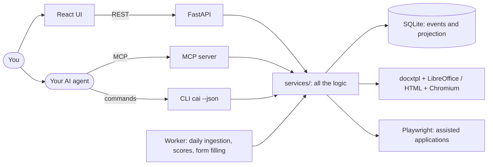

- **Thin layers.** API, MCP and CLI only translate; the logic lives in `app/services/` and is tested
  there. Every MCP tool has a `cai … --json` command with the same input and output (a test checks
  it), so an agent without MCP can do exactly the same.
- **Events are the source of truth.** Every change to a job is an event validated against a
  transition table; the current stage is a projection that can be rebuilt.
- **The agent never writes directly.** It fills strict Pydantic schemas (`JobExtraction`,
  `CvContent`…) that the code validates, with each CV claim tied to its evidence.

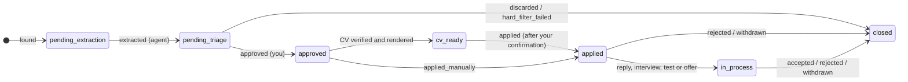

<details>
<summary><b>Key decisions</b> (ADRs in <code>dev/DECISIONS.md</code>)</summary>

| Decision | Why |
|---|---|
| No LLM API: your agent does the reasoning | No extra cost or keys; it works with the subscription you already have |
| Neutral agent interface: MCP + CLI with parity | Any agent that speaks MCP or runs commands works |
| `.agents/` as the single source, native config generated | A skill is written once and generated for Claude Code, Codex… |
| Security that doesn't depend on the agent | Injection detection, validation and an interface that can't send anything, with any agent |
| Events as the source of truth | Full history, reliable analytics and states that don't get corrupted |
| CV content and presentation kept apart | Changing template, photo or colour doesn't spend agent quota again |
| LinkedIn only through alerts, your clicks or opt-in features | Respects your account; the app prepares and you finish |
| SQLite, native on Windows | A personal app: no servers; Docker only if you want it |
| Optional local embeddings | Better matching without sending your data anywhere |
</details>

## Quality and evals

- **Tests:** backend with pytest (≥ 85 % coverage enforced on `services/`) and frontend with
  Vitest. CI runs the backend on Windows, Linux and macOS, the frontend, the installer and the
  Docker image, plus a check that the generated agent configuration is up to date and a demo seed
  as smoke test. The CI badge above shows whether it passes.
- **Matching eval** (80 fictional cases, no embeddings): precision **0.88**, recall **0.95**,
  F1 **0.92** at the default triage threshold. Typical errors and why:
  [`evals/REPORT.md`](evals/REPORT.md).
- **CV eval** (`cai eval cv`): 7 automatic checks on the CVs an agent leaves (evidence exists, no
  invented or unrequested skills, one page, keyword coverage, language and independent
  verification).

## Documentation

| I want to… | Read |
|---|---|
| Install it and use it day to day | [User guide](docs/GUIDE.md) · [Guía de uso](docs/GUIA.md) |
| See everything it does | [`docs/FEATURES.md`](docs/FEATURES.md) |
| See how it compares with similar projects | [`docs/COMPARATIVA.md`](docs/COMPARATIVA.md) |
| Understand the architecture and the data model | [`docs/ARCHITECTURE.md`](docs/ARCHITECTURE.md), [`docs/DATA_MODEL.md`](docs/DATA_MODEL.md) |
| Know the rules (truthfulness, privacy, applying) | [`docs/POLICIES.md`](docs/POLICIES.md) |
| Set up job sources and email alerts | [`docs/FUENTES_OFERTAS.md`](docs/FUENTES_OFERTAS.md), [`docs/CONFIGURAR_CORREO.md`](docs/CONFIGURAR_CORREO.md) |
| Work with CV templates | [`docs/CV_TEMPLATES.md`](docs/CV_TEMPLATES.md) |
| Connect another agent | [`docs/AGENTS_COMPAT.md`](docs/AGENTS_COMPAT.md), [`docs/AGENT_INTERFACE.md`](docs/AGENT_INTERFACE.md) |
| See what changed in each version | [`CHANGELOG.md`](CHANGELOG.md) |
| Contribute | [`CONTRIBUTING.md`](CONTRIBUTING.md) |

All documents, grouped: [`docs/README.md`](docs/README.md). Technical docs are in Spanish.

## How it was built

In 23 phases (with sub-phases), each with its brief in `dev/prompts/`, implemented with an AI agent
(Claude Code) against a specification written before the code: a plan, a branch per phase, tests,
a review by a `reviewer` role, and a log of decisions and debt. The phase log is in
[`dev/ROADMAP.md`](dev/ROADMAP.md) and the method in
[`dev/DESARROLLO_POR_FASES.md`](dev/DESARROLLO_POR_FASES.md).

## License and credits

[MIT](LICENSE) © 2026 Diego Prieto.

Inspired by [ackyer/job-search-agent-template](https://github.com/ackyer/job-search-agent-template)
(MIT), and by ideas from [AI Job Search](https://github.com/MadsLorentzen/ai-job-search) and
[career-ops](https://github.com/career-ops-hq/career-ops) (both MIT). Not affiliated with
Anthropic, OpenAI, LinkedIn or any job portal.
