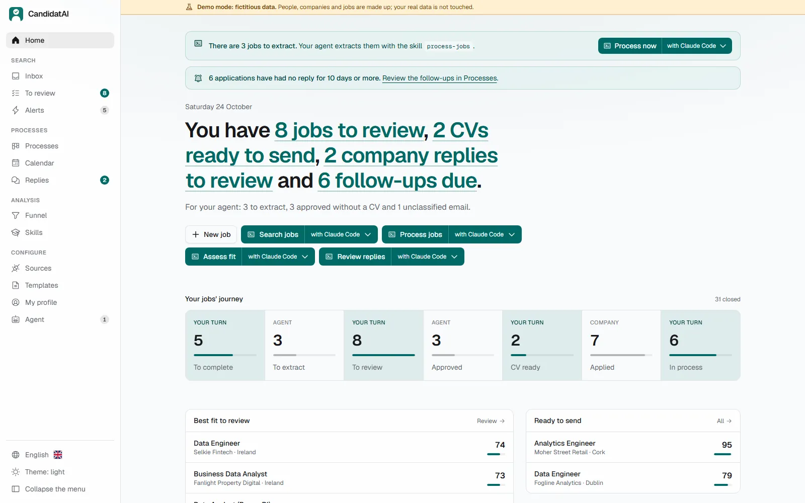
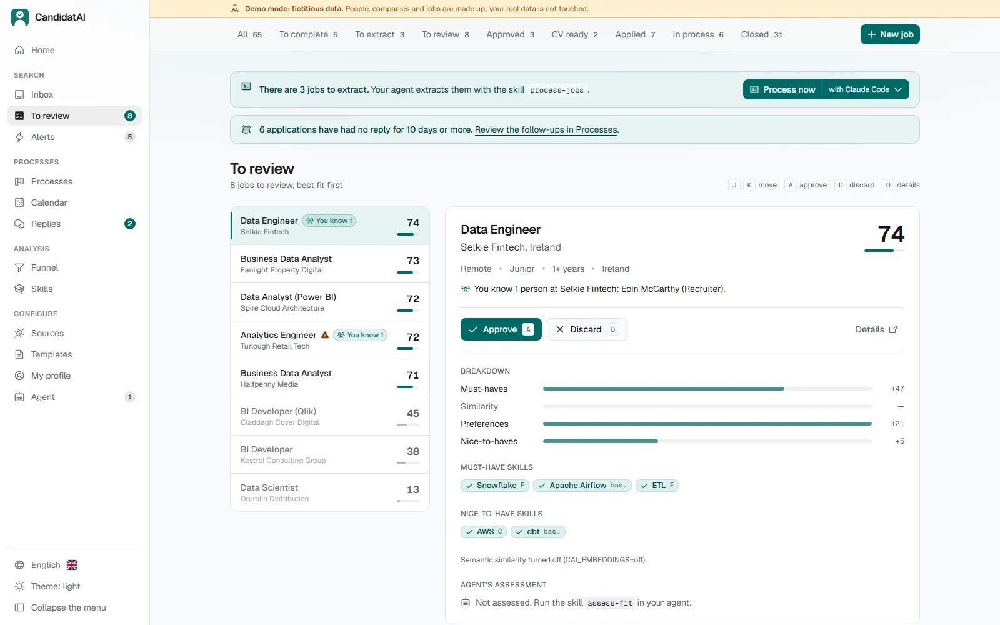
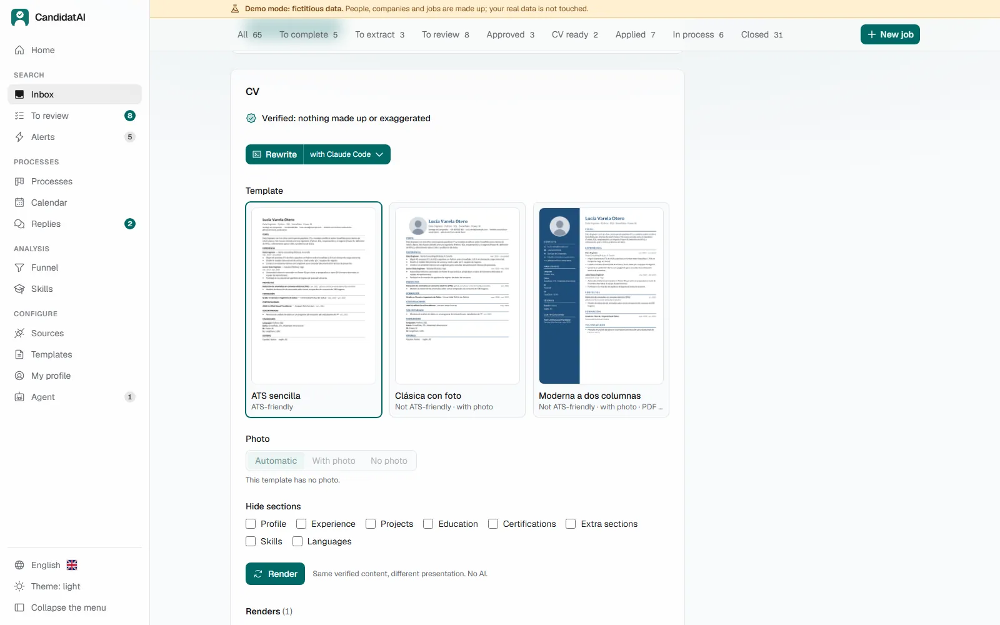
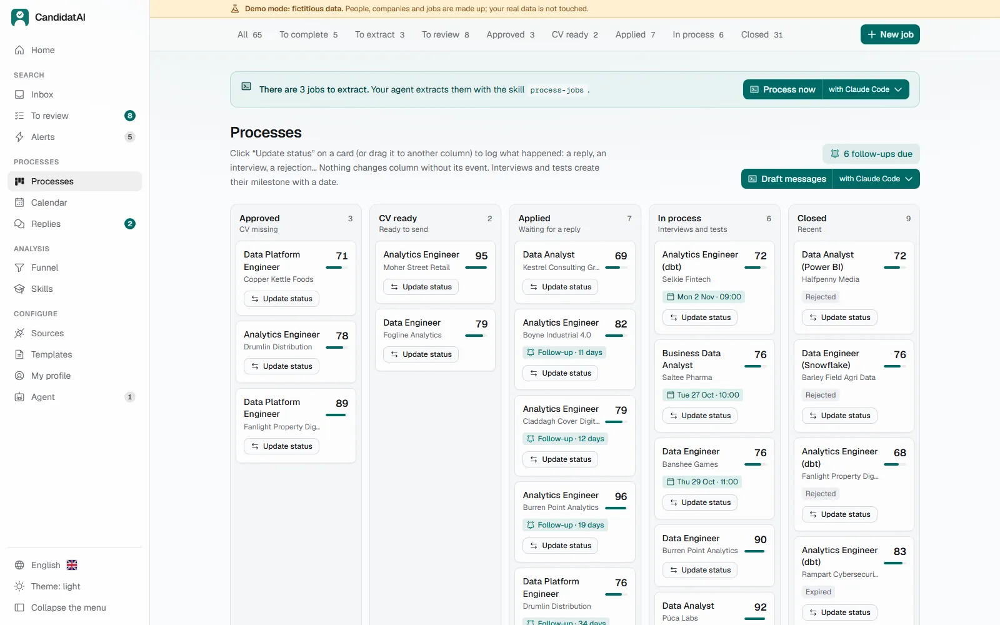
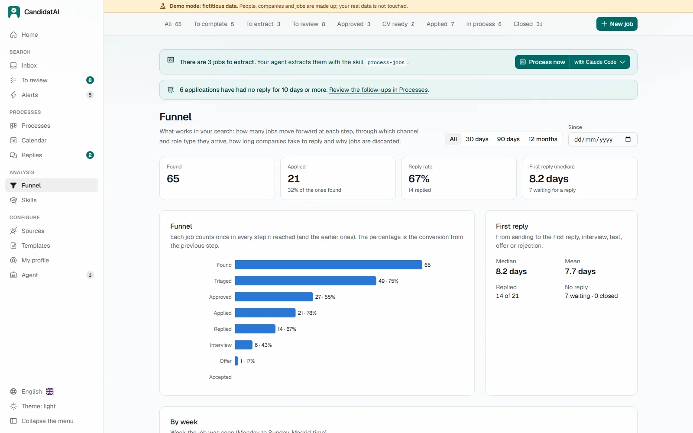
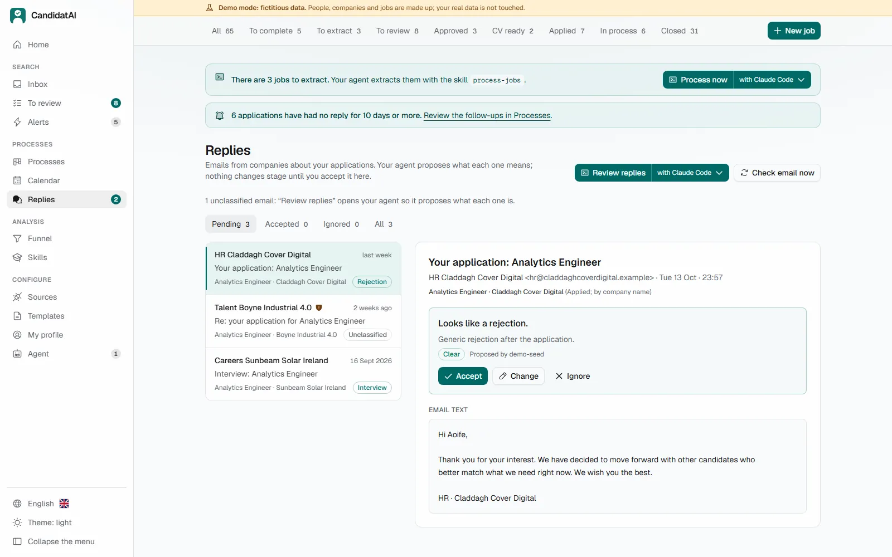
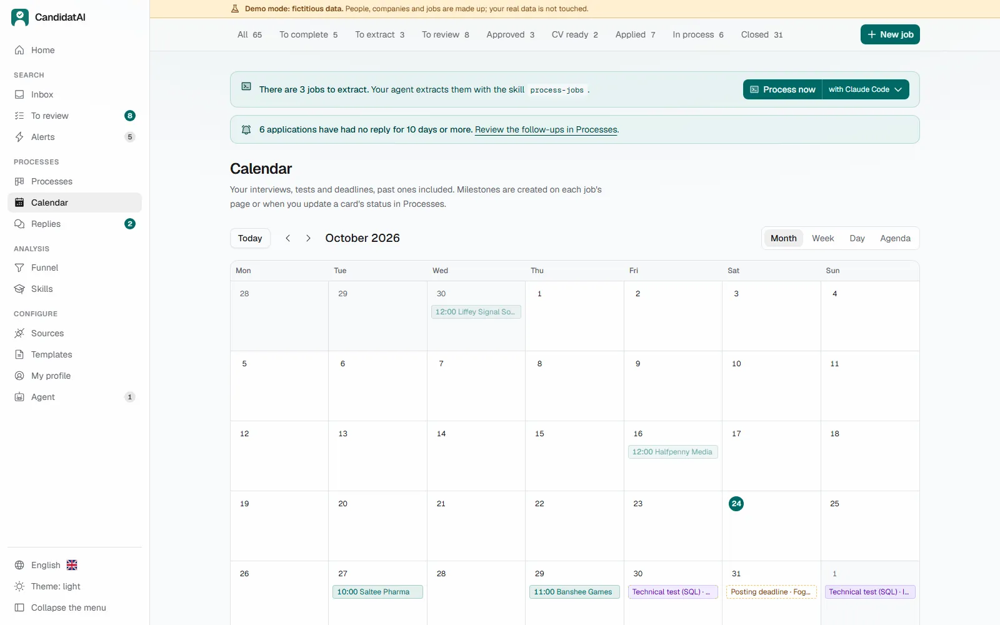
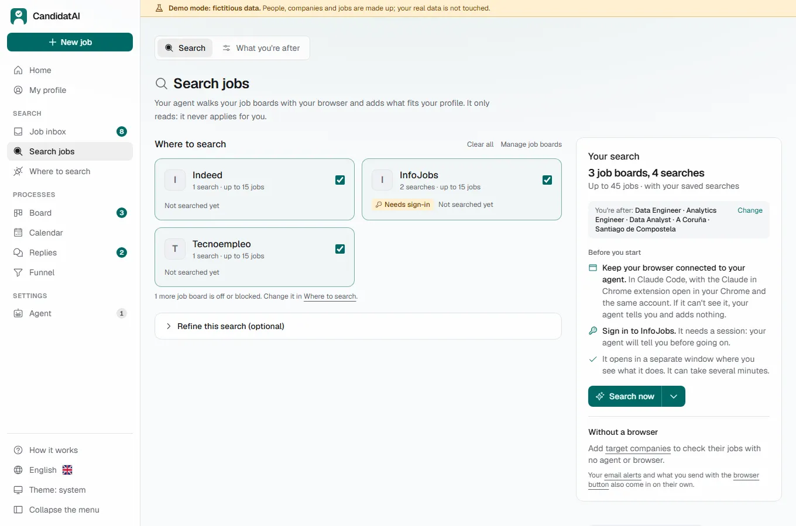
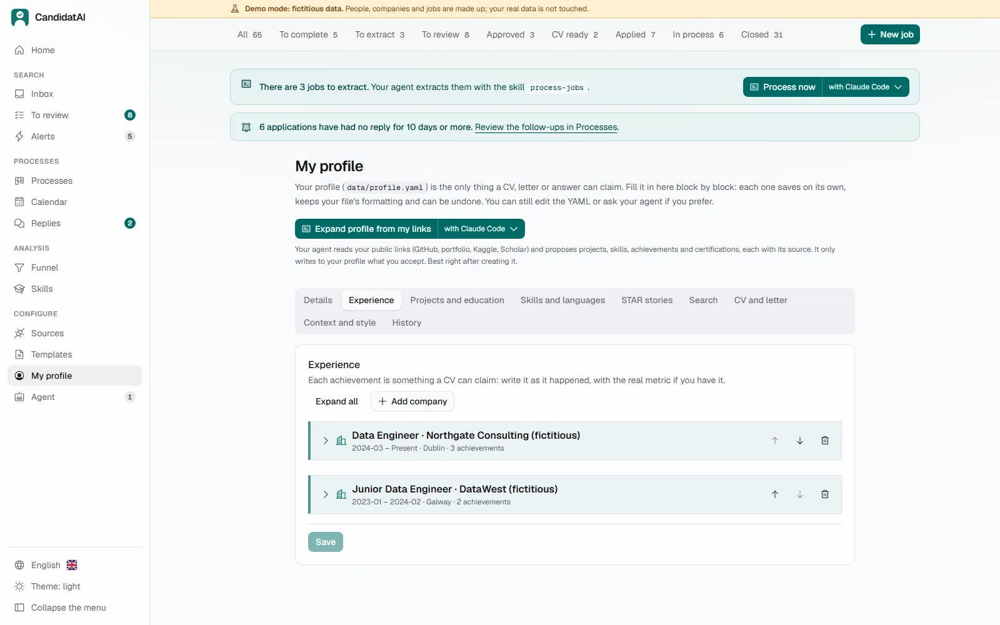
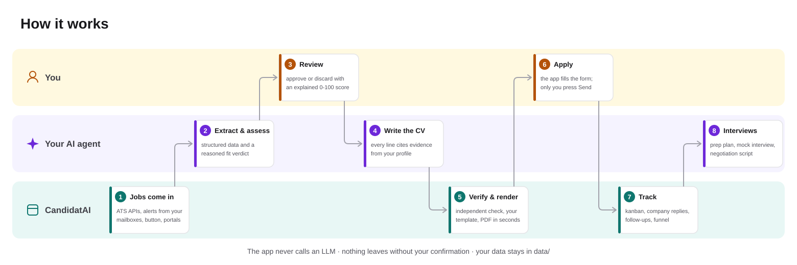

<p align="center">
  
</p>

<h1 align="center">CandidatAI</h1>

<p align="center">
  Your whole job search in one app: you decide, your AI agent reads and writes, and nothing is sent without you.
</p>

<p align="center">
  <b>English</b> · <a href="README.es.md">Español</a>
</p>

<p align="center">
  <a href="https://github.com/DiegoPrieto23/candidatai/releases/latest"></a>
  <a href="https://github.com/DiegoPrieto23/candidatai/actions/workflows/ci.yml"></a>
  <a href="LICENSE"></a>
  
  
  
</p>

CandidatAI takes you from a new job posting to an offer: it gathers jobs from many sources, shows
how well each one fits you, writes a tailored CV and cover letter with nothing made up, fills the
application form and waits for you to press Send, and then tracks every process with its
interviews, replies and follow-ups.

It's for anyone looking for a job who wants their search in one place, with their data on their own
computer. The reading and writing is done by an AI agent you already use (Claude Code, Codex,
Antigravity CLI…), which the app doesn't include. It's a young project with one maintainer, most
tested on Windows 11 with Claude Code: see the [known limitations](#known-limitations).

**Get started:** [install it](#run-it-on-your-computer) · [Start here](docs/START_HERE.md), if
you're not technical.

## Demo

<p align="center">
  <!-- media:provisional -->
  
  <br><sub>Everything you see is the demo: a fictional candidate, companies and jobs. The agent's work
  (reading jobs, writing the CV) is already done in it; with a real agent each step takes from
  seconds to a few minutes.</sub>
</p>

## Features

- **Jobs from many sources:** paste a link or the text, follow your target companies through their
  public job boards (Greenhouse, Lever, Ashby and five more), read your email job alerts, send the
  page you're on with a browser button, or let your agent search the job boards you choose.
  Duplicates are merged.
- **Text aimed at an AI is caught:** posting text is only ever data. Hidden instructions are
  detected and flagged, and such a job can never come out as a strong fit.
- **An explained fit for every job:** hard filters, a 0-100 fit that says where each point comes
  from, and your agent's reasoned verdict. Approve or discard from the keyboard.
- **A tailored CV for each job:** your agent writes it from your profile, the app renders it with
  your template, photo and colour, and a separate verifier checks it. Ask for changes
  in plain words, edit it yourself or go back to any version.
- **Your own CV design:** import any CV (Word, PDF, an image, Canva) as a template, and change
  template, colour or sections in seconds without using your agent.
- **No made-up experience:** every line of a CV must point to evidence in your profile, or the code
  rejects it.
- **Cover letters and form answers** that match the CV and the job, from your own instructions.
- **Assisted applications:** the app fills Greenhouse, Lever, Ashby or generic forms and stops at
  captchas and logins.
- **Nothing leaves without your confirmation:** submitting takes your click, application by
  application. Messages and emails are drafts you send yourself.
- **Every process on one board:** a board that only moves with recorded steps, a calendar, follow-up
  reminders and company replies read from your mailbox and sorted for you to accept.
- **Interviews and offers:** a prep guide in PDF with a day-by-day plan, mock interviews, debriefs,
  company research with sources, and offers compared with your minimum salary without the agent
  ever seeing it.
- **A funnel that tells you what works:** where each application stopped, by source, role, template
  and referral, and whether the fit score predicted what really happened.

**Every feature, page by page and skill by skill:** [`docs/FEATURES.md`](docs/FEATURES.md).

## Screenshots

<!-- media:provisional -->
<picture>
  <source media="(prefers-color-scheme: dark)" srcset="docs/img/en/dark/home.webp">
  
</picture>
<p align="center"><sub>Home tells you what's waiting for you and for your agent, and the next step.</sub></p>

<table>
  <tr>
    <td width="50%"><!-- media:provisional --><br><sub>Review jobs by fit and decide with one key.</sub></td>
    <td width="50%"><!-- media:provisional --><br><sub>A verified CV, in the design you choose.</sub></td>
  </tr>
  <tr>
    <td><!-- media:provisional --><br><sub>Every application on one board, moved by recorded steps.</sub></td>
    <td><!-- media:provisional --><br><sub>See where your applications stop.</sub></td>
  </tr>
  <tr>
    <td><!-- media:provisional --><br><sub>Company emails, sorted for you to accept.</sub></td>
    <td><!-- media:provisional --><br><sub>Interviews, deadlines and follow-ups in one calendar.</sub></td>
  </tr>
  <tr>
    <td><!-- media:provisional --><br><sub>Choose where your agent searches, and what to prepare first.</sub></td>
    <td><!-- media:provisional --><br><sub>Your profile, the only source of what goes in a CV.</sub></td>
  </tr>
</table>

<sub>All screenshots use the demo's fictional data. The short animations of each feature are in
[`docs/FEATURES.md`](docs/FEATURES.md).</sub>

## Run it on your computer

1. **What you need.** A computer with Windows, macOS or Linux; no Python, Node or admin rights,
   because the installer brings what it needs. And an AI agent: Claude Code, Codex or Antigravity
   CLI with a subscription you may already pay (Claude, ChatGPT or Google AI Pro), Antigravity CLI
   also with a free Google account, or a local model. **The app never calls an AI itself.** Which
   one to pick and what each costs: [Start here](docs/START_HERE.md).
2. **Install it.**
   - **Windows** (Windows 11), in PowerShell:

     ```powershell
     iwr -useb https://raw.githubusercontent.com/DiegoPrieto23/candidatai/main/install.ps1 -OutFile $env:TEMP\cai-install.ps1
     powershell -ExecutionPolicy Bypass -File $env:TEMP\cai-install.ps1
     ```

   - **macOS and Linux**, in a terminal (no `sudo`):

     ```bash
     curl -fsSL https://raw.githubusercontent.com/DiegoPrieto23/candidatai/main/install.sh | bash
     ```

   - **Docker** (optional): from a copy of the repository, `docker compose up -d --build`. Your
     agent stays outside the container, with some limits: see
     [With Docker](docs/GUIDE.md#with-docker-optional).

   The installers download the [latest release](https://github.com/DiegoPrieto23/candidatai/releases/latest),
   **check its SHA-256 checksum** and create a "CandidatAI" shortcut. To update, run them again:
   your data isn't touched. To see first what they'd do, add `-WhatIf` to the second Windows line
   or use `| bash -s -- --dry-run`.
3. **Open it.** Use the "CandidatAI" shortcut: on the desktop and in the Start menu on Windows, in
   `~/Applications` on macOS (Spotlight finds it) and in the applications menu on Linux. A terminal
   window starts the app and your browser opens at `http://127.0.0.1:8000`, which is your own
   computer. Keep that window open while you use it. From a terminal, it's `uv run cai start` in
   the app's `backend` folder:

   ```bash
   cd $env:LOCALAPPDATA\CandidatAI\app\backend               # Windows (PowerShell)
   cd ~/"Library/Application Support/CandidatAI/app/backend"   # macOS
   cd ~/.local/share/candidatai/app/backend                    # Linux
   uv run cai start
   ```

   `uv run cai --help` lists the other commands: `cai doctor` checks that nothing is missing. With
   Docker, the app starts with the container and you open it at that same address.
4. **Try the demo, then make it yours.** `uv run cai demo seed` loads a fictional search to look
   around. Then create your profile from your CV and connect your agent:
   [Start here](docs/START_HERE.md) step by step, or the [user guide](docs/GUIDE.md).

## Documentation

- [Start here](docs/START_HERE.md): what you need and how to install it, without being technical.
- [User guide](docs/GUIDE.md): every page and how to use it day to day.
- [Features](docs/FEATURES.md): everything the app does, page by page and skill by skill.
- [Policies](docs/POLICIES.md): the rules on truthfulness, privacy and applying.
- [Agents](docs/AGENTS_COMPAT.md): which agents are supported and how well they've been tested.
- [All documents](docs/README.md), grouped. Technical documents are in Spanish; the guides
  exist in English and Spanish.
- [Changelog](CHANGELOG.md): what changed in each version.

## How it works

<p align="center">
  <!-- media:provisional -->
  
</p>

Each colour is who does the step: **you** decide, **your agent** reasons, **the app** stores,
checks and automates. The agent works through a dedicated interface (MCP tools plus an equivalent
`cai … --json` CLI) and can only fill strict schemas that the code validates. Skills such as
`generate-cv 42` or `process-jobs` run from your agent or from a button in the app. More in
[`docs/ARCHITECTURE.md`](docs/ARCHITECTURE.md) (Spanish).

## Why CandidatAI

Two well-known open projects also use an AI agent for the job search, and both inspired this one:
[AI Job Search](https://github.com/ai-job-search-dev/ai-job-search) and
[career-ops](https://github.com/career-ops-hq/career-ops). CandidatAI is different in three ways:
it's an **app** you install like any program and can use without opening your agent; its rules
(no made-up CV lines, nothing sent without you, posting text is only data) are **enforced by
code**, whichever agent you use; and it covers the whole search, **up to the offer**, in one place.

**What they do better, today:** career-ops works with more agents and models, covers more job
sources and countries and is far more battle-tested; AI Job Search is simpler (fork it and run
`/setup`) and has a real hiring story behind it. Both have large communities that this project
doesn't have yet.

<details>
<summary><b>Side by side</b> (checked on 6 November 2026)</summary>
<br>

| | CandidatAI | AI Job Search | career-ops |
|---|---|---|---|
| What it is | An **app** with a web UI, a database and a background worker | Instructions and commands for Claude Code over files | An agent with many modes and Node scripts over files, a terminal dashboard and a web UI |
| Installing | One command, a desktop shortcut, nothing installed beforehand | Fork, then Claude Code, Python, Bun and LaTeX | `npx … init` with Node installed |
| Without the agent open | Reviewing jobs, board, calendar, funnel, profile, CV designs | Nothing | Scanning, the dashboard and the web UI |
| Rules | **Enforced by code**: a CV line without evidence in your profile is rejected; sending needs your click | Instructions, least-privilege permissions and an injection filter in code | Instructions, plus fact and wording checks of the CV in code |
| Agents | 5 configured; Claude Code fully tested | Claude Code | 12 CLIs, free and local models |
| Community | One maintainer, just released | ~70k stars, ~90 contributors, the author's real search | ~81k stars, ~470 contributors, Discord, many success stories |

The full comparison, feature by feature and with its sources, is in
[`docs/COMPARATIVA.md`](docs/COMPARATIVA.md) (Spanish).
</details>

## Known limitations

- **Desktop only.** The app is made for a computer screen; it isn't designed for a phone.
- **One person, one computer.** It runs on your own machine at `127.0.0.1`, with no accounts and
  no sync between devices.
- **You need an AI agent.** Without one you can review jobs, track processes and change CV designs,
  but reading jobs and writing CVs, letters or interview guides needs an agent, which the app
  doesn't include.
- **What has really been tested:** Windows 11 the most, including a clean install from the release;
  macOS and Linux have an installer and run the tests in CI, but haven't been installed by hand from
  a release. Claude Code is tested end to end, Codex with one job and Antigravity CLI in part;
  OpenCode was only tried with a small local model, which didn't finish the test, and Qwen Code is
  configured but untested. Details in [`docs/AGENTS_COMPAT.md`](docs/AGENTS_COMPAT.md).
- **English and Spanish only**, in the app and in the guides.
- **No scraping of job boards without an API** and no automated LinkedIn applications, by design:
  those jobs come in through email alerts, the browser button or your agent searching with your
  browser.

## Performance

Measured on 6 November 2026 on a laptop with an AMD Ryzen 7 5700U, 16 GB of RAM and no dedicated
graphics card, running Windows 11, with the app already opened once before (median of three runs, except memory):

| What | Time or size |
|---|---|
| Starting the app, until it answers / until you see Home | 4.0 s / 4.6 s |
| Memory of the whole app, idle / after going through every page | ≈ 330 MB / ≈ 365 MB |
| A CV in another design, to PDF: Word templates (LibreOffice) / HTML templates | 11.7 s / 4.7 s |
| Home, first load / reload, with the demo (65 jobs) | 0.28 s / 0.11 s |
| Home, first load / reload, with 10 times as many jobs (650) | 0.28 s / 0.11 s |
| Job inbox, first load / reload, with the demo | 0.49 s / 0.31 s |
| Job inbox, first load / reload, with 650 jobs | 0.53 s / 0.31 s |

Your agent's work (reading a job, writing a CV) isn't included: it depends on the agent and its
model. As a reference, Claude Code took 8.5 minutes to read, assess and write a verified CV for five
jobs in the [agent matrix](evals/compat/REPORT.md).

The matching eval (80 fictional cases, no embeddings): precision **0.88**, recall **0.95**,
F1 **0.92** at the default score threshold ([`evals/REPORT.md`](evals/REPORT.md)).

## Security

Nothing leaves your computer without your confirmation, and posting or email text is never followed
as instructions. To report a vulnerability, see [`SECURITY.md`](SECURITY.md); the rules the app
enforces are in [`docs/POLICIES.md`](docs/POLICIES.md).

## Development

To contribute, read [`CONTRIBUTING.md`](CONTRIBUTING.md) and the
[development section of the guide](docs/GUIDE.md#15-development).

## License

[MIT](LICENSE) © 2026 Diego Prieto.

Inspired by [ackyer/job-search-agent-template](https://github.com/ackyer/job-search-agent-template)
(MIT), and by ideas from [AI Job Search](https://github.com/ai-job-search-dev/ai-job-search) and
[career-ops](https://github.com/career-ops-hq/career-ops) (both MIT). Not affiliated with
Anthropic, OpenAI, Google, LinkedIn or any job portal.
