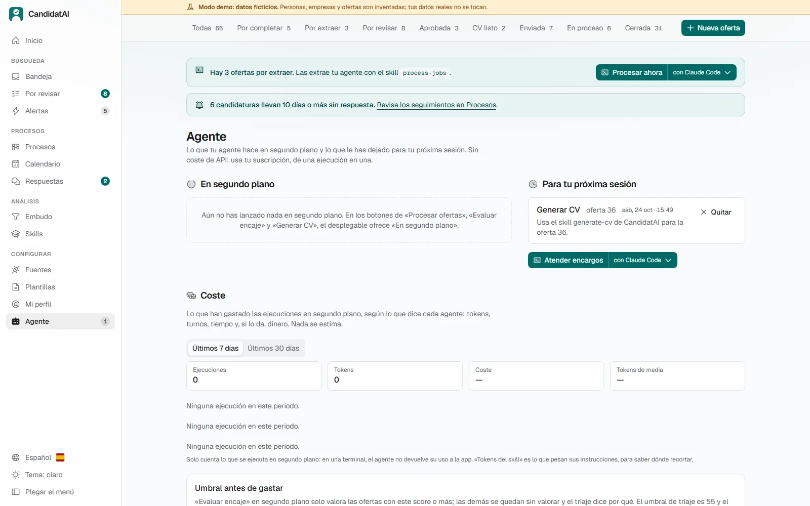
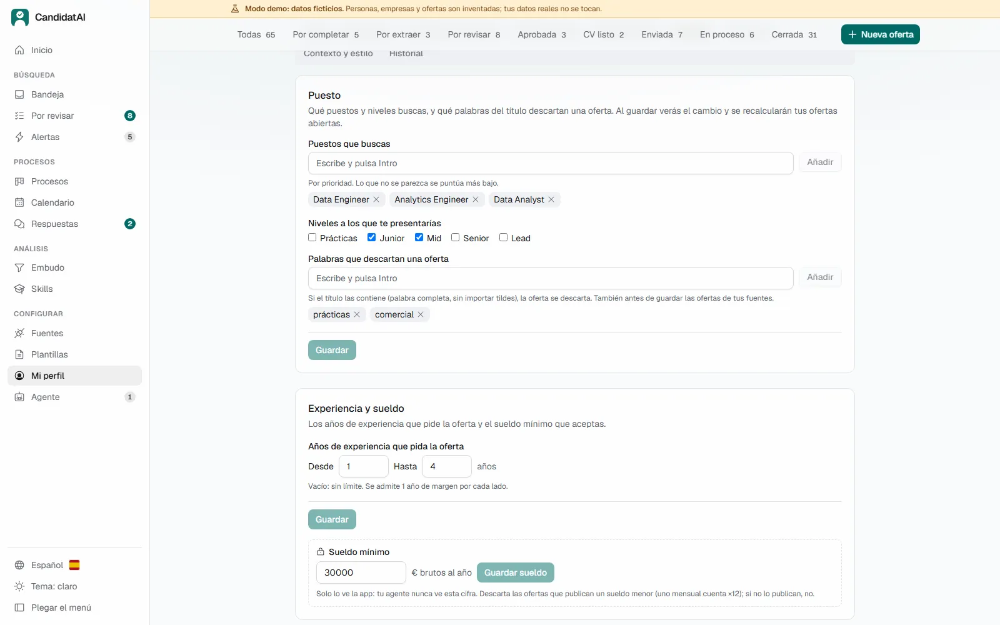

# Empieza aquí

[English](START_HERE.md) · **Español**

Una guía para cualquiera, sepa de informática o no: lo que necesitas, cómo instalar CandidatAI, un
primer vistazo con la demo, tu perfil y tu primera búsqueda. Para todo lo demás, la
[guía de uso](GUIA.md).

## Índice

1. [Lo que necesitas](#1-lo-que-necesitas)
2. [Instalar la app](#2-instalar-la-app)
3. [Instalar tu agente](#3-instalar-tu-agente)
4. [La primera vez: la demo](#4-la-primera-vez-la-demo)
5. [Crear tu perfil](#5-crear-tu-perfil)
6. [Tu primera búsqueda](#6-tu-primera-búsqueda)
7. [Preguntas](#7-preguntas)

## 1. Lo que necesitas

| | Qué | Para qué |
|---|---|---|
| 💻 | **Un ordenador** con Windows 11, macOS o Linux, y conexión a internet | Windows es lo más probado; macOS y Linux son nuevos |
| 📦 | **La app** (este proyecto, gratis) | Guarda tus ofertas, tu perfil, tus CVs y tus procesos, aplica las reglas y hace el trabajo automático |
| 🤖 | **Un agente de IA** | Lee las ofertas, valora el encaje y redacta tus CVs y cartas. **La app nunca llama a una IA por su cuenta**, así que sin agente puedes triar y hacer el seguimiento, pero no redactar |

Un **agente de IA** es un programa que habla con un modelo de IA y puede usar herramientas: aquí,
las de CandidatAI. Funciona en una ventana de terminal, y los botones de CandidatAI te lo abren con
la orden ya escrita. Tú eliges cuál, y eso decide cuánto cuesta y adónde van tus datos:

| Agente | Lo que cuesta (octubre de 2026) | Adónde van las ofertas y tu perfil | Qué tal funciona aquí |
|---|---|---|---|
| **Claude Code** | Incluido en Claude Pro, unos 20 US$ al mes, o planes superiores | A Anthropic | **La referencia**: probado de principio a fin |
| **Codex** | Incluido en ChatGPT Plus, unos 20 US$ al mes, o planes superiores | A OpenAI | Probado con una oferta |
| **Antigravity CLI** | Gratis con una cuenta de Google, con un cupo semanal | A Google | Extrae y valora bien; el cupo gratuito se acaba al empezar con los CVs |
| **OpenCode** o **Qwen Code** con un modelo gratuito en la nube (OpenRouter `:free`) | Gratis, unas 50 peticiones al día | Al proveedor del modelo | Configurado, aún sin medir con un modelo en la nube |
| **Un modelo local** (Ollama o LM Studio) con OpenCode, Codex o Qwen Code | Gratis | **A ningún sitio**: se queda en tu equipo | Pide un ordenador potente: medido con un modelo de 20B en 16 GB de memoria y sin tarjeta gráfica, no terminó la prueba |

Los precios cambian: mira [claude.com/pricing](https://claude.com/pricing) y
[chatgpt.com/pricing](https://chatgpt.com/pricing) antes de suscribirte. Si no lo tienes claro,
empieza con **Claude Code**: es el más probado con CandidatAI. Modelos gratuitos y locales, paso a
paso: [`MODELOS_GRATIS.md`](MODELOS_GRATIS.md). Lo que hace cada agente, medido:
[`evals/compat/REPORT.md`](../evals/compat/REPORT.md).

Elijas el que elijas, **el agente nunca recibe tu correo, tu teléfono ni tu mínimo salarial**, y no
puede enviar nada a una empresa: eso lo haces tú.

## 2. Instalar la app

No necesitas permisos de administrador, ni Python, ni nada instalado antes.

### En Windows

1. Abre **PowerShell**: pulsa la tecla de Windows, escribe `PowerShell` y pulsa Intro.
2. Copia estas dos líneas, pégalas en la ventana de PowerShell (clic derecho) y pulsa Intro:

   ```powershell
   iwr -useb https://raw.githubusercontent.com/DiegoPrieto23/candidatai/main/install.ps1 -OutFile $env:TEMP\cai-install.ps1
   powershell -ExecutionPolicy Bypass -File $env:TEMP\cai-install.ps1
   ```

3. Espera. Instala [uv](https://docs.astral.sh/uv/) (que trae Python), descarga la última release
   de CandidatAI, la comprueba y prepara el navegador con el que hace los PDF. La primera vez tarda
   unos minutos. Cuando diga que ha terminado, tendrás un acceso directo **«CandidatAI»** en el
   escritorio y en el menú Inicio.

**Sobre los avisos de Windows.** Con estas dos líneas no verás la ventana azul de **SmartScreen**
(«Windows protegió su PC»): solo sale con programas descargados con el navegador, y aquí no se
descarga nada así. `-ExecutionPolicy Bypass` deja a PowerShell ejecutar ese script, solo esa vez y
sin cambiar tu configuración. Si en cambio descargaste `install.ps1` con el navegador, clic derecho
→ **Propiedades** → marca **Desbloquear** → Aceptar, y ejecútalo con la segunda línea de arriba
(cambiando la ruta). Si tu antivirus pregunta, el script es el de este repositorio: puedes leerlo
antes de ejecutarlo.

**¿Quieres ver antes qué haría?** Añade ` -WhatIf` al final de la segunda línea: explica cada paso
y no cambia nada.

### En macOS o Linux

Abre **Terminal** (en macOS: Cmd + Espacio, escribe `Terminal`), pega esta línea y pulsa Intro:

```bash
curl -fsSL https://raw.githubusercontent.com/DiegoPrieto23/candidatai/main/install.sh | bash
```

Hace lo mismo que en Windows y deja **CandidatAI** en Aplicaciones (macOS) o en el menú de
aplicaciones (Linux). En macOS, la primera vez, puede pedir permiso para controlar Terminal:
concédelo. En Linux, si al navegador de los PDF le faltan bibliotecas del sistema, te dice qué
comando ejecutar (ese sí necesita `sudo`).

### La suma de verificación: cómo sabes que la descarga no se ha alterado

Cada [release](https://github.com/DiegoPrieto23/candidatai/releases/latest) publica
`candidatai.zip` y un fichero `candidatai.zip.sha256` con su «huella». **El instalador la comprueba
solo**: si la descarga no coincide, se para y no instala nada. Para comprobarla a mano (por ejemplo,
si descargaste tú el zip), pon los dos ficheros en la misma carpeta y ejecuta:

```powershell
# Windows (PowerShell), en esa carpeta
(Get-FileHash .\candidatai.zip -Algorithm SHA256).Hash.ToLower()
Get-Content .\candidatai.zip.sha256
```

```bash
# macOS o Linux, en esa carpeta
shasum -a 256 -c candidatai.zip.sha256
```

En Windows, las dos líneas tienen que empezar por el mismo código largo; en macOS y Linux dice
`OK`. La suma detecta una descarga corrupta o alterada, no una release comprometida (ver
[`SECURITY.md`](../SECURITY.md)).

### Ábrela

Haz doble clic en **CandidatAI**. Se abre una ventana (déjala abierta mientras uses la app; al
cerrarla, se cierra CandidatAI) y luego tu navegador en `http://127.0.0.1:8000`. Esa dirección es tu
propio ordenador: no hay nada en internet.

## 3. Instalar tu agente

En CandidatAI, abre **Agente** en la barra lateral. Lista los agentes que conoce la app, marca los
que no tienes como **No instalado** y te da el comando para instalar cada uno, listo para copiar.
Sus páginas oficiales: [Claude Code](https://code.claude.com/docs/en/setup),
[Codex](https://developers.openai.com/codex/cli),
[Antigravity CLI](https://antigravity.google/docs/install?tab=cli),
[OpenCode](https://opencode.ai) y [Qwen Code](https://qwenlm.github.io/qwen-code-docs/). La primera
vez que lo abras, entra con tu cuenta.

De vuelta en **Agente**, elige el tuyo como agente por defecto. Desde ese momento, botones como
**Procesar ofertas**, **Evaluar encaje** o **Generar CV** lo abren en una terminal con la orden ya
escrita: ves lo que hace y lo apruebas. Su flechita ofrece además **En segundo plano** (sin ventana;
lo sigues en «Agente») y **Dejar para mi próxima sesión**.



## 4. La primera vez: la demo

Antes de usar tus datos, date una vuelta con la **demo**: una candidata inventada con 65 ofertas,
8 semanas de historia y 2 CVs, así que ninguna página sale vacía. Vive en su propia carpeta y nunca
toca tus datos.

1. Cierra CandidatAI (su ventana).
2. Abre PowerShell (o Terminal) y ejecuta:

   ```powershell
   cd $env:LOCALAPPDATA\CandidatAI\app\backend
   uv run cai demo seed --dir data-demo
   $env:CAI_DATA_DIR = "data-demo"; uv run cai start
   ```

   Si ya la creaste, sáltate la segunda línea (o añade `--force` para empezarla de cero). En macOS
   la primera línea es `cd ~/"Library/Application Support/CandidatAI/app/backend"`, en
   Linux `cd ~/.local/share/candidatai/app/backend`, y la última es
   `CAI_DATA_DIR=data-demo uv run cai start`.
3. Se abre el navegador con un aviso de **«Modo demo»**. Prueba **Por revisar** (muévete con
   `J`/`K`, aprueba con `A`, descarta con `D`), abre una oferta, cambia la plantilla del CV y pulsa
   **Renderizar**, y mira **Procesos** y **Embudo**.

Para volver a tus datos, cierra esa ventana y abre CandidatAI como siempre.

## 5. Crear tu perfil

Tu **perfil** es la única fuente de verdad: en un CV no entra nada que no esté en él.

1. Abre tu agente en la carpeta de la app. En Windows, en PowerShell (con Claude Code; con otro
   agente, su comando en lugar de `claude`):

   ```powershell
   cd $env:LOCALAPPDATA\CandidatAI\app
   claude
   ```

   En macOS la primera línea es `cd ~/"Library/Application Support/CandidatAI/app"` y en Linux
   `cd ~/.local/share/candidatai/app`.
2. Pídele: *«Crea mi perfil a partir de mi CV»* y dile dónde está tu CV (Word o PDF). Usa el skill
   `update-profile`: lee tu CV, te pregunta lo que falta y lo guarda, sin inventarse nada.
3. Luego revísalo bloque a bloque en **Mi perfil**: experiencia y logros (con cifras si las tienes),
   skills, idiomas y, en **Búsqueda**, lo que buscas: puestos, ubicaciones, teletrabajo y tu mínimo
   salarial. Cada bloque se guarda solo y se puede deshacer.



Tu mínimo salarial sirve para descartar ofertas que pagan menos y para comparar ofertas recibidas,
pero **tu agente nunca ve la cifra**.

## 6. Tu primera búsqueda

Las ofertas pueden entrar de varias formas; empieza con una o dos:

- **Pega una oferta** que hayas visto: **Nueva oferta**, pega su enlace o su texto.
- **Empresas en las que te gustaría trabajar**: **Fuentes → Empresas objetivo**. Si usan
  Greenhouse, Lever, Ashby y similares, sus ofertas nuevas llegan solas cada día.
- **Alertas de empleo por correo** (LinkedIn, InfoJobs, Indeed…): **Alertas**, añade tu buzón paso
  a paso. La app solo lee; nunca envía ni borra correos.

Después:

1. En **Inicio**, pulsa **Procesar ofertas** y luego **Evaluar encaje**: tu agente lee cada oferta y
   explica cuánto encaja contigo.
2. En **Por revisar**, aprueba o descarta cada oferta.
3. En una oferta aprobada, ábrela y pulsa **Generar CV**. Después eliges el diseño y pulsas
   **Renderizar**, y la app comprueba que cada línea sale de tu perfil.
4. Al candidatar, la app puede rellenar el formulario y **se para antes de enviar**: lo revisas y
   pulsas Enviar tú.

Cada página y lo que puedes hacer en ella: [`FUNCIONALIDADES.md`](FUNCIONALIDADES.md).

## 7. Preguntas

**¿Qué datos salen de mi equipo?** CandidatAI no envía nada a ningún sitio: tus datos están en una
carpeta de tu equipo (`cai paths` te dice cuál). Lo que sí sale es lo que lee tu agente (las ofertas
y tu perfil, sin tu correo, tu teléfono ni tu mínimo salarial), y va a la empresa del modelo de tu
agente, salvo que uses un modelo local. La app, además, lee las páginas públicas de las ofertas y
las APIs de los portales que configures.

**¿Envía candidaturas sola?** No. Rellena formularios y se para; enviar requiere tu clic,
candidatura a candidatura. Los mensajes y correos son borradores que copias y envías tú.

**¿Es seguro conectar mi correo?** La app abre solo la carpeta o etiqueta que elijas, en solo
lectura (IMAP): lee alertas y respuestas de empresas y nunca envía, mueve, borra ni marca nada como
leído. Le das una **contraseña de aplicación**, no la tuya normal, y la puedes revocar cuando
quieras. Ten en cuenta que en Gmail una contraseña de aplicación puede llegar a todo el buzón (Google
no ofrece nada más limitado); el límite a una etiqueta lo pone la app. La contraseña se queda en el
fichero `.env` de tu equipo y tu agente nunca la ve. Si prefieres no conectar nada, puedes exportar
los correos de alertas y dejarlos en una carpeta. Paso a paso para Gmail, Outlook, Yahoo e iCloud:
[`CONFIGURAR_CORREO.md`](CONFIGURAR_CORREO.md). Un correo puede llevar texto dirigido a una IA: la
app lo detecta y lo trata como datos, nunca como una orden.

**¿Y LinkedIn?** Nada de candidaturas automáticas en LinkedIn, nunca. Las ofertas de LinkedIn te
llegan por tus alertas de correo o con el botón del navegador. Buscar en LinkedIn (con tu navegador,
o su búsqueda pública sin tu cuenta) solo pasa si lo activas, y es bajo tu responsabilidad.

**¿Cuánto cuesta?** La app es gratis (licencia MIT). El agente cuesta lo que cueste su plan (ver la
[sección 1](#1-lo-que-necesitas)): nada con un modelo gratuito o local, unos 20 US$ al mes con
Claude Pro o ChatGPT Plus.

**¿Puedo usarla sin agente?** En parte: puedes añadir y triar ofertas, seguir tus procesos, ver el
calendario y el embudo, editar tu perfil y volver a renderizar un CV con otro diseño. Leer ofertas y
redactar CVs necesita el agente.

**¿Dónde pido ayuda?** En las
[Discussions](https://github.com/DiegoPrieto23/candidatai/discussions) del repositorio o abriendo una
[incidencia](https://github.com/DiegoPrieto23/candidatai/issues) (con los datos de la demo, nunca
con los tuyos). Si algo no arranca, `uv run cai doctor` en la carpeta `backend` de la app lo
comprueba todo y te dice qué falta, y la [guía de uso](GUIA.md#14-problemas-frecuentes) recoge los
problemas habituales.
