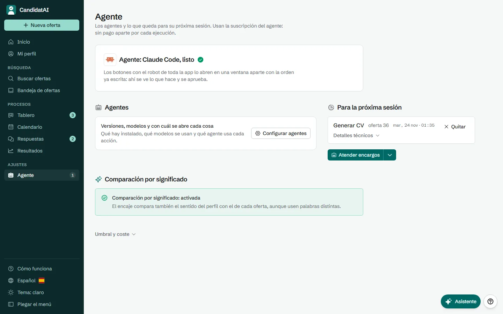
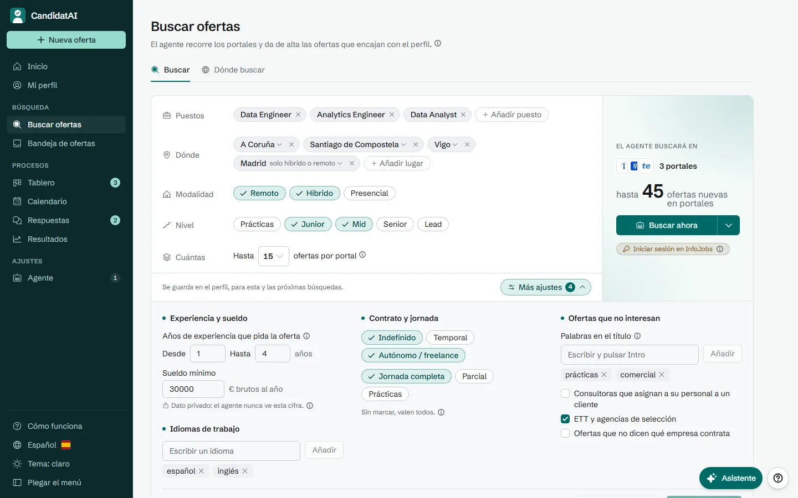

# Primeros pasos

[English](START_HERE.md) · **Español**

Una guía para cualquier persona, sepa de informática o no: lo que hace falta, cómo instalar
CandidatAI, un primer vistazo con la demo, el perfil y la primera búsqueda. Para todo lo demás, la
[guía de uso](GUIA.md).

## Índice

1. [Lo que hace falta](#1-lo-que-hace-falta)
2. [Instalar la app](#2-instalar-la-app)
3. [Instalar el agente](#3-instalar-el-agente)
4. [La primera vez: la demo](#4-la-primera-vez-la-demo)
5. [Crear el perfil](#5-crear-el-perfil)
6. [La primera búsqueda](#6-la-primera-búsqueda)
7. [Preguntas](#7-preguntas)

## 1. Lo que hace falta

| | Qué | Para qué |
|---|---|---|
| 💻 | **Un ordenador** con Windows 11, macOS o Linux, y conexión a internet | Windows 11 es lo más probado, también instalado desde cero; macOS y Linux tienen instalador y pasan los tests, pero aún no se han instalado a mano desde una release |
| 📦 | **La app** (este proyecto, gratis) | Guarda las ofertas, el perfil, los CVs y los procesos, aplica las reglas y hace el trabajo automático |
| 🤖 | **Un agente de IA** | Lee las ofertas, valora el encaje y redacta los CVs y las cartas. **La app nunca llama a una IA por su cuenta**, así que sin agente se pueden revisar ofertas y hacer el seguimiento, pero no redactar |

Un **agente de IA** es un programa que habla con un modelo de IA y puede usar herramientas: aquí,
las de CandidatAI. Funciona en una ventana de terminal, y los botones de CandidatAI lo abren con la
orden ya escrita. La elección del agente decide cuánto cuesta y adónde van los datos:

| Agente | Lo que cuesta (comprobado el 6 de noviembre de 2026) | Adónde van las ofertas y el perfil | Qué tal funciona aquí |
|---|---|---|---|
| **Claude Code** | Incluido en Claude Pro, unos 20 US$ al mes, o planes superiores | A Anthropic | **La referencia**: probado de principio a fin |
| **Codex** | Incluido en ChatGPT Plus, unos 20 US$ al mes, o planes superiores; el plan gratuito tiene un acceso limitado | A OpenAI | Probado con una oferta |
| **Antigravity CLI** | Incluido en Google AI Pro, 21,99 € al mes en España (unos 20 US$), o en Google AI Ultra; también gratis con una cuenta de Google, con un cupo semanal | A Google | Extrae y valora bien. Con el plan gratuito, el cupo se acaba al empezar con los CVs; con Google AI Pro, aún sin medir |
| **OpenCode** o **Qwen Code** con un modelo gratuito en la nube (OpenRouter `:free`) | Gratis, unas 50 peticiones al día (1000 tras haber comprado alguna vez 10 US$ de crédito) | Al proveedor del modelo | Configurado, aún sin medir con un modelo en la nube |
| **Un modelo local** (Ollama o LM Studio) con OpenCode, Codex o Qwen Code | Gratis | **A ningún sitio**: se queda en el equipo | Pide un ordenador potente: medido con un modelo de 20B en 16 GB de memoria y sin tarjeta gráfica, no terminó la prueba |

Los precios cambian: conviene mirar [claude.com/pricing](https://claude.com/pricing),
[chatgpt.com/pricing](https://chatgpt.com/pricing) y
[gemini.google/subscriptions](https://gemini.google/subscriptions/) antes de suscribirse. Ante la
duda, **Claude Code** es el más probado con CandidatAI. Modelos gratuitos y locales, paso a paso:
[`MODELOS_GRATIS.md`](MODELOS_GRATIS.md). Lo que hace cada agente, medido:
[`evals/compat/REPORT.md`](../evals/compat/REPORT.md).

Sea cual sea el agente, **nunca recibe el correo, el teléfono ni el mínimo salarial**, y no puede
enviar nada a una empresa: los envíos son siempre manuales.

## 2. Instalar la app

No hacen falta permisos de administrador, ni Python, ni nada instalado antes.

### En Windows

1. Pulsar **Windows+R** (la tecla de Windows y la R a la vez): se abre la ventana «Ejecutar».
2. Copiar esta línea, pegarla en esa ventana (Ctrl+V) y pulsar Intro. Es una sola línea, aunque
   aquí se vea partida. También funciona pegada en una ventana de PowerShell:

   ```powershell
   powershell -ExecutionPolicy Bypass -NoExit -Command "cd ([IO.Path]::GetTempPath()); iwr -useb https://raw.githubusercontent.com/DiegoPrieto23/candidatai/main/install.ps1 -OutFile cai-install.ps1; .\cai-install.ps1"
   ```

3. Esperar. Instala [uv](https://docs.astral.sh/uv/) (que trae Python), descarga la última release
   de CandidatAI, la comprueba y prepara el navegador con el que hace los PDF. La primera vez tarda
   unos minutos. Se ve en una ventana de PowerShell; al terminar, se puede cerrar. Queda un acceso
   directo **«CandidatAI»** en el escritorio y en el menú Inicio.

**Para actualizar más adelante**, no hace falta nada de esto: cuando sale una versión nueva, Inicio
lo avisa y **«Actualizar ahora»** la instala, sin tocar los datos. También vale repetir la misma
línea.

**Sobre los avisos de Windows.** Con esta línea no aparece la ventana azul de **SmartScreen**
(«Windows protegió su PC»): solo sale con programas descargados con el navegador, y aquí no se
descarga nada así. `-ExecutionPolicy Bypass` deja a PowerShell ejecutar ese script, solo esa vez y
sin cambiar la configuración. Si `install.ps1` se descargó con el navegador: clic derecho →
**Propiedades** → marcar **Desbloquear** → Aceptar, y ejecutarlo en PowerShell con
`powershell -ExecutionPolicy Bypass -File <carpeta>\install.ps1`. Si el antivirus pregunta, el
script es el de este repositorio y se puede leer antes de ejecutarlo.

**Para ver antes qué haría**, se añade ` -WhatIf` justo después de `.\cai-install.ps1`, antes de las
comillas del final: explica cada paso y no cambia nada.

### En macOS o Linux

Abrir **Terminal** (en macOS: Cmd + Espacio, escribir `Terminal`), pegar esta línea y pulsar Intro:

```bash
curl -fsSL https://raw.githubusercontent.com/DiegoPrieto23/candidatai/main/install.sh | bash
```

Hace lo mismo que en Windows y deja **CandidatAI** en Aplicaciones (macOS) o en el menú de
aplicaciones (Linux). En macOS, la primera vez, puede pedir permiso para controlar Terminal: hay que
concederlo. En Linux, si al navegador de los PDF le faltan bibliotecas del sistema, indica qué
comando ejecutar (ese sí necesita `sudo`).

### La suma de verificación: cómo saber que la descarga no se ha alterado

Cada [release](https://github.com/DiegoPrieto23/candidatai/releases/latest) publica
`candidatai.zip` y un fichero `candidatai.zip.sha256` con su «huella». **El instalador la comprueba
solo**: si la descarga no coincide, se para y no instala nada. Para comprobarla a mano (por ejemplo,
con el zip descargado a mano), se ponen los dos ficheros en la misma carpeta y se ejecuta:

```powershell
# Windows (PowerShell), en esa carpeta
(Get-FileHash .\candidatai.zip -Algorithm SHA256).Hash.ToLower()
Get-Content .\candidatai.zip.sha256
```

```bash
# macOS o Linux, en esa carpeta
shasum -a 256 -c candidatai.zip.sha256
```

En Windows, las dos líneas tienen que empezar por el mismo código largo; en macOS y Linux dice
`OK`. La suma detecta una descarga corrupta o alterada, no una release comprometida (ver
[`SECURITY.md`](../SECURITY.md)).

### Abrirla

Doble clic en **CandidatAI**. Se abre una ventana (debe quedarse abierta mientras se usa la app; al
cerrarla, se cierra CandidatAI) y luego el navegador en `http://127.0.0.1:8000`. Esa dirección es el
propio ordenador: no hay nada en internet.

## 3. Instalar el agente

Un agente no es la app de chat de Claude ni claude.ai: es un programa aparte que se instala en el
equipo, con la misma cuenta y la misma suscripción (Claude Code, en el caso de Claude). Mientras no
haya ninguno, **Inicio** y **Agente** avisan con «Hace falta un agente de IA» y los pasos para
instalar Claude Code: abrir PowerShell (o Terminal en macOS), pegar la orden que se copia con
**Copiar**, iniciar sesión escribiendo `claude` y volver a abrir CandidatAI.

Para otro agente, **Configurar agentes**, en **Agente**: lista los que conoce la app, marca los que
no están instalados como **No instalado** y da el comando para instalar cada uno, listo para
copiar.
Sus páginas oficiales: [Claude Code](https://code.claude.com/docs/en/setup),
[Codex](https://developers.openai.com/codex/cli),
[Antigravity CLI](https://antigravity.google/docs/install?tab=cli),
[OpenCode](https://opencode.ai) y [Qwen Code](https://qwenlm.github.io/qwen-code-docs/). La primera
vez que se abre, hay que iniciar sesión con la cuenta.

De vuelta en **Agente**, arriba dice «Agente: Claude Code, listo». Con varios agentes, el que se usa
por defecto se elige en **Configurar agentes**. Desde ese momento, botones como **Valorar las ofertas
nuevas** o **Generar CV** lo abren en una ventana aparte con la orden ya escrita: ahí se ve lo que
hace y se aprueba. Si no puede abrirlo, el botón muestra la orden entera, con **Copiar**, para
pegarla en el agente. Su flechita ofrece además **En segundo plano** (sin ventana; un aviso indica
cuándo termina) y **Dejar para la próxima sesión**.



## 4. La primera vez: la demo

Antes de usar los datos reales, conviene dar una vuelta por la **demo**: una candidata inventada con
65 ofertas, 8 semanas de historia y 2 CVs, así que ninguna página sale vacía. Vive en su propia
carpeta y nunca toca los datos reales.

1. Cerrar CandidatAI (su ventana).
2. Abrir PowerShell (o Terminal) y ejecutar:

   ```powershell
   cd $env:LOCALAPPDATA\CandidatAI\app\backend
   uv run cai demo seed --dir data-demo
   $env:CAI_DATA_DIR = "data-demo"; uv run cai start
   ```

   Si ya existe, se salta la segunda línea (o se añade `--force` para empezarla de cero). En macOS
   la primera línea es `cd ~/"Library/Application Support/CandidatAI/app/backend"`, en
   Linux `cd ~/.local/share/candidatai/app/backend`, y la última es
   `CAI_DATA_DIR=data-demo uv run cai start`.
3. Se abre el navegador con un aviso de **«Modo demo»**. Para probar: **Revisión rápida**, en la
   Bandeja (`J`/`K` para moverse, `A` para aprobar, `D` para descartar), abrir una oferta, cambiar la
   plantilla del CV y pulsar **Generar**, y mirar el **Tablero** y los **Resultados**.

Para volver a los datos reales, se cierra esa ventana y se abre CandidatAI como siempre.

## 5. Crear el perfil

El **perfil** es la única fuente de verdad: en un CV no entra nada que no esté en él. No hace falta
rellenarlo a mano: el agente lo crea a partir del CV. Sin CV o sin agente, también se puede empezar a
mano.

Lo más fácil es desde la app. En **Mi perfil**, mientras no hay perfil, se propone empezar por el
CV: **Subir el CV** (PDF o Word) y luego **Crear el perfil desde un CV**, que abre el agente en una
terminal con la orden ya escrita. Lee el CV, pregunta lo que no dice (el nivel de las skills, las
cifras de los logros, qué se busca) y no guarda nada sin confirmación. Al terminar, el perfil
aparece solo en **Mi perfil**: se sigue en el paso 3.

Sin agente (o sin CV), **Empezar a mano** en **Mi perfil**: el nombre, el titular, el puesto buscado
y los niveles que se aceptan, y **Crear el perfil**. Se abre el editor para seguir bloque a bloque;
lo que no se ha preguntado (modalidad, ubicaciones, foto en el CV) empieza abierto a todo y se
cambia en **Buscar ofertas** y en **Mi perfil**.

También se puede hacer desde el agente:

1. Abrir el agente en la carpeta de la app. En Windows, en PowerShell (con Claude Code; con otro
   agente, su comando en lugar de `claude`):

   ```powershell
   cd $env:LOCALAPPDATA\CandidatAI\app
   claude
   ```

   En macOS la primera línea es `cd ~/"Library/Application Support/CandidatAI/app"` y en Linux
   `cd ~/.local/share/candidatai/app`.
2. Pedirle *«Crea mi perfil a partir de mi CV»* e indicarle dónde está el CV (Word o PDF). Usa el
   skill `update-profile`: lee el CV, pregunta lo que falta y lo guarda, sin inventarse nada.
3. Después, revisarlo bloque a bloque en **Mi perfil**: experiencia y logros (con cifras si las
   hay), skills e idiomas; y en **Buscar ofertas**, lo que se busca: puestos, ubicaciones y modalidad
   arriba, y en «Más ajustes» el mínimo salarial, los años de experiencia y el contrato. Cada cambio
   se puede deshacer.



El mínimo salarial sirve para descartar ofertas que pagan menos y para comparar ofertas recibidas,
pero **el agente nunca ve la cifra**.

## 6. La primera búsqueda

Las ofertas pueden entrar de varias formas; conviene empezar con una o dos:

- **Pegar una oferta** ya vista: **Nueva oferta**, con su enlace o su texto.
- **Empresas de interés**: en **Buscar ofertas**, sección **Dónde buscar → Empresas con portal
  propio**. Si usan Greenhouse, Lever, Ashby y similares, sus ofertas nuevas llegan solas cada día.
- **Alertas de empleo por correo** (LinkedIn, InfoJobs, Indeed…): **Dónde buscar → Alertas por
  correo**, se añade el buzón paso a paso. La app solo lee; nunca envía ni borra correos.

Después:

1. En **Inicio**, **Valorar las ofertas nuevas**: el agente lee cada oferta, la app le pone un
   encaje de 0 a 100 y el agente explica por qué encaja con el perfil o no.
2. En **Revisión rápida**, en la Bandeja, cada oferta se aprueba o se descarta.
3. En una oferta aprobada, **Generar CV**. Después se elige el diseño y se pulsa **Generar**, y la app
   comprueba que cada línea sale del perfil.
4. Al candidatar, la app puede rellenar el formulario y **se para antes de enviar**: se revisa y el
   envío se confirma a mano.

Este recorrido también está en la app: **Cómo funciona**, en el menú, con un enlace a cada pantalla.
Cada página y lo que se puede hacer en ella: [`FUNCIONALIDADES.md`](FUNCIONALIDADES.md).

## 7. Preguntas

Las dudas del día a día (cómo añadir una oferta, corregir un CV, anotar una entrevista…) están en
[Preguntas frecuentes](PREGUNTAS.md) y en el botón **Ayuda** de la app, abajo a la derecha.

**¿Qué datos salen del equipo?** CandidatAI no envía nada a ningún sitio: los datos están en una
carpeta del equipo (`cai paths` indica cuál). Lo que sí sale es lo que lee el agente (las ofertas y
el perfil, sin el correo, el teléfono ni el mínimo salarial), y va a la empresa del modelo del
agente, salvo con un modelo local. La app, además, lee las páginas públicas de las ofertas, las
APIs de los portales configurados y, una vez por web, el icono de cada portal y de cada empresa de
«Dónde buscar». Esa web ve una visita desde la conexión, sin ningún dato personal. El icono se guarda
en la carpeta de datos, así que abrir la página no vuelve a avisar a nadie.

**¿Envía candidaturas sola?** No. Rellena formularios y se para; enviar requiere un clic manual,
candidatura a candidatura. Los mensajes y correos son borradores que se copian y se envían a mano.

**¿Es seguro conectar el correo?** La app abre solo la carpeta o etiqueta elegida, en solo lectura
(IMAP): lee alertas y, si se activa, respuestas de empresas, y nunca envía, mueve, borra ni marca
nada como leído. Se usa una **contraseña de aplicación**, no la habitual, que se puede revocar en
cualquier momento. En Gmail, una contraseña de aplicación puede llegar a todo el buzón (Google no
ofrece nada más limitado); el límite a una etiqueta lo pone la app. La contraseña se queda en el
fichero `.env` del equipo y el agente nunca la ve. Para no conectar nada, se pueden exportar los
correos de alertas y dejarlos en una carpeta. Paso a paso para Gmail, Outlook, Yahoo e iCloud:
[`CONFIGURAR_CORREO.md`](CONFIGURAR_CORREO.md). Un correo puede llevar texto dirigido a una IA: la
app lo detecta y lo trata como datos, nunca como una orden.

**¿Y LinkedIn?** Nada de candidaturas automáticas en LinkedIn, nunca. Las ofertas de LinkedIn
llegan por las alertas de correo o con el botón del navegador. Buscar en LinkedIn (con el navegador,
o su búsqueda pública sin cuenta) solo pasa si se activa, y bajo la responsabilidad de quien lo
activa.

**¿Cuánto cuesta?** La app es gratis (licencia MIT). El agente cuesta lo que cueste su plan (ver la
[sección 1](#1-lo-que-hace-falta)): nada con un modelo gratuito o local, unos 20 US$ al mes con
Claude Pro o ChatGPT Plus.

**¿Se puede usar sin agente?** En parte: se pueden añadir, aprobar y descartar ofertas, seguir los
procesos, ver el calendario y los resultados, editar el perfil y volver a renderizar un CV con otro
diseño. Leer ofertas y redactar CVs necesita el agente.

**¿Dónde pedir ayuda?** En las
[Discussions](https://github.com/DiegoPrieto23/candidatai/discussions) del repositorio o abriendo una
[incidencia](https://github.com/DiegoPrieto23/candidatai/issues) (con los datos de la demo, nunca
con los reales). Si algo no arranca, `uv run cai doctor` en la carpeta `backend` de la app lo
comprueba todo e indica qué falta, y la [guía de uso](GUIA.md#14-problemas-frecuentes) recoge los
problemas habituales.
