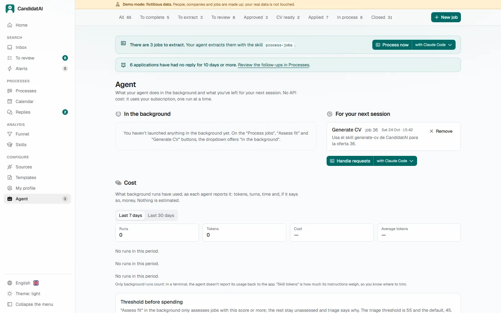
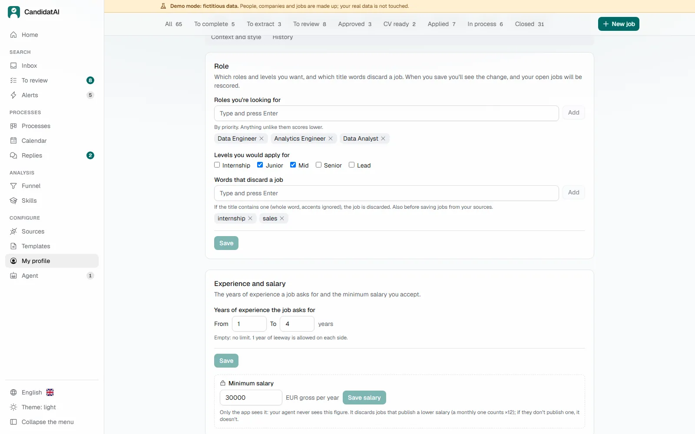

# Start here

**English** · [Español](EMPEZAR.md)

A guide for anyone, technical or not: what you need, how to install CandidatAI, a first look with
the demo, your profile and your first search. For everything else, the [user guide](GUIDE.md).

## Contents

1. [What you need](#1-what-you-need)
2. [Install the app](#2-install-the-app)
3. [Install your agent](#3-install-your-agent)
4. [First run: the demo](#4-first-run-the-demo)
5. [Create your profile](#5-create-your-profile)
6. [Your first search](#6-your-first-search)
7. [Questions](#7-questions)

## 1. What you need

| | What | Why |
|---|---|---|
| 💻 | **A computer** with Windows 11, macOS or Linux, and an internet connection | Windows is the most tested; macOS and Linux are new |
| 📦 | **The app** (this project, free) | It keeps your jobs, profile, CVs and processes, applies the rules and does the automatic work |
| 🤖 | **An AI agent** | It reads the postings, judges the fit and writes your CV and letters. **The app never calls an AI itself**, so without an agent you can review jobs and track, but not write |

An **AI agent** is a program that talks to an AI model and can use tools: here, CandidatAI's. It runs
in a terminal window, and CandidatAI's buttons open it for you with the right instructions. You
choose which one, and that decides what it costs and where your data goes:

| Agent | What it costs (October 2026) | Where the postings and your profile go | How well it works here |
|---|---|---|---|
| **Claude Code** | Included in Claude Pro, about US$20 a month, or higher plans | To Anthropic | **The reference**: tested end to end |
| **Codex** | Included in ChatGPT Plus, about US$20 a month, or higher plans | To OpenAI | Tested with one job |
| **Antigravity CLI** | Free with a Google account, with a weekly quota | To Google | Extracts and assesses well; the free quota runs out when it starts on CVs |
| **OpenCode** or **Qwen Code** with a free cloud model (OpenRouter `:free`) | Free, about 50 requests a day | To the model's provider | Configured, not yet measured with a cloud model |
| **A local model** (Ollama or LM Studio) with OpenCode, Codex or Qwen Code | Free | **Nowhere**: it stays on your computer | Needs a powerful computer: measured with a 20B model on 16 GB of memory and no graphics card, it didn't finish the test |

Prices change: check [claude.com/pricing](https://claude.com/pricing) and
[chatgpt.com/pricing](https://chatgpt.com/pricing) before subscribing. If you're not sure, start
with **Claude Code**: it's the one that has been tested the most with CandidatAI. Free and local
models, step by step: [`MODELOS_GRATIS.md`](MODELOS_GRATIS.md) (Spanish). What each agent does,
measured: [`evals/compat/REPORT.md`](../evals/compat/REPORT.md).

Whichever you choose, **the agent never receives your email, phone or salary minimum**, and it can't
send anything to a company: you do that.

## 2. Install the app

You don't need administrator rights, Python or anything else beforehand.

### On Windows

1. Open **PowerShell**: press the Windows key, type `PowerShell` and press Enter.
2. Copy these two lines, paste them into the PowerShell window (right click) and press Enter:

   ```powershell
   iwr -useb https://raw.githubusercontent.com/DiegoPrieto23/candidatai/main/install.ps1 -OutFile $env:TEMP\cai-install.ps1
   powershell -ExecutionPolicy Bypass -File $env:TEMP\cai-install.ps1
   ```

3. Wait. It installs [uv](https://docs.astral.sh/uv/) (which brings Python), downloads the latest
   CandidatAI release, checks it, and prepares the browser it uses to make PDFs. It takes a few
   minutes the first time. When it says it has finished, a **"CandidatAI"** shortcut appears on your
   desktop and in the Start menu.

**About Windows warnings.** With these two lines you won't see the blue **SmartScreen** window
("Windows protected your PC"): it only appears for programs downloaded with a browser, and here
nothing is downloaded that way. `-ExecutionPolicy Bypass` lets PowerShell run that one script
without changing your settings. If you downloaded `install.ps1` from the browser instead, right
click it → **Properties** → tick **Unblock** → OK, and run it with the second line above
(changing the path). If your antivirus asks, the script is the one in this repository: you can read
it before running it.

**Want to see first what it would do?** Add ` -WhatIf` at the end of the second line: it explains
each step and changes nothing.

### On macOS or Linux

Open **Terminal** (on macOS: Cmd + Space, type `Terminal`), paste this line and press Enter:

```bash
curl -fsSL https://raw.githubusercontent.com/DiegoPrieto23/candidatai/main/install.sh | bash
```

It does the same as on Windows and leaves **CandidatAI** in Applications (macOS) or in the
applications menu (Linux). On macOS, the first time, it may ask for permission to control Terminal:
allow it. On Linux, if the PDF browser is missing system libraries, it tells you which command to
run (that one does need `sudo`).

### The checksum: how you know the download wasn't altered

Each [release](https://github.com/DiegoPrieto23/candidatai/releases/latest) publishes
`candidatai.zip` and a `candidatai.zip.sha256` file with its "fingerprint". **The installer checks
it by itself**: if the download doesn't match, it stops and installs nothing. To check it by hand
(for example, if you downloaded the zip yourself), put both files in the same folder and run:

```powershell
# Windows (PowerShell), in that folder
(Get-FileHash .\candidatai.zip -Algorithm SHA256).Hash.ToLower()
Get-Content .\candidatai.zip.sha256
```

```bash
# macOS or Linux, in that folder
shasum -a 256 -c candidatai.zip.sha256
```

On Windows the two lines must start with the same long code; on macOS and Linux it says `OK`. The
checksum catches a corrupt or tampered download, not a compromised release (see
[`SECURITY.md`](../SECURITY.md)).

### Open it

Double click **CandidatAI**. A window opens (keep it open while you use the app; closing it closes
CandidatAI) and then your browser at `http://127.0.0.1:8000`. That address is your own computer:
nothing is online.

## 3. Install your agent

In CandidatAI, open **Agent** in the sidebar. It lists the agents the app knows, marks the ones you
don't have as **Not installed** and gives you the command to install each one, ready to copy.
Their official pages: [Claude Code](https://code.claude.com/docs/en/setup),
[Codex](https://developers.openai.com/codex/cli),
[Antigravity CLI](https://antigravity.google/docs/install?tab=cli),
[OpenCode](https://opencode.ai) and [Qwen Code](https://qwenlm.github.io/qwen-code-docs/). Sign in
with your account the first time you open it.

Back in **Agent**, choose yours as the default agent. From then on, buttons such as **Process
jobs**, **Assess fit** or **Generate CV** open it in a terminal with the instruction already
typed: you watch what it does and approve it. Their small arrow also offers **In the background**
(no window; you follow it in "Agent") and **Leave for my next session**.



## 4. First run: the demo

Before using your own data, look around with the **demo**: a fictional candidate with 65 jobs,
8 weeks of history and 2 CVs, so no page is empty. It lives in its own folder and never touches your
data.

1. Close CandidatAI (its window).
2. Open PowerShell (or Terminal) and run:

   ```powershell
   cd $env:LOCALAPPDATA\CandidatAI\app\backend
   uv run cai demo seed --lang en --dir data-demo-en
   $env:CAI_DATA_DIR = "data-demo-en"; uv run cai start
   ```

   If you already created it, skip the second line (or add `--force` to start it afresh). On macOS
   the first line is `cd ~/"Library/Application Support/CandidatAI/app/backend"`, on Linux
   `cd ~/.local/share/candidatai/app/backend`, and the last line is
   `CAI_DATA_DIR=data-demo-en uv run cai start`.
3. Your browser opens with a **"Demo mode"** banner. Try **To review** (move with `J`/`K`, approve
   with `A`, discard with `D`), open a job, change the CV template and press **Render**, and look at
   **Processes** and **Funnel**.

To go back to your own data, close that window and open CandidatAI as usual.

## 5. Create your profile

Your **profile** is the single source of truth: nothing goes into a CV that isn't in it.

1. Open your agent in the app folder. On Windows, in PowerShell (with Claude Code; for another
   agent, its command instead of `claude`):

   ```powershell
   cd $env:LOCALAPPDATA\CandidatAI\app
   claude
   ```

   On macOS the first line is `cd ~/"Library/Application Support/CandidatAI/app"` and on Linux
   `cd ~/.local/share/candidatai/app`.
2. Ask it: *"Create my profile from my CV"*, and tell it where your CV is (Word or PDF). It uses the
   `update-profile` skill: it reads your CV, asks you for what's missing and saves it, without
   making anything up.
3. Then review it block by block in **My profile**: experience and achievements (with numbers if you
   have them), skills, languages, and in **Search** what you're looking for: roles, locations,
   remote work and your salary minimum. Each block saves on its own and can be undone.



Your salary minimum is used to discard jobs below it and to compare offers, but **your agent never
sees the figure**.

## 6. Your first search

Jobs can come in several ways; start with one or two:

- **Paste a job** you've seen: **New job**, paste its link or its text.
- **Companies you'd like to work for**: **Sources → Target companies**. If they use Greenhouse, Lever,
  Ashby and the like, their new jobs arrive every day by themselves.
- **Job alerts by email** (LinkedIn, InfoJobs, Indeed…): **Alerts**, add your mailbox step by step.
  The app only reads; it never sends or deletes email.

Then:

1. On **Home**, press **Process jobs** and then **Assess fit**: your agent reads each job and
   explains how well it fits you.
2. In **To review**, approve or discard each job.
3. For an approved job, open it and press **Generate CV**. Then you choose the design and press
   **Render**, and the app checks that every line comes from your profile.
4. When you apply, the app can fill the form and **stops before sending**: you check it and press
   Send yourself.

Every page and what you can do in it: [`FEATURES.md`](FEATURES.md).

## 7. Questions

**What data leaves my computer?** CandidatAI itself sends nothing anywhere: your data is in a folder
on your computer (`cai paths` tells you which). What does leave is what your agent reads (the
postings and your profile, without your email, phone or salary minimum), and it goes to the company
behind your agent's model, unless you use a local model. The app also reads public job pages and
the APIs of the job boards you set up.

**Does it send applications by itself?** No. It fills in forms and stops; sending takes your click,
one application at a time. Messages and emails are drafts that you copy and send.

**Is it safe to connect my email?** The app opens only the folder or label you choose, read-only
(IMAP): it reads alerts and company replies and never sends, moves, deletes or marks anything as
read. You give it an **app password**, not your normal one, and you can revoke it at any moment. Be
aware that with Gmail an app password can reach the whole mailbox (Google offers nothing narrower);
the limit to one label is set by the app. The password stays in the `.env` file on your computer
and your agent never sees it. If you'd rather not connect anything, you can export the alert emails
and drop them in a folder. Step by step for Gmail, Outlook, Yahoo and iCloud:
[`CONFIGURAR_CORREO.md`](CONFIGURAR_CORREO.md) (Spanish). An email can contain text aimed at an AI:
the app detects it and treats it as data, never as an instruction.

**What about LinkedIn?** No automated applications on LinkedIn, ever. LinkedIn jobs reach you through
your email alerts or the browser button. Searching LinkedIn (with your browser, or its public search
without your account) only happens if you turn it on, and it's at your own risk.

**How much does it cost?** The app is free (MIT licence). The agent costs what its plan costs (see
[section 1](#1-what-you-need)): nothing with a free or local model, around US$20 a month with Claude
Pro or ChatGPT Plus.

**Can I use it without an agent?** In part: you can add, approve and discard jobs, follow your processes, see
the calendar and the funnel, edit your profile and re-render a CV with another design. Reading
postings and writing CVs needs the agent.

**Where do I ask for help?** In the repository's
[Discussions](https://github.com/DiegoPrieto23/candidatai/discussions) or by opening an
[issue](https://github.com/DiegoPrieto23/candidatai/issues) (with the demo data, never yours). If
something doesn't start, `uv run cai doctor` in the app's `backend` folder checks everything and
tells you what's missing, and the [user guide](GUIDE.md#14-troubleshooting) lists the usual
problems.
